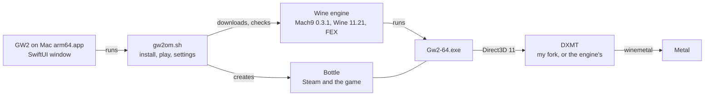
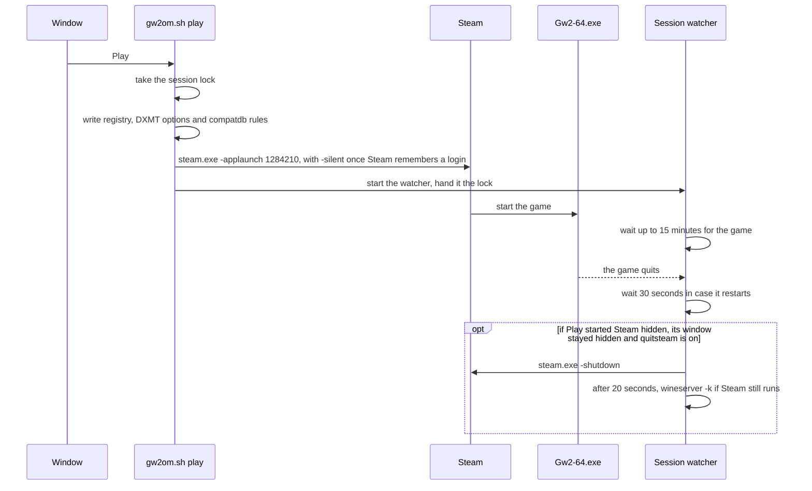
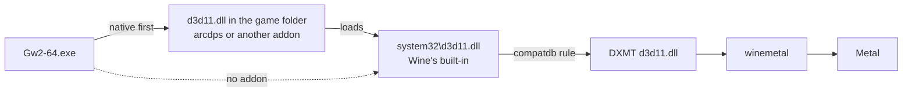

# GW2 on Mac

GW2 on Mac is a small macOS app I wrote to play [Guild Wars 2](https://www.guildwars2.com) on
Apple silicon. It installs the game into a Wine engine and bottle of its own and starts it. The
engine is athei's [Mach9](https://github.com/athei/mach9) 0.3.1, an arm64 Wine 11.21 that runs the
game's x86_64 code with FEX, used as it ships but for three parts: the game's Direct3D 11 goes to
Metal through my DXMT fork, built for this engine, which the app puts into the engine's DXMT tree,
and every Wine process loads my builds of Wine's `ntdll.so` and of its Mac driver, `winemac.so`,
which have switches for the game. The engine's own DXMT, `ntdll.so` and `winemac.so` stay next to
them, and a setting switches back to each. It changes nothing you already have installed.

> **This is the `arm64` branch.** It builds *GW2 on Mac arm64*, the development app for 0.2,
> which moves the game to an arm64 Wine engine. 0.1.x runs CrossOver 26.3 under Rosetta with my
> DXMT fork and my Wine pieces. This app puts my DXMT fork, built for the arm64 engine, into its
> engine, and my Wine pieces for it: an `ntdll.so` with job wakes, the event pool, the msync fix
> and fast locks, and a `winemac.so` with the launcher's frame copies. A build made without one of
> those files leaves the engine's own in place. It has its own name, bundle id
> (`cz.jandrly.gw2onmac.arm64`) and folders, so it installs next to GW2 on Mac 0.1.x and shares
> nothing with it. The name is `APP_NAME` at the top of `src/gw2om.sh`, `collect-logs.sh` and
> `session-report.sh`, and `appName` in `src/native/App.swift`. It has no updates, and 0.1.x stays
> the release on `main`. The paths below are this app's.

Website: [gw2onmac.com](https://gw2onmac.com). Download: the
[latest release](https://github.com/jdrly/gw2-on-mac/releases/latest).

> **GW2 on Mac is an unofficial fan project.** ArenaNet and NCSOFT don't make, endorse or support
> it. ArenaNet doesn't support third-party tools or compatibility layers, so you use it at your
> own risk.
>
> **It doesn't host or change the game.** Steam comes from Valve, and the game comes from Steam or
> ArenaNet. The app only provides the layer the game runs on, which is Wine plus DXMT for
> Direct3D 11 on Metal. CrossOver and Proton are the same kind of software. One optional addon is the exception.
> *Larger interface* changes the game's memory for a sharper interface at 4K. It is off by default
> and asks before it goes in. The *arcdps* switch downloads deltaconnected's arcdps from
> deltaconnected.com. It is also off by default and asks first, and I don't host or change arcdps.
>
> **I do all the support for GW2 on Mac.** I'm Pharaphobia on
> [Discord](https://discord.gg/AnV3fZWz2b), or you can open a
> [GitHub issue](https://github.com/jdrly/gw2-on-mac/issues). Please don't send logs or bug reports
> about GW2 on Mac to ArenaNet's support.
>
> Guild Wars 2 is a trademark of NCSOFT Corporation. Steam is a trademark of Valve Corporation.
> Mac is a trademark of Apple Inc.

The README has three parts. [For players](#for-players) covers installing, playing and getting
help. [How it works](#how-it-works) explains the engine, Play and updates. [Development](#development)
is for building, testing and releasing the app.

# For players

## What you need

- A Mac with Apple silicon and macOS 26.4 or later. The engine's loader needs 26.4, and the install
  refuses to start on an earlier macOS, naming both versions.
- About 75 GB of free space for the game, plus about 3 GB for the engine and Steam. The install
  refuses to start under 3 GB and warns under 75 GB.
- Guild Wars 2 on Steam, or an ArenaNet account.

The app comes as a signed and notarized DMG on the
[releases page](https://github.com/jdrly/gw2-on-mac/releases/latest). Drag it to Applications and
open it.

## Installing the game

The window offers three ways in. Pick one and its card opens. The *This Mac* panel checks macOS,
the engine, the graphics, Game Mode, the game and the free space.

**Steam.** The app downloads the engine, creates the bottle, installs Steam from Valve's CDN and
opens Steam's install page for Guild Wars 2. You sign in to Steam and the download starts. Your
login stays in Steam. The window follows the download and finishes the setup on its own when
Steam reports the game complete.

**ArenaNet's installer.** Download `Gw2Setup-64.exe` from ArenaNet's site and drop it into the
window. Before it changes anything, the app checks that the file is ArenaNet's, with a valid
signature over this exact file. Then the engine and bottle go in and the installer runs. The
installer leaves no record of when it's done, so the app treats the game as installed once
`Gw2.dat` is larger than 1 GB and neither the installer nor `Gw2-64.exe` is running.

**Game files I already have.** If you already play in GW2 on Mac 0.1, CrossOver, Whisky or an app
wrapper, the app can take that copy of the game instead of downloading 75 GB again. It looks in
these places:

- GW2 on Mac 0.1's bottle in `~/Library/Application Support/GW2 on Mac/bottle`, listed as
  `GW2 on Mac 0.1`
- CrossOver's bottles in `~/Library/Application Support/CrossOver/Bottles`
- Whisky's bottles in `~/Library/Containers/com.isaacmarovitz.Whisky/Bottles` and
  `…/Data/Bottles`, named from each bottle's `Metadata.plist`
- app wrappers in `~/Applications` and `/Applications`, such as Sikarugir, Kegworks, Wineskin or
  Porting Kit
- Heroic's prefixes in `~/Games/Heroic/Prefixes`, and `~/.wine`
- GameHub's folders in `~/Library/Application Support` and `~/Library/Containers`, a few levels
  deep, because GameHub doesn't document where it keeps its bottles

Inside each bottle it checks Steam's library and ArenaNet's default folder. A folder counts when it
has `Gw2-64.exe` and a `Gw2.dat` larger than 1 GB. The list shows the source app, the path, the
size, and the route. That's Steam if Steam's `appmanifest_1284210.acf` sits next to the game, and
ArenaNet otherwise. If your copy is somewhere else, use *Choose folder…* or drop the folder on the card. A
game folder works, and so does a bottle or wrapper app with the game in it.

On the same disk the app clones the files with APFS. That takes a moment and no extra space until
one of the copies changes. From another disk it copies them, after checking there's room for their
size plus 1 GB. Either way it only reads your original. My own addon files are left behind. So is
arcdps, as `d3d11.dll` or `dxgi.dll`, because addons aren't cleared for this engine yet, and any
other program's `d3d11.dll`; the summary says what stayed behind. Any other addon, such as an
`addons` folder, comes along as it is, and the summary names it. DXMT's caches stay behind too:
they live in the other app's cache folder, never in the game's. *Also bring my game settings* is on by default and brings `GFXSettings.Gw2-64.exe.xml`
and `Local.dat`, which holds your options and remembered login. If the new bottle already had
those files, the old ones move to a `GW2 on Mac backup <date>` folder next to them. The import
refuses to run while Guild Wars 2 runs anywhere on the Mac, since its files could change during the
copy. On the Steam route, if Steam's record says the game is incomplete, the install runs Steam's
download step and Steam continues from the files. Otherwise Steam may still verify them at the
first Play.

If the first install fails or you cancel it, it removes the engine, the bottle, the settings and
the install state it created, and any game files it copied. Other files it made on the way can
stay, such as cached downloads, logs and `dxmt.conf`. You can quit
the app during a Steam or ArenaNet download. The window picks the download up again when you open
it, and *Stop waiting* stops following it but keeps the engine and the bottle.

## Playing

Once the game is installed, the window shows *Play*, *Repair*, *Settings* and *Uninstall…*.

The first time, Steam shows its window so you can sign in. After Steam remembers your login, Play
starts it in the background without a window, and Steam signs in and starts the game.

While the game starts, the window shows the stages as they happen, with the time so far:

1. Starting Steam
2. Updating Steam, only when Steam updates itself
3. Signing in
4. Checking game files, only when Steam verifies or updates the game
5. Starting Guild Wars 2
6. Playing

On ArenaNet's route the stages begin at *Starting Guild Wars 2*, and the game's launcher takes over
from there. If Steam waits for you to sign in, *Show Steam* brings its window up, and after 2
minutes the window suggests it. Once the game is up, the window shows how long you've played and a
*Bring to Front* button. If you open the app while the game starts or runs, it picks the session up.

When the game quits, Steam quits too, after 30 seconds in case the patcher or a restart starts the
game again. It only does this for a Steam that Play started in the background. Steam stays open if
it was already running before Play, if its window showed, or if you brought it up with *Show Steam*.
*Quit Steam when the game quits* in Settings › Game turns this off.

Some details:

- Pressing Play while the game runs brings it to the front.
- Settings take effect the next time the game starts. If Steam still runs from an earlier start
  with other settings, Play asks you to quit Steam first, because the game inherits Steam's
  environment.
- If the game's own Frame Limiter is set while vertical sync is on, the window suggests
  *Unlimited* with vsync. *Don't show again* hides the tip.

**Repair** puts the engine, the bottle's settings and Steam back in place. It unpacks the engine
again when its files aren't the expected ones. It keeps the game and your settings. Use it when the
window says so.

## Settings

Open Settings with ⌘, or from the window. Each pane covers one area. The defaults are the mix I
play with. The settings with a key in the table also exist as `gw2om.sh set <key> <value>` for
scripting.

On this line some settings need pieces of mine that come in later steps. Settings greys them and
says why under each, `gw2om.sh set` refuses them with the same reason, and `settings.conf` keeps
their values, which do nothing here. `gw2om.sh settings` prints `<key>_state=ok` or
`<key>_state=off:<reason>` for every key, and a `<key>_note` for the ones that work but are
untested on this engine.

A switch of my `ntdll.so` is also greyed when the file in this app doesn't have it, which the
file's `VERSION` says with a line `switches: <variable> …`. A `VERSION` without that line greys
nothing.

`settings.conf` has a line `settings_version=`. Install and Repair write every key with its value,
so the file holds the defaults it was written with. When a default changes for the files that
exist, `SETTINGS_RESETS` in `gw2om.sh` names the key and a new version, and a file older than
that reads the key as its new default until the next write keeps it. Version 1 resets
`fastlocks` to `off`. Before it, the arm64 line wrote `on` into every file while its row was
greyed, so no file held a choice of mine. Version 2 resets `dxmt`, `wine` and `macdrv` to `fork`,
`mine` and `mine`, because their rows left Settings with it, and a bottle on the engine's own
files would have had no row to show it. A key `settings.conf` still has but the app no longer
knows, such as `coolworkers`, is read by nothing and gone at the next write.

Three keys have no row: `dxmt`, `wine` and `macdrv` pick my DXMT fork, my `ntdll.so` and my
`winemac.so` (`fork`, `mine`, `mine`) or the engine's own (`engine`). They are for my comparisons
from Terminal, with `gw2om.sh set`. The rows that need one of my files are greyed while the
engine's own is chosen, and the main window's *Engine* and *Graphics* checks name the files in
place.

| Pane | Setting | Key | Default | What it does |
|---|---|---|---|---|
| Graphics | Retina | `retina` | on | draws at your display's full resolution, at some cost in frame rate |
| | Frame cap | `fpscap` | off | a steady cap paced by Metal at 30, 40, 60 or 120. Use it with the game's own vsync |
| | MetalFX for Subsample | `metalfx` | off | MetalFX upscales the 3D scene of the game's Subsample render sampling. Greyed while the engine's own DXMT is chosen |
| | Metal HUD | `hud` | off | Apple's overlay with frame rate and frame times, over the game only and not over Steam's windows |
| | Launcher frames | `launcherframes` | off | the launcher's window gets a copy of each frame, and a frame equal to the last is skipped (`WINE_MACDRV_SURFACE=copy,skip`). Against a launcher that flickers. Greyed while the engine's own `winemac.so` is chosen |
| Performance | Shader warming | `warm` | on | builds the pipelines the last sessions used before the game asks for them. Greyed while the engine's own DXMT is chosen |
| | CPUs the game sees | `ncpu` | 8 | from 2 up to your Mac's logical CPUs, or all. The game starts one job worker per CPU, minus one |
| | Job wakes | `jobwakes` | on | a job the game hands out wakes one sleeping worker, and none when no worker sleeps (`WINE_HEAT_WAKE=one,skip`). Greyed while the engine's own `ntdll.so` is chosen |
| | Event pool | `eventpool` | on | closed events are kept and handed out again, without a request to the Wine server (`WINE_HEAT_EVPOOL=1`). Greyed while the engine's own `ntdll.so` is chosen |
| | Faster locks | `fastlocks` | off | short spins before the game thread sleeps on a busy lock, a job group or an event (`WINE_HEAT_SPIN=lock=20:game,event=30:game`). Greyed while the engine's own `ntdll.so` is chosen |
| Interface | Larger interface | `uiscale` | off | my interface addon, see below. Untested on this engine |
| | Interface Size "Larger" | `uiscale_size` | 1.75 | the addon's scale: 1.5, 1.75, 1.8 or 2.0 |
| | Small text in Cronos | `uiscale_sans` | on | chat, the tracker and labels have no larger font, so the addon draws them in Cronos at the larger size |
| | Cinematic dialogue | `uiscale_cinema` | off | story cinematics size their dialogue apart from the interface. This draws it at the same size, with a small code patch, untested under FEX |
| | arcdps | `arcdps` | off | downloads or removes arcdps, see below. Untested under FEX |
| Game | Game Mode | `gamemode` | on | greyed and shown on: the engine's loader is a Game Mode app, see [Game Mode](#game-mode) |
| | Start Steam in the background | `steambg` | on | Steam starts without a window once it remembers your login |
| | Quit Steam when the game quits | `quitsteam` | on | shown while the previous setting is on |
| | Launch options | `launchopts` | none | arguments for `Gw2-64.exe`, using letters, digits and `-_.:=,/+` |
| | Quit GW2 on Mac after launching | | off | the app quits once Play has started Steam or the game |
| Mouse | Raw mouse-look | `rawmouse` | on | on, the game's raw input is the mouse's own counts from GameController; off, it is the pointer's movement, see below |
| | Mouse-look speed | `mousespeed` | 1× | greyed: the engine gives the game the mouse's own counts. Use the game's own camera settings for the speed |
| Updates | Check automatically | `updates` | on | Sparkle checks for new versions. Off in development builds, which have no update feed |
| Troubleshooting | Debug logging | `debug` | off | DXMT's log at `debug` and Wine's errors, for a bug report, at some cost in performance. With my `winemac.so`, also its `macsurface` lines for `Gw2-64.exe`. On in development builds |

### Raw mouse-look

On this engine the switch is Mach9's. Its Mac driver reads the mouse from GameController and
gives the game's raw input the mouse's own counts, summed until the game next reads its input,
without the pointer's acceleration and without the Retina factor. The engine does that for every
program by a built-in rule, so with the setting on the game's rule says nothing about the mouse.
With it off the rule gets `gcmouse=false`, and the game's raw input is the pointer's movement, as
Wine does it. The pointer keeps moving under the hidden cursor either way, and the game moves it
back. The rule is written at each game start, so the change needs no closed Steam, and the session
report names which mouse the game had. *Mouse-look speed* stays greyed: 0.1.x's speed factor was a
piece of my own driver, which this engine doesn't have.

### Larger interface

The game's largest Interface Size is still small on a 4K display. This addon makes the "Larger"
size larger, from the game's own sharp fonts, and draws small text in Cronos. It is my own code,
in [`addon/ui-scale`](addon/ui-scale), and goes into the game folder as `version.dll` with
`gw2-ui-scale.ini`. It is off by default and asks first, because it changes the game's memory
and patches one piece of its code for the cinematic dialogue. ArenaNet doesn't support that, and a
game update may break it.

### arcdps

Settings › Interface has an *arcdps* switch, off by default. arcdps is deltaconnected's
third-party addon, and it reads the game's memory. ArenaNet, NCSOFT and I don't support it, so the
switch asks first, and you use it at your own risk.

- On downloads `d3d11.dll` and its `.md5sum` from deltaconnected.com, checks the file against that
  checksum and checks that it is arcdps. Then it goes next to `Gw2-64.exe` as `d3d11.dll`.
  From then on arcdps updates itself.
- Off removes arcdps from `d3d11.dll` or `dxgi.dll` and keeps its settings in `addons/arcdps` for
  next time.
- An arcdps you put there yourself, or that came with your game files, shows as on.
- Another addon in the same place, such as the Nexus loader, is left alone, and the switch says
  which file it found.
- The switch only works while the game and Steam are closed.

Other addons that load as `d3d11.dll` or `dxgi.dll` next to `Gw2-64.exe` work too. The game loads
them first, and they pass its drawing on to DXMT. [How addons load](#how-addons-load) has the
details.

## Updates

The app updates itself with Sparkle. *Check for Updates…* is in the app menu, and with *Check
automatically* on it looks on its own. Releases come from this repository's GitHub releases.

Some updates bring new pieces for the engine, such as 0.1.1's Mac driver for raw mouse-look. Those
go in at your next Play, before Wine starts. You don't need Repair. If the app finds an engine file
it doesn't recognise, it leaves the file alone and *This Mac* says *needs Repair*.

## Logs and help

**Collect Logs…** is in the menu and in Settings › Troubleshooting. It puts a zip on your Desktop
with what I need for a bug report:

- my logs: `wine.log` and DXMT's `Gw2-64_d3d11.log`, each with the 4 sessions before, plus the
  newest heat logs, `session.env`, the settings and the state
- a session report
- the game's `ArenaNet.log` and `GFXSettings.Gw2-64.exe.xml`
- Steam's bootstrap, content, gameprocess and shader logs
- crash reports from the last 7 days, GPU errors from the last 2 hours, and `system-info.txt`

On the way into the zip it removes account, persona and Mac names, Steam IDs, e-mail addresses,
home folders, tokens and the crash logs' machine, account and address fields. `Local.dat`, Steam's
config and Steam's login and connection logs never go in. If a file still holds one of those after
redaction, the zip leaves it out and lists it in `left-out.txt`. arcdps's logs stay out too. Its
crash log dumps the game's threads and modules, and I can't be sure it holds no account or character
names. If I ask for it, look through it before you attach it.

Send the zip with a short description to Pharaphobia on [Discord](https://discord.gg/AnV3fZWz2b),
or attach it to a [GitHub issue](https://github.com/jdrly/gw2-on-mac/issues). The *Discord* button
at the top of the window opens the server, and it's also the place for arcdps and addon
questions. Please don't send it
to ArenaNet's support.

## What it puts on your Mac

Everything the app creates is in these places. It adds no launch agents or login items, and puts
nothing in `/Applications` besides itself.

| Path | What | Uninstall |
|---|---|---|
| `~/Library/Application Support/GW2 on Mac arm64/engine/` | the Wine engine as it ships, without its SDK, about 1 GB, with my DXMT fork's tree in `lib/wine/dxgi/dxmt` and my `ntdll.so` and `winemac.so` in `lib/wine/aarch64-unix`, the engine's own next to each | removed |
| `…/GW2 on Mac arm64/bottle/` | the game's Wine prefix with Steam, the game's files and the game's settings. About 75 GB, or no extra space for a clone of files on the same disk | removed, with the game |
| `…/GW2 on Mac arm64/settings.conf`, `state`, `install-manifest.json`, `dxmt.conf`, `compatdb.rules`, `compatdb.local`, `session`, `session.req`, `.session.lock` | settings, install state, what was installed, DXMT's options, the game's compatdb rules and my own, the current game session and its lock | removed |
| `~/Library/Caches/GW2 on Mac arm64/downloads/` | the engine archive, `SteamSetup.exe`, a copy of `Gw2Setup-64.exe` | removed |
| `~/Library/Caches/GW2 on Mac arm64/fork/dxmt/` | my DXMT fork's caches (`DXMT_CACHE_DIR`): `Gw2-64.exe/` holds the game's shaders, recorded pipelines and pipeline archives, and the other processes keep theirs next to it | removed. *Reset the shader cache* in Settings empties it too |
| `~/Library/Caches/GW2 on Mac arm64/dxmt/Gw2-64.exe/` | the engine's own DXMT's shader cache for the game, where 0.2.0-dev.1 kept it, apart from my fork's, which translates shaders differently. Other processes keep theirs where the engine's DXMT puts it by default | removed, and emptied by *Reset the shader cache* |
| `~/Library/Logs/GW2 on Mac arm64/` | `install.log`, `wine.log`, DXMT's `Gw2-64_d3d11.log`, `session.env`, the heat logs, and `.lock-claim` for the install lock | kept |

In the game folder, `version.dll` and `gw2-ui-scale.ini` exist only while *Larger interface* is on,
and arcdps's `d3d11.dll` only while *arcdps* is on. The app never touches another program's
`version.dll`, `d3d11.dll` or `dxgi.dll` there. The app's own preferences, such as the chosen
route and the last Settings pane, live in the defaults domain `cz.jandrly.gw2onmac.arm64`. Other Wine
apps' bottles are only ever read.

## Uninstall

*Uninstall…* in the window asks first and tells you the game's files go with the bottle. Close the
game and Steam before you run it. It removes everything in the table above except the logs. To do
it by hand:

```sh
rm -rf ~/Library/"Application Support/GW2 on Mac arm64" ~/Library/Caches/"GW2 on Mac arm64"
rm -rf ~/Library/Logs/"GW2 on Mac arm64"      # the logs, if you want them gone too
```

Then move the app to the Bin. A Steam library you added outside the bottle, in Steam › Settings ›
Storage, stays where it is.

## Known limits

- My DXMT fork has no vkd3d-proton swap-chain bridge, so D3D12 programs can't present through it.
  Guild Wars 2, Steam and their CEF windows are D3D11. `gw2om.sh set dxmt engine` goes back to the
  engine's own DXMT, which has it.
- I've installed and played through the app since 2026-11-04, on the Steam route with my existing
  game files imported, and I now play on the published 0.1.1. A fresh Steam download and
  ArenaNet's installer haven't had a real install yet, so the Steam route's `StateFlags` check and
  the ArenaNet route's 1 GB rule are still unchecked against a real download.
- Raw mouse-look comes from SWTOR on Mac, where people have used it for a long time. In Guild
  Wars 2 this Mac driver build has had one in-game test so far, on 2026-11-08.
- arcdps on DXMT has had one check, on 2026-11-08 with arcdps 1.2026.1023.2303. It loads and
  creates its device through DXMT. I haven't tested its overlay in play, or the Nexus loader.
- While Steam verifies the game's files, *Checking game files* shows no percentage, because Steam's
  logs don't give one. A game update shows its progress.
- There's no Keyboard pane. SWTOR on Mac's game keys by keyboard position are in the Mac driver,
  but nothing turns them on. On QWERTZ layouts they swap Z and Y, and I haven't checked how Guild
  Wars 2 names keys in its bindings.
- DXMT's caches live in the app's own cache folder, so they aren't shared with another DXMT setup
  of the game on the same Mac. Caches an older build left in
  `$(getconf DARWIN_USER_CACHE_DIR)dxmt/Gw2-64.exe/` stay where they are, since another setup may
  use them. Your first sessions build the app's cache from scratch.
- Blish HUD and macOS 28's Rosetta changes aren't covered.
- For *Game files I already have*, GameHub's location is a guess. *Choose folder…* always works.

# How it works

## The pieces



The app is a SwiftUI window around one bash script, `gw2om.sh`, which runs under macOS's own
bash 3.2. The window calls it for everything: `status`, `install`, `play`, `settings`, `set`,
`repair`, `uninstall` and a few more, listed at the top of [`src/gw2om.sh`](src/gw2om.sh). The
script reports back in lines that start with `@`, such as `@phase`, `@progress` and `@error`.

The Wine engine is not in the app. It is athei's
[Mach9 0.3.1](https://github.com/athei/mach9/releases/tag/v0.3.1), the release asset
`wine-v0.3.1-macos-arm64.tar.xz`, built from Wine `athei/wine@53def89293a`, which is wine-11.21-37,
FEX `9d4fa4b46b1`, DXMT `athei/dxmt@d903db89036` and the other components its release page lists. The script
downloads it at install time, pinned by size and sha256. The download resumes, retries and has a
second address through GitHub's API. `status`, the manifest and Collect Logs name the three
commits.

After unpacking, the script takes the quarantine attribute off the whole tree. An archive downloaded
in a browser and put into the downloads folder by hand carries it, and `tar` copies it onto every
file. The loader is notarized and would pass, the engine's ad hoc signed libraries would not. Then
it removes the SDK, which nothing reads at run time: `include/`, `lib/wine/tests/`,
`lib/wine/x86_64-windows/` and `share/man/`. Last it checks the build, which means the sha256 of the loader
`lib/wine/aarch64-unix/wine.app/Contents/MacOS/wine`, of `ntdll.so` and of `winemac.so`, and
`codesign --verify --strict` on `wine.app` with Mach9's team `WLKUUJD25W` and the identifier
`app.mach9.loader`. That reads the signature and starts nothing.

The app writes nothing into the engine afterwards but its DXMT tree, `ntdll.so` and `winemac.so`,
and nothing at all inside `wine.app`. The loader is signed with an embedded provisioning profile,
and a re-signed, edited or copied loader exits. The check of the engine's `ntdll.so` and
`winemac.so` takes each where it is, in place or next to mine as `<file>.engine`.

### The DXMT tree

The engine's compatdb gives every process `lib/wine/dxgi/dxmt` as its DXGI tree (the built-in
`dxgi=dxmt` rule, and the pin on Steam's web helper), and Wine loads `winemetal.so` from that
tree's `aarch64-unix/`. A rule can't point the game at another tree, because the `dxgi` key knows
only `dxmt` and `wined3d`. So the app swaps the tree. The active one is always
`lib/wine/dxgi/dxmt`, and the other waits next to it:

- `dxmt.engine`: the engine's own, as it ships, moved aside and never changed
- `dxmt.fork`: a copy of the engine's tree with the files of `components/dxmt` over it, which are
  `d3d11`, `dxgi`, `d3d10core` and `winemetal` for `aarch64-windows` and `i386-windows`, plus
  `winemetal.so`, `VERSION` and the licence, marked with `.gw2om-dxmt`. In the engine's tree
  `aarch64-unix/winemetal.so` is a link to `lib/wine/aarch64-unix/winemetal.so`, the one
  `winemetal.so` that serves its ARM64X and its i386 DLLs. My copy replaces the link with my
  fork's own file and never writes through it, so the two DXMTs never share a `winemetal.so`, and
  the engine's comes back intact, link and file, when the setting switches to it. The copy has no
  quarantine attribute: a dev build downloaded in a browser carries it on every file of the app,
  `cp -p` copies it, and the script takes it off before the tree goes into place. A tree made
  quarantined by an earlier build keeps it until *Reinstall the engine* or an update with another
  build of my fork

Steam's processes get the same DXMT as the game, as on 0.1.x. My fork's `dxgi.dll` has no
vkd3d-proton swap-chain bridge, so a D3D12 program in that tree can't present. Guild Wars 2,
Steam and the CEF windows of Steam and the game's launcher are D3D11, so none of them needs it.
The `dxmt` setting picks the tree.
The swap is two renames, done only while no session runs or starts, under the session's lock:
at install, Repair, `set dxmt` and Play. While Steam runs, the change waits for the next start.
`status` prints `dxmt` (the setting), `dxmt_tree` (`fork`, `engine`, `oldfork` for an earlier
build of mine, `other`) and `graphics`: `yes` when the tree is the one asked for, `switch` when the
next start puts it in (after a change during a session, or an update of the app with another build
of my fork), and `other` when the tree is neither the engine's own nor mine. Repair then unpacks
the engine again and puts the asked-for tree in.
To tell my fork's tree from an earlier build, the script compares every file of
`components/dxmt` (44 MB in `0.2.0-dev.3`) with the tree. Play and `status` do that once and
reuse the answer for the rest of the command, until a swap changes the tree.

### My ntdll.so

Wine has one `ntdll.so` for every process of the bottle, `lib/wine/aarch64-unix/ntdll.so`. My
build of it comes from my Wine fork [jdrly/wine](https://github.com/jdrly/wine), which starts at
the commit the engine was built from, and is in the app as `components/ntdll`. The app puts it in
place and moves the engine's own aside once, as `ntdll.so.engine`, only after its sha256 matched
the pin. Back to the engine's own is one rename. Like the DXMT tree, it switches only while no
session runs or starts, under the session's lock, at install, Repair, `set wine` and Play. Mine is
copied next to it first, so a switch cut short leaves one of the two files in place, or none
between the renames, and the next switch finishes it.

`status` prints `wine` (the setting), `wine_file` (`mine`, `engine`, `other` or `none`, the file
in place), `wine_commit` (its commit), `wine_build` (my build's commit in this app) and
`wine_ready`: `yes`, `switch` when the next start puts the asked-for file in, and `other` when the
engine's own is neither in place nor next to it. Repair then unpacks the engine again. The *This
Mac* panel shows my file with its commit in the Engine cell.

The app tells my file from the engine's by comparing it with `components/ntdll/ntdll.so`, not by
the fork's hash, because a release signed with my Developer ID changes the file's bytes. The
engine's loader has library validation off, so it loads the file either way. `Resources/VERSIONS`
names the file's sha256 as built, and `session.env` the sha256 of the file in the engine.

A build of the app without my file has no `components/ntdll`. It leaves the engine's own in place,
and greys the switches that need my file.

The code is written for more than one file: `unix_lib` in `gw2om.sh` has one row per file, with its
setting, its folder in `components/` and the engine's pinned sha256. The second row is my Mac
driver's.

### My winemac.so

Wine's Mac driver, `lib/wine/aarch64-unix/winemac.so`, draws every window of the bottle: Steam's,
its web helper's, the game's launcher and the game. My build of it comes from the same fork and
commit line as my `ntdll.so` and is in the app as `components/macdrv`. The app installs it the same
way, with its own setting, `macdrv`, so I can take my driver out and keep my `ntdll.so`, or the
other way round. The engine's own goes aside as `winemac.so.engine`, and the pin is its sha256,
`ae468edc…`. `status` prints `macdrv`, `macdrv_ready`, `macdrv_file`, `macdrv_commit` and
`macdrv_build`, and the *This Mac* panel names my driver with its commit next to my `ntdll.so`.

Its switches are `WINE_MACDRV_*` entries of the game's rule. My driver reads them once in each
process, and the engine's own ignores them. They reach `Gw2-64.exe` only, which is the launcher too,
so Steam's windows run my file with every switch unset. With `macdrv` at `engine` the app writes
none of them and greys the rows that need them. Today that is *Launcher frames*.

A build of the app without my file has no `components/macdrv`. It leaves the engine's own in place,
and greys *Launcher frames*. My Wine fork's archive for the driver holds
`winemac.so` only; `win32u.so` comes with a later step.

## Installing, step by step

`gw2om.sh install <route>` runs five phases. A failed or cancelled first install removes what that
run tracked as created: the engine, the bottle, `settings.conf`, `state`, `install-manifest.json`,
and an import's copied game folder with Steam's record. Other files it made can stay, such as
cached downloads, logs and `dxmt.conf`.

1. **The engine.** Check macOS, download, unpack, take the quarantine off, remove the SDK, check
   the build, then put my DXMT fork into its DXMT tree and my `ntdll.so` and `winemac.so` in
   place, as above.
2. **The bottle.** `wineboot`, then `settings.conf`, `dxmt.conf` and three values in `user.reg`:
   `RetinaMode` under `Software\Wine\Mac Driver`, `EmulateModeset=N` under
   `Software\Wine\X11 Driver` and `ShowCrashDialog=dword:0` under `Software\Wine\WineDbg`.
   Mach9's own launcher writes `EmulateModeset=Y`. 0.1.x never writes it, and I write `N`, so a
   bottle with `Y` from an earlier 0.2 build gets `N` at its next start without a running session
   ([#90](https://github.com/jdrly/gw2-on-mac/issues/90)). With `Y`, moving the cursor made the
   frame interval saw between 16.7 and 33 ms, where 0.1.x stays at 16.7. Wine fakes the game's
   mode set and drops its gamma ramp, so macOS flips the game's frames straight to the display,
   and each cursor update holds a frame back by a refresh. The game's Gamma slider did nothing
   either. A value I set under `AppDefaults` for `Gw2-64.exe` stays as it is.
3. **Steam or ArenaNet's installer.** Steam's `SteamSetup.exe` comes from Valve's CDN and runs with
   `/S`. ArenaNet's installer goes through `gw2om.sh check-setup` first, which uses only macOS's
   `/usr/bin/openssl`. The file must be a PE x86_64 executable. Its Authenticode signature must be
   valid, with the message digest covering the SpcIndirectData content. The signed PE hash must
   match the file, recomputed. The signer's certificate must be ArenaNet's. The chain up to
   Windows' root certificates isn't checked, because macOS doesn't have them.
4. **The game's download.** Steam opens `steam://install/1284210`, or ArenaNet's installer starts.
   The command ends with `stage=waiting_game` and the window follows the download. For Steam it
   reads `BytesDownloaded` and `BytesToDownload` in `appmanifest_1284210.acf` and waits for
   `StateFlags` 4. For ArenaNet it waits for the 1 GB `Gw2.dat` rule.
5. **Finishing touches.** `gw2om.sh finish` creates DXMT's cache folder, puts the interface addon
   in if it's on, writes the registry settings, records `stage=finished`, and the window shows
   Ready.

An import, `gw2om.sh install import <folder> [--no-settings]`, runs the engine and bottle phases,
then Steam on the Steam route, then places the folder in the bottle's
`steamapps/common/Guild Wars 2` with Steam's record, or in `Program Files/Guild Wars 2` for
ArenaNet. `gw2om.sh scan` finds the installs and `gw2om.sh check-game <dir>` checks one folder.
Both only read.

## The game's environment

The install's own Wine calls, `wineboot` and Valve's Steam installer, get `WINEPREFIX`,
`WINEDEBUG=-all`, `WINEMSYNC=1` and `WINEDLLOVERRIDES=winemenubuilder.exe=d`, and nothing else of
the app's. If the app inherited `WINE_COMPATDB`, `WINE_COMPATDB_FILE`, `WINE_LARGE_ADDRESS_AWARE`
or `WINE_PROF_SERVICE`, they are removed from every Wine start, because each changes what the
engine does for every process. The engine's built-in rules already give each process DXMT, leave
Mono and Gecko out, and set Steam's web helper up.

`settings.conf` holds the settings. Every start turns them into three things: the environment of
the session's first process, `dxmt.conf`, and the game's compatdb rules. `gw2om.sh env` and
`gw2om.sh rules` print what Play would use.

The environment is fixed while Steam runs, because Steam passes its own on to the game. It holds
`WINEPREFIX`, `WINEDEBUG=-all`, `WINEDLLOVERRIDES=winemenubuilder.exe=d`, `WINEMSYNC=1`,
`DXMT_CONFIG_FILE`, `DXMT_LOG_PATH`, `WINE_COMPATDB_FILE`, and `WINENCPU` unless the game sees every
CPU. Debug logging adds `DXMT_LOG_LEVEL=debug` and sets `WINEDEBUG=err+all,fixme-all`, with
`,Gw2-64.exe:+macsurface` while my `winemac.so` is in place: my driver's channel, in the launcher
and the game only.

With my DXMT fork in the engine, it also gets what the fork reads (its `docs/gw2/README.md`):
`DXMT_CACHE_DIR` set to `~/Library/Caches/GW2 on Mac arm64/fork`, so the fork's caches stay in
its `dxmt/` and never in the per-user folder, 0.1.x's or the engine's DXMT's;
`DXMT_DEPENDENCY_COMPRESSION=1`; `DXMT_WARM=all` with shader warming on;
`DXMT_SUBSAMPLE_METALFX=1` with MetalFX on; and `DXMT_STATS=1` with Debug logging, which the fork
has on by default anyway. With the engine's own DXMT none of them is set, since it reads none.

`compatdb.rules` in the app's folder is the file `WINE_COMPATDB_FILE` names. Every Wine process
reads it when it starts, so a change reaches the next game start even while Steam runs. Play
writes it before it starts anything, to a temporary file that it then renames. The rules are in the
text Mach9's compatdb reads. With everything on and raw mouse-look off they are:

```text
exe=Gw2-64.exe;gcmouse=false;metal_hud=true;dll_overrides=d3d11,dxgi=n,b;dll_overrides=version=n,b;env=DXMT_SHADER_CACHE_PATH=<caches>/dxmt/Gw2-64.exe
exe=CefHost.exe;metal_hud=false;env=DXMT_SHADER_CACHE_PATH=
```

- `gcmouse=false` is there while raw mouse-look is off. It takes the game back from the engine's
  built-in rule, which reads the mouse from GameController in every process.
- `metal_hud` is there while the Metal HUD is on. The engine turns it into the `MTL_HUD_` variables
  in the game only. `CefHost.exe`, which the game starts for its launcher and the Trading Post,
  would inherit them, so its rule takes them away.
- `d3d11,dxgi=n,b` is there while a `d3d11.dll` or `dxgi.dll` is in the game folder, such as
  arcdps or Nexus. `version=n,b` is there while the larger interface is on. With no such file Wine
  loads its own.
- `DXMT_SHADER_CACHE_PATH` keeps DXMT's shader cache for the game in the app's cache folder, never
  in the per-user one another DXMT setup may use: `dxmt/Gw2-64.exe` for the engine's own DXMT, as
  in 0.2.0-dev.1, and `fork/dxmt/Gw2-64.exe` while my fork is active. My fork doesn't read the
  variable; it takes the same folder from `DXMT_CACHE_DIR`.
  `CefHost.exe` gets it removed.
- The `WINE_HEAT_*` entries are my `ntdll.so`'s switches, which it acts on in `Gw2-64.exe` only.
  They follow the cache path, one `env=` field each, and only while my file is in place. The table
  `HEAT_SWITCHES` in `gw2om.sh` has one row per setting, `<key> <entry>`: *Job wakes* writes
  `WINE_HEAT_WAKE=one,skip`, *Event pool* `WINE_HEAT_EVPOOL=1` and *Faster locks*
  `WINE_HEAT_SPIN=lock=20:game,event=30:game`. `WINE_HEAT_MSYNC_UNREG=1` has no setting and goes
  in whenever my file is in place, as on 0.1.x. An entry whose variable the file's `VERSION`
  doesn't list on its `switches:` line stays out. Debug logging adds `WINE_HEAT_COUNT=1` and
  `WINE_HEAT_LOG` with the logs folder, where my file writes `heat-<pid>.log` every 5 seconds.
  `CefHost.exe`'s rule unsets each of them again with an empty value.
- The `WINE_MACDRV_*` entries are my `winemac.so`'s, rows of the same table. Each goes in only
  while my driver is in place, whatever `wine` says, and `CefHost.exe`'s rule unsets it. *Launcher
  frames* writes `WINE_MACDRV_SURFACE=copy,skip`, after the `WINE_HEAT_*` switches and before the
  counters. The comma needs no escape.
- A `compatdb.local` that I put in the app's folder is appended as it is, for trying FEX switches
  such as `exe=Gw2-64.exe;env=FEX_HOSTFEATURES=disableavx`. Nothing in the app writes it, and
  Collect Logs includes it.

The engine's built-in rules already give every process DXMT, DPI awareness, raw mouse input from
GameController and FEX's reduced x87 precision. The `compatdb` check on GitHub's runners reads each
text the sandbox suite pins (`scripts/compatdb-check/rules`) with Mach9 0.3.1's `compatdb-core` and
checks that it writes back byte for byte.

A setting change that only changes the rules or `dxmt.conf` takes effect at the next game start.
One that changes the environment, the registry or the engine's files (`ncpu`, `debug`, `retina`,
`dxmt`, `wine`, `macdrv`) waits until Steam has
quit.

The other settings:

| Key | Sets |
|---|---|
| `retina` | `RetinaMode` in the bottle's `user.reg` |
| `fpscap` | `d3d11.preferredMaxFrameRate` in `dxmt.conf` |
| `ncpu` | `WINENCPU`, bounded by `sysctl hw.logicalcpu` |
| `uiscale` | the addon files in the game folder |
| `uiscale_size`, `uiscale_sans`, `uiscale_cinema` | the addon's ini: `scale`, `sans=cronos` or `keep`, `cinema=1` |

The script writes registry settings straight into the bottle's `user.reg`, as SWTOR on Mac does.
It only does that while no Wine session of the bottle runs or starts. The write takes the session's
lock, so if a game session holds it, the change waits for the next Play that finds the bottle idle.

## What Play does



`gw2om.sh play` runs `steam.exe -applaunch 1284210 <launch options>` on the Steam route, adding
`-silent` once Steam's `config/loginusers.vdf` has a user with `"RememberPassword" "1"`. On the
ArenaNet route it runs `Gw2-64.exe <launch options>`. It also writes `session.env` and rotates the
logs when no session runs. `session.env` records the engine and its Wine, FEX and DXMT commits, the
`ntdll.so` and `winemac.so` the session loads (`LIB_wine`, `LIB_macdrv`: mine or the engine's,
its commit and sha256), the settings, the environment and the rules.

Play refuses while a `Gw2-64.exe` of another app runs, such as 0.1.x's or a Mach9.app's: one
account, one login. While this bottle's game runs, Play brings it to the front instead. Every Wine
process here runs as the engine's loader, `app.mach9.loader`, and so does Steam's, so the window
finds the game by the pid that `status` and `session-status` print as `game_pid`.

One session runs at a time. The session's lock is a kernel `flock` on `.session.lock`, taken by the
app's helper `helpers/sessionlock`. Play takes it before it writes registry settings, and passes it to the
watcher, `gw2om.sh watch-session`, which it starts detached so the window can quit. The lock ends
with the watcher, so nothing stale is left behind. After Play writes the first version of the
`session` file, the watcher is its only writer. Others append requests to `session.req`: `join` from
a second Play, `shown` from *Show Steam*. The watcher applies them in order.

The watcher follows the engine's own processes. It waits up to 15 minutes for `Gw2-64.exe`, since
Steam may update itself and ask for a sign-in first. When the game quits it waits 30 seconds. Then,
if this Play started Steam in the background, it runs `steam.exe -shutdown` through the engine with
the game's environment, and if Steam still runs 20 seconds later, `wineserver -k` for this bottle
only.

It leaves Steam alone when:

- Steam was running before Play
- Steam's window showed, before the first sign-in or with *Start Steam in the background* off
- *Quit Steam when the game quits* is off
- someone brought Steam's window up during the session
- the game never started, by the timeout or because Steam closed first

Play decides whether Steam belongs to the session by looking at the bottle's processes before it
starts Steam. The bottle's Steam only ever starts through Play, so a `steam.exe` that changes
without a request is Steam restarting itself after an update.

A second Play during a session joins it. That happens while Steam starts the game, or in the grace
after it quit. The second Play waits until the watcher has the request, and the watcher waits for
the game again. If no Steam ran before that Play, Steam counts as the session's. Once the watcher
has decided to quit Steam, or if it doesn't answer, Play starts nothing and asks you to try again in
a few seconds.

The `session` file's `stage` is one of `waiting_game`, `playing`, `grace`, `closing_steam` or
`done`, with a `result`. The watcher logs to `install.log` under `---- session`, and Uninstall stops
it.

### The start's stages

The window polls `gw2om.sh session-status` once a second while a session runs. It prints `stage`,
`detail`, `progress`, `elapsed`, `game_elapsed`, `steam`, `game`, `game_pid`, `closing`,
`quit_steam` and `limiter_hint`. The stages come from these signals:

| Stage | Detected by |
|---|---|
| Starting Steam | a start is under way and Steam hasn't signed in |
| Updating Steam | Steam's `logs/bootstrap_log.txt` verifies Steam's files, or downloads or installs an update, with its percent |
| Signing in | `steamwebhelper.exe` runs and `logs/connection_log.txt` shows no logon since the start |
| Checking game files | `logs/content_log.txt` has app 1284210 validating or updating. An update's percent comes from its appmanifest |
| Starting Guild Wars 2 | Steam has signed in, or `Gw2-64.exe` runs |
| Playing | DXMT's log for this session has the device (`Using feature level`). The engine's DXMT logs nothing per frame |

Only the session's lines count, meaning Steam's log lines from the session's start on, and only
their state lines. Nothing from them is printed, so no account name or ID leaves `session-status`. `status`
prints `session=live` while the watcher waits for the game, follows it, sits in the grace or
closes Steam, which is how the window picks a session up when it opens. A Steam idling on its own
doesn't count. A Play that joins a session restarts the stages with `session-status --since <time>`.

`gw2om.sh show-steam` runs `steam.exe steam://open/main` through the engine and sends the watcher a
`shown` request, so that Steam stays open after the game. If Steam is already quitting, the window
stays shut.

The frame-limiter tip reads `frameLimit` and `verticalSync` from the bottle's `GFXSettings.Gw2-64.exe.xml`
and never writes the file.

## Game Mode

macOS turns Game Mode on only for a process whose executable sits in a bundle with
`LSSupportsGameMode`. On this engine every Wine process runs as the loader in `wine.app`, whose
`Info.plist` carries `LSSupportsGameMode`, `GCSupportsGameMode` and the games category, so the app
builds nothing and has nothing to switch. `status` prints `gamemode=engine`, and Settings shows
*Game Mode* greyed and on. Whether the game gets Game Mode when Steam starts it, rather than Launch
Services, is still to be seen in play.

## Raw mouse-look in the driver

Raw mouse-look is SWTOR on Mac's port of SWGL on Mac's two mouse patches. The stock driver moves
the real pointer for each of the game's re-centring `SetCursorPos` calls, and those moves reach the
game once per screen refresh. With `RawMouseWhenCursorHidden=y`, an input thread in the driver
reads GameController's `GCMouse` and sends the moves to the Wine server as relative motion while the
macOS pointer stays still. `GCMouse` reports the mouse's own counts, so the driver measures their
ratio to the pointer's moves while you turn, and sends them at that ratio times
`RawMouseGameControllerScale`. Until the first measurement, and for devices `GCMouse` doesn't
report, it sends the pointer's moves. The driver hides the pointer with a blank cursor image. Turning
the cursor off would drop the game out of direct presentation. The SWG-specific
`IgnoreStaleCursorWarps` stays off.

The same driver build carries SWTOR on Mac's game keys by keyboard position,
`winemac-physical-keys.patch` with its `PhysicalKeyboard` value. It does nothing unless the
registry turns it on, and this app never does.

## How addons load



While a `d3d11.dll` or `dxgi.dll` is next to `Gw2-64.exe`, the game's compatdb rule gives it `d3d11`
and `dxgi` as `n,b`, so that addon loads first. The addon then loads `system32\d3d11.dll`, Wine's built-in,
which the compatdb points at the DXMT tree. I checked the chain on 2026-11-08 with arcdps
1.2026.1023.2303. arcdps loaded system32's `d3d11.dll`, that loaded `winemetal.dll`, and a device
came up.
Without an addon the game gets the built-in directly. Steam and the launcher keep Wine's default
order.

arcdps updates itself, so the app can't recognise it by hash. A `d3d11.dll` or `dxgi.dll` counts as
arcdps when it's a PE whose export directory lists `addextension2`, arcdps's extension API, and the
file names arcdps. Other addons may mention arcdps and look up its exports, but they don't export
them. `gw2om.sh set arcdps on|off` does the switching. It takes the session's lock like the registry
writes, so it refuses while a session runs. `status` and `settings` print `arcdps_state`, which is
`on`, `off`, `foreign` with the file in `arcdps_foreign`, or `nogame`. `GW2_ON_MAC_ARCDPS_URL`
points the download elsewhere for tests.

## Engine updates

The app puts only my DXMT fork into the engine. An app update with another build of it finds the
earlier one in the engine's tree (`graphics=switch`, `dxmt_tree=oldfork`), and the next Play or
Repair puts the new one in, made again from the engine's own tree. A new engine comes with new
pins in `gw2om.sh`, and Repair or *Reinstall the engine* unpacks it.

### The install lock

`.lock` holds its owner's pid and keeps installs, repairs, uninstalls and settings changes apart. Creating it, taking over one whose process is gone, and removing it all happen under
`.lock-claim`, a kernel lock taken through the same `sessionlock` helper. Only the owner removes
the lock. `.lock-claim` lives in the logs folder, which Uninstall keeps, so it's always the same
file. Each contender holds the claim only for those steps and releases it before anything else runs,
so Wine and Steam never inherit it. A contender waits up to 5 seconds for the claim, which
`GW2_ON_MAC_LOCK_WAIT` changes.

## Logs in depth

Collect Logs is SWTOR on Mac's `collect-logs.sh` adapted to this app's files, with the same
redaction, crash reports, unified-log GPU errors and leak check.

The session report, `Resources/session-report.sh [--keep] [--from S] [--to S] [log]` or `--compare A B`, sums up the
last session from DXMT's own log lines:

- frame rate as median, 10th percentile and minimum, frame times, hitches and DXMT's share of them
- shader compiles and the render thread's waits for them
- shader warming, presentation and Metal 4 errors
- which `ntdll.so` ran and its switches, and with Debug logging the game thread's row of the
  session's heat log, a second. The game thread is the thread with the most semaphore releases: it
  hands the job workers their jobs, about 49,000 a second, and the workers make a few thousand
- the same thread's server requests from `heat-requests-<pid>.log`, which my `ntdll.so` writes
  next to the heat log: its twelve busiest requests by count with their time, and the
  `set_cursor`, `get_message`, `message` and `set_queue_mask` splits, as totals and a second. My
  dumper appends the game thread's block every 5 seconds and at exit, and the report sums the game thread's blocks that
  lie wholly inside the heat log's run, or inside `--from <s> --to <s>` (seconds since the game
  started). It says how many blocks it counted and the seconds they cover, so a block across an
  edge shows as missing time
- which `winemac.so` ran and its switches, and with Debug logging the last `macsurface` line of
  the launcher's window from `wine.log`. The launcher's is the window with the most flushes, about
  40 a second, since the game draws with Metal

# Development

## Building

You need Xcode 27, for the macOS 27 SDK. The app targets macOS 26.4, as the engine does.

```sh
scripts/stage-components.sh    # copy my DXMT fork, my ntdll.so and winemac.so and the addon into prebuilt/
./build.sh                     # build dist/GW2 on Mac arm64.app, ad-hoc signed
```

On this branch the app bundles four components: my DXMT fork built for the arm64 engine, my
`ntdll.so` and my `winemac.so` built for it when there is one of each, and the interface addon. 0.1.x's Wine pieces stay on
`main`; `build.sh` doesn't need them and `stage-components.sh` doesn't stage them.

**Where DXMT comes from.** The fork's CI builds it for this engine
([jdrly/dxmt#182](https://github.com/jdrly/dxmt/issues/182)): `aarch64-windows/` and
`i386-windows/` with `d3d11`, `dxgi`, `d3d10core` and `winemetal.dll`, `aarch64-unix/winemetal.so`,
and `VERSION`, `LICENSE`, `COPYING.LIB`. `VERSION`'s first line names the commit, as `git
describe` writes it. `stage-components.sh` copies that artifact, unpacked, from
`work/dxmt-arm64/install` in the workspace (`DXMT_BUILD` overrides it) and writes the record
`prebuilt/dxmt/SHA256SUMS`, every file's sha256. `build.sh` refuses a `prebuilt/dxmt` with a file
that doesn't match the record, or one the record doesn't name. Until a components archive has the
real build, `stage-components.sh --standin` adds a stand-in in the same layout for the checks;
`--pack` and `scripts/release.sh` refuse it.

**Where my ntdll.so comes from.** My Wine fork's `GW2` workflow builds it for this engine (#40)
and publishes each commit's build as the asset `ntdll-mach9-<commit>.tar.xz` of jdrly/wine's
pre-release `mach9-builds`: `ntdll.so`, `VERSION`, `COPYING.LIB` and `LICENSE`. `VERSION` has the
lines `commit: <full sha>`, `engine: … sha256 <the engine tarball's>` and `ntdll.so: sha256 <the
file's>`. `stage-components.sh` copies it, unpacked, from `work/ntdll-mach9/install` in the
workspace (`NTDLL_BUILD` overrides it) and writes `prebuilt/ntdll/SHA256SUMS`. It refuses a build
for another engine than `ENGINE_SHA256` or on another base than `ENGINE_WINE` (`VERSION`'s `base:`
line), an `ntdll.so` that isn't the file its `VERSION` names or
has no valid signature, and with `WINE_COMMIT` set, a build of another commit or none. Without a
build and without `WINE_COMMIT` it stages no `ntdll/`, and the app leaves the engine's own in
place. `build.sh` refuses a `prebuilt/ntdll` that doesn't match its record.

**Where my winemac.so comes from.** The same workflow builds it from the same commit and publishes
it next to the `ntdll` archive as `macdrv-mach9-<commit>.tar.xz` (#57): `winemac.so`, `VERSION`,
`COPYING.LIB` and `LICENSE`, with `winemac.so: sha256 <the file's>` in `VERSION`. Staging takes it
from `work/macdrv-mach9/install` (`MACDRV_BUILD`) into `prebuilt/macdrv` with the same checks, and
`MACDRV_COMMIT` asks for a commit as `WINE_COMMIT` does. `build.sh` refuses a `prebuilt/macdrv`
that doesn't match its record.

**Where the addon comes from.** `stage-components.sh` copies `version.dll` and
`gw2-ui-scale.ini` from `GW2_ON_MAC_WORKSPACE`, by default `../gw2-on-mac` next to this checkout,
at `work/ui-scale/build`. `UISCALE_BUILD` overrides that. The DLL must carry the addon's marker
string. The script changes nothing in the workspace. Git ignores `prebuilt/`.

**Without the workspace.** A checkout without my workspace, like a GitHub runner, can't copy
anything, so `stage-components.sh` downloads the components archive instead and keeps its
`ui-scale/`, and its `dxmt/` if that is the arm64 build (0.1.x's archives have an x86_64 one). It does that when `GW2_ON_MAC_WORKSPACE` doesn't exist, or with `--fetch`. The archive
is a pre-release of this repository, tagged `components-<date>`. [`prebuilt.lock`](prebuilt.lock)
pins its tag, file name and sha256, and the script refuses a download or cached copy with another
sha256 before it unpacks anything. My `ntdll.so` is a download of its own: with `ntdll_url=` and
`ntdll_sha256=` in `prebuilt.lock`, the script fetches jdrly/wine's asset, checks its sha256 the
same way and stages it as from the workspace. My `winemac.so` is the same with `macdrv_url=` and
`macdrv_sha256=`. `prebuilt.lock` pins neither today. `build.sh` then checks `prebuilt/` like any
other.

`--pack <tag>` makes such an archive from `prebuilt/` without `ntdll/` and `macdrv/` and writes
`prebuilt.lock` for it, keeping its `ntdll_` and `macdrv_` lines; README.md on `main` says how I
publish one.

**In a dev build.** The Dev build workflow ([Releasing](#releasing)) takes neither my workspace nor
the archive. It fetches my DXMT fork's build of the commit I name into `work/dxmt-arm64/install`,
builds the addon with `scripts/build-addon.sh` into `work/ui-scale/build`, and stages both with
the checkout as `GW2_ON_MAC_WORKSPACE`. Staging refuses a DXMT build whose `VERSION` names another
engine than `ENGINE_SHA256` in `src/gw2om.sh`, or a `winemetal.so` without a valid signature, and
with `DXMT_COMMIT` set, a build of another commit. `STAGED_FROM` puts the fork's commit and where
its files came from into the first line of `prebuilt/STAGED`. With a Wine commit it fetches my
fork's `ntdll.so` asset into `work/ntdll-mach9/install` and stages it with `WINE_COMMIT` set;
without one a dev build has none. A Mac driver commit does the same for `winemac.so`, into
`work/macdrv-mach9/install` with `MACDRV_COMMIT`.

**The engine's source** is athei's: [athei/mach9](https://github.com/athei/mach9) and the
repositories its release page lists, each under its own licence. The app doesn't bundle any of it,
and changes only which DXMT tree, `ntdll.so` and `winemac.so` are active ([The DXMT
tree](#the-dxmt-tree), [My ntdll.so](#my-ntdllso), [My winemac.so](#my-winemacso)). See [`THIRD_PARTY_NOTICES.md`](THIRD_PARTY_NOTICES.md).

**The interface addon** is this repository's own code in [`addon/ui-scale`](addon/ui-scale).
`scripts/build-addon.sh` builds `version.dll` with Homebrew's mingw-w64 (`brew install mingw-w64`)
into `work/ui-scale/build` and runs its native test. Staging still takes the workspace's build of
the same source, which differs only in link timestamps.

**What build.sh does.** It checks `prebuilt/` again, compiles `src/native/*.swift` for arm64 and the
`procpaths` and `sessionlock` helpers, and bundles my DXMT fork, my `ntdll.so` and `winemac.so` if
staged, the addon, fonts, art and licences. It
downloads Sparkle at a pinned version and sha256, and compiles the Icon Composer icon
`src/AppIcon.icon` with actool into `Assets.car` and a fallback `AppIcon.icns`.

- `GW2_ON_MAC_VERSION` sets the version, 0.2.0-dev.5 by default. `X.Y.Z-dev.N` makes a development build,
  as in SWTOR on Mac.
- `GW2_ON_MAC_FEED_URL` and `GW2_ON_MAC_ED_PUBLIC_KEY` turn updates on. Without them Sparkle stays
  off, which is normal for local builds.

**The icon.** `swift src/make-icon.swift layers src/AppIcon.icon` draws the wordmark layer. The ensō,
`Assets/icon-ring.png`, is artwork from the design I approved. `… preview src/AppIcon.icon <sheet.png>`
renders a review sheet of every appearance and size.

**Window icons** are Lucide's, drawn from path data. After adding an SVG to `src/icons`, run
`python3 -I scripts/gen-icons.py`.

## Testing

Tests never touch a real install, and never run while Wine, Steam or the game is open on my screen.

**On GitHub.** The Checks workflow ([`.github/workflows/checks.yml`](.github/workflows/checks.yml))
runs on every pull request and every push to `main`, on GitHub's runners, so none of it needs my
Mac. It has read-only access and no secrets, and its actions are pinned by commit.

- `lint`: `shellcheck -S warning` on the bash scripts and `actionlint` on the workflows
- `compatdb`: `scripts/compatdb-check`, a small Rust program, reads each rules text the sandbox
  suite pins with Mach9 0.3.1's `compatdb-core` (`Table::parse_strict`) and checks that it writes
  back byte for byte. It needs `cargo`, so it runs only there, never in the app's build.
- `build`: `bash -n` (macOS's 3.2) on the scripts, `stage-components.sh --fetch`, `./build.sh`,
  then the build's `VERSIONS` and component hashes in the run's summary. `build.sh` writes
  `dist/<name>.files`, every file's sha256, which a dev build's DMG is compared with. Until `prebuilt.lock`
  pins my arm64 DXMT, my `ntdll.so` and my `winemac.so`, `stage-components.sh --standin` adds a
  stand-in for each it lacks. It also checks that `build.sh` refuses a DXMT file, an `ntdll.so` or
  a `winemac.so` that doesn't match its record, a file the record doesn't name and a changed
  `version.dll`, and `stage-components.sh` a changed archive. It stages an `ntdll.so` and a
  `winemac.so` from pinned downloads in their assets' layout (signed dylibs built on the runner, as
  `file://` URLs) and refuses each under another sha256.
- `sandbox`: `test-sandbox.sh` on that build. Without my workspace, the ArenaNet route and the real
  arcdps are skipped, and each skip shows as a notice on the run.
- `renders`: `ui-render.sh`, with the PNGs as the run's `renders` artifact. A runner has no design
  exports, so there are no `compare-*.png`.
- `addon`: `scripts/build-addon.sh` with Homebrew's mingw-w64, so the addon compiles and its native
  test runs. The app's build takes `version.dll` from the components archive instead.

The Dev build workflow calls the same jobs with my real DXMT fork and the addon built on the
runner instead of the archive and the stand-in ([Releasing](#releasing)).

What still needs my Mac is signing with my Developer ID, notarizing and publishing a release
(`scripts/release.sh`, which has Sparkle's key and my Developer ID), the ArenaNet route's and the
real arcdps's checks, and playing.

`scripts/test-sandbox.sh` tests the backend of a built app end to end in `work/app-sandbox/test`,
with 504 checks. It uses a stand-in engine archive whose `bin/wine` only pretends, plays Steam's and
ArenaNet's downloads itself, and uses a clone of the game's own ArenaNet-signed `Gw2-64.exe` as the
installer to check. That's `SIGNED_PE`, by default the copy in my development workspace's bottle.
Without one, those checks are skipped. It covers:

- dry runs, both routes, finish, every setting and its effect, and the addon
- my DXMT fork in the engine's tree with the engine's own next to it as it ships, its link left
  alone, the switch to the engine's own and back, a switch waiting while a session runs, an
  earlier build of mine replaced at Play, a swap cut short between its renames or during its copy,
  a foreign tree left for Repair, and the hashes of `wine.app`'s files unchanged through all of
  it
- my `ntdll.so` in the engine with the engine's own next to it, the switch to the engine's own and
  back, a switch waiting while a session runs, a switch cut short, an earlier build of mine, a
  foreign file left for Repair, the `WINE_HEAT_*` entries in the rules, the session's record and
  the session report. With a build that has no `ntdll.so` of mine, the checks that the engine's
  own stays and the settings are greyed run instead, and the rest say "skip"
- my `winemac.so` the same way, switched apart from `ntdll.so`, with the `WINE_MACDRV_*` entry in
  the rules and none while the engine's own is chosen, `macsurface` in `WINEDEBUG`, and the
  report's `macsurface` line from a stand-in `wine.log`
- raw mouse-look's registry values, which go to `Gw2-64.exe` only and never set `PhysicalKeyboard`,
  and registry writes waiting while a session holds the lock
- arcdps on and off from a stand-in deltaconnected.com, set by `GW2_ON_MAC_ARCDPS_URL` to a
  `file://` folder. It uses stand-in PEs with and without arcdps's exports, and the real arcdps as
  `ARCDPS_REAL`, read only. It tests the md5 check, a web page instead of the checksum, no server, a
  self-updated arcdps, `dxgi.dll`, another addon left alone, and refusals while a session runs or a
  Play holds its lock.
- an update from 0.1.0 with stand-in 0.1.0 files from `GW2_ON_MAC_OLD_COMPONENTS`. Play puts the
  new pieces in without Repair. Damaged or foreign DXMT, sibling and Wine files stay for Repair. Two
  Plays race, with the first paused after classifying and halfway through the replacement
  (`GW2_ON_MAC_TEST_PAUSE`). A failure and a kill land between the Mac driver's pieces
  (`GW2_ON_MAC_UPDATE_FAIL_AFTER`, `GW2_ON_MAC_UPDATE_KILL_AFTER`) and get rolled back or finished
  by the next Play. A kill halfway through a backup, followed by a failing retry
  (`GW2_ON_MAC_UPDATE_KILL_IN_BACKUP`), leaves the originals intact. Two contenders race for a dead
  process's install lock, and one wins. A fresh contender arrives while another holds the claim
  after reading a live owner, and gets refused. A missing piece refuses Play, and this version's
  pieces under 0.1.0's manifest count as set up.
- play, the busy checks, repair, reset-shaders, reinstall-engine and the lock
- Collect Logs' redaction, with no arcdps log, uninstall, and a failed install's rollback
- Steam's `-silent` with and without a remembered login, and the CPU counts
- the session's watcher, with stand-in Steam and game processes and shorter times
  (`GW2_ON_MAC_WATCH_TIMEOUT`, `GW2_ON_MAC_WATCH_GRACE`, `GW2_ON_MAC_WATCH_QUITWAIT`,
  `GW2_ON_MAC_WATCH_POLL`). Cases: Steam quits after the game, a restart within the grace, a Steam
  already running, the setting off, Steam's window shown, the timeout, Steam closed before the
  game, Steam restarting itself, a `shown` request, Play in the grace, Play while Steam quits, one
  watcher per session including two Plays at once, a stale lock file and a held lock that doesn't
  answer, the `wineserver -k` fallback, and Uninstall stopping the watcher.
- existing game files: stand-in GW2 on Mac 0.1, CrossOver, Whisky and wrapper bottles with a
  sparse `Gw2.dat`, the scan, arcdps and another `d3d11.dll` left behind, a checksum of 0.1's
  folders before and after, check-game, the clone on both routes, the settings and their backup,
  a real copy from an attached disk image when `hdiutil` can attach one, a forced copy
  (`GW2_ON_MAC_IMPORT_COPY`), the free-space refusal (`GW2_ON_MAC_FREE_KB`), the refusal while the
  game runs, and that the sources never change

`scripts/ui-render.sh` renders every window state, light and dark, headlessly into
`work/app-renders/`. Nothing shows on screen and the app never activates. With the exports of
the design I approved in `DESIGN_EXPORTS`, by default my workspace's, it also writes `compare-*.png`
with the design next to the render. The design file isn't in this repository.

To try things by hand, `GW2_ON_MAC_ROOT=/abs/dir` puts every path `gw2om.sh` and `collect-logs.sh`
use under that folder, and `GW2_ON_MAC_DRY_RUN=1` prints what would change without changing it:

```sh
R="dist/GW2 on Mac arm64.app/Contents/Resources"
GW2_ON_MAC_ROOT=$PWD/work/app-sandbox/try GW2_ON_MAC_DRY_RUN=1 "$R/gw2om.sh" install steam
```

The app passes both variables on, so the window can run against a sandbox too. In a sandbox,
`gw2om.sh` refuses to run the real engine's Wine. `GW2_ON_MAC_ALLOW_WINE=1` overrides that, for a
deliberate test only. The full list of test variables is at the top of
[`src/gw2om.sh`](src/gw2om.sh).

## Releasing

`scripts/release.sh` comes from SWTOR on Mac. It signs with Developer ID from the inside out: the
bundled Mach-O components, `procpaths` and `sessionlock`, Sparkle, then the app with
`src/entitlements/app.plist`. It builds and notarizes the DMG, then builds the Sparkle feed with
delta updates and checks it with `scripts/check-appcast.swift`.

- Every mode that creates or changes a GitHub release stops unless `GW2_ON_MAC_PUBLISH=1`. The
  default mode creates a draft release, and publishing the draft makes the update live. Installed
  apps read `https://github.com/jdrly/gw2-on-mac/releases/latest/download/appcast.xml`.
- The feed needs an app built with `GW2_ON_MAC_FEED_URL` and `GW2_ON_MAC_ED_PUBLIC_KEY`.
- `--sign-only` and `--no-notarize` run locally without touching GitHub.
- `--dev` makes `GW2-on-Mac-arm64-<version>.dmg` with `GW2 on Mac arm64.app` in it and publishes
  it as a GitHub pre-release with no feed, so `releases/latest` stays on 0.1.x.
- `--adhoc` does the same without my Developer ID, for the Dev build workflow. It keeps
  `build.sh`'s ad hoc signatures and only verifies them, makes an unsigned DMG, and doesn't
  notarize. It refuses a version below `build.sh`'s, a tag that exists and the stand-in DXMT,
  `ntdll.so` or `winemac.so`. It
  mounts the DMG and checks that its app matches `dist/<name>.files` file for file, with a valid
  signature, this app's bundle id, the dev channel and no feed. The pre-release gets the DMG and
  the record `GW2-on-Mac-arm64-<version>.build.txt`, and the notes get a section on installing a
  build that isn't notarized.

**Dev builds come from GitHub's runners.** The Dev build workflow
([`.github/workflows/devbuild.yml`](.github/workflows/devbuild.yml)) builds one from `arm64` and
publishes it as the pre-release `v<version>`:

```sh
gh workflow run devbuild.yml --ref arm64                    # DXMT at the fork's head, build.sh's version
gh workflow run devbuild.yml --ref arm64 -f dxmt_commit=<sha> -f wine_commit=<sha> -f macdrv_commit=<sha> -f version=0.2.0-dev.6
gh workflow run devbuild.yml --ref arm64 -f publish=false   # a dry run: the DMG as an artifact, 7 days
gh release download v0.2.0-dev.5 -R jdrly/gw2-on-mac -p '*.dmg' -D ~/Downloads
```

- DXMT is my fork's build of a commit on its `gw2-on-mac`: the release asset
  `dxmt-mach9-<commit>.tar.xz` of jdrly/dxmt's `mach9-builds`, checked against GitHub's digest,
  or until that exists, the artifact `dxmt-mach9-<commit>` of the fork's `GW2` run, fetched with
  the run's own token. A commit that isn't on the branch, or whose run hasn't finished green, is
  refused.
- My `ntdll.so` comes only with `wine_commit`, a commit on my Wine fork's `gw2-on-mac`: the
  release asset `ntdll-mach9-<commit>.tar.xz` of jdrly/wine's `mach9-builds`, checked against
  GitHub's digest. A commit that isn't on the branch or has no asset is refused. Without
  `wine_commit` the app has no `ntdll.so` of mine and leaves the engine's own in place.
- My `winemac.so` comes only with `macdrv_commit`, the same way: the asset
  `macdrv-mach9-<commit>.tar.xz`. The two commits are separate inputs, so a build can carry either
  file without the other.
- The addon is built on the runner from the commit, with Homebrew's mingw-w64.
- Checks' jobs run on that build: `lint`, `compatdb`, `build`, `sandbox` and `renders`, and
  `addon` builds the addon a second time, as on a pull request. Then `release.sh --adhoc` packages
  the app the `build` job made and never builds it again.
- The notes are `release-notes/<version>.md` when the commit has one. Otherwise the run writes
  them: the app's and the forks' commits, and a link to the DXMT fork's changes since the previous
  dev build's DXMT. The record names all four commits.
- The run proves its refusals on copies: the stand-in DXMT, `ntdll.so` and `winemac.so`, a
  `VERSION` with another commit or another engine, a version below `build.sh`'s and a tag that
  exists. With `wine_commit` or `macdrv_commit`, also a file of that build whose `VERSION` names
  another commit, base or engine, one that isn't the file its `VERSION` names and one without a
  valid signature. `release.sh` checks that the DMG's app has that commit's file with the sha256
  its `VERSION` names.
- A pull request that changes the workflow, `checks.yml`, `build.sh`, `release.sh`,
  `stage-components.sh`, `build-addon.sh` or `app-files.sh` runs it with `publish` false.

A dev build is signed ad hoc and not notarized. `gh release download` sets no quarantine
attribute, so macOS opens it. After a download in a browser, `xattr -dr com.apple.quarantine
"/Applications/GW2 on Mac arm64.app"` comes before the first start. Signing it with my Developer
ID on the runner is a later step.
- I haven't tested `wineserver` under the hardened runtime yet.

Release notes live in [`release-notes/`](release-notes), one file per version, in SWTOR on Mac's
format. Releases are `X.Y.Z`, development builds `X.Y.Z-dev.N`, with SWTOR on Mac's bundle-version
scheme. Git ignores the `release/` output.

## Layout

```
build.sh                   the app bundle (see Building)
src/native/                SwiftUI: App (model, menus), MainWindow, Settings, Play, Updates
                           (Sparkle), Brand (the design's tokens and pieces), Lucide and LucideData
src/gw2om.sh               the backend, bash 3.2
src/collect-logs.sh        Collect Logs…
src/helpers/procpaths.c    every process's real executable, for gw2om.sh's busy checks
src/helpers/sessionlock.c  the kernel lock (flock) for the game session and the install lock's claim
src/fonts/, src/art/, src/icons/, src/AppIcon.icon, src/make-icon.swift, src/Info.plist
addon/ui-scale/            the interface addon's source (version.dll) and its native test
patches/                   the patches to Wine in the bundled ntdll.so, wineserver and Mac driver
scripts/                   stage-components, build-addon, test-sandbox, ui-render, session-report,
                           release, app-files, check-appcast, gen-icons
release-notes/             the notes of each release
prebuilt/, dist/, release/, work/, .cache/   build and test output, ignored by git
```
