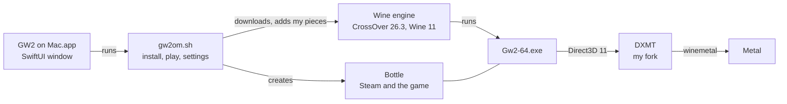
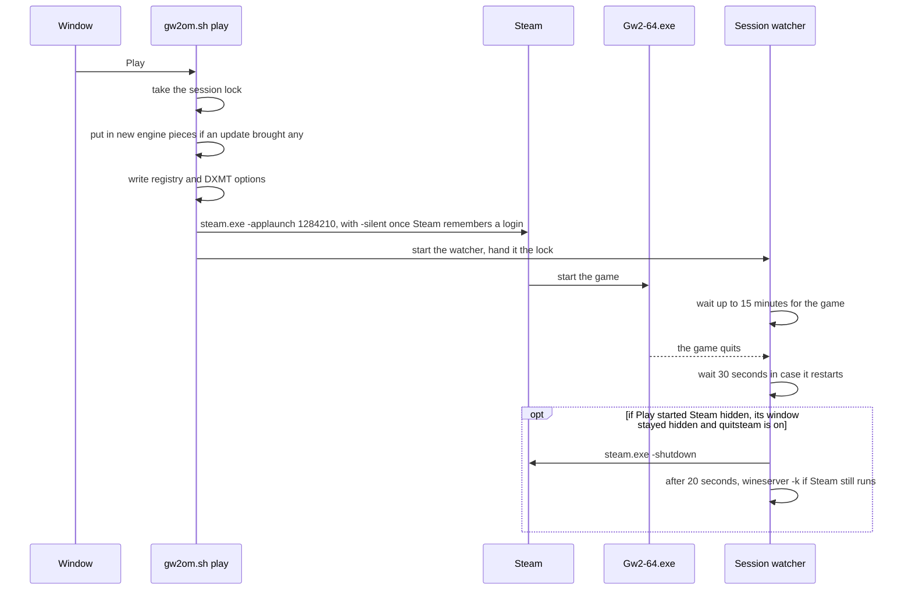
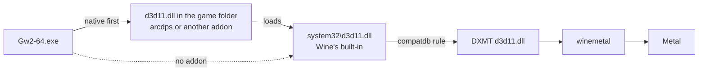
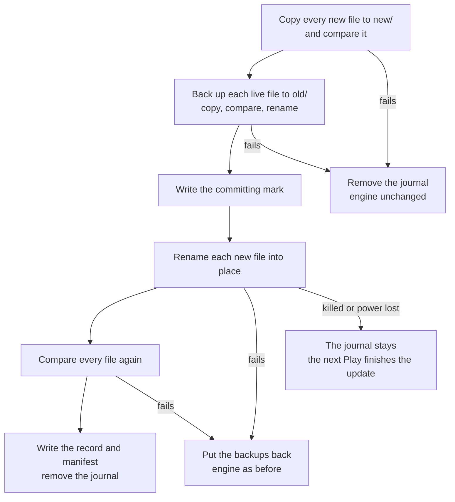

# GW2 on Mac

GW2 on Mac is a small macOS app I wrote to play [Guild Wars 2](https://www.guildwars2.com) on
Apple silicon. It installs the game into a Wine engine and bottle of its own and starts it. The
engine is CrossOver 26.3 with Wine 11. The game's Direct3D 11 goes to Metal through
[my fork of DXMT](https://github.com/jdrly/dxmt), and the app adds macOS Game Mode, Retina
rendering and a Wine I tuned for the game's crowded maps. It changes nothing you already have
installed.

Website: [gw2onmac.com](https://gw2onmac.com). Download: the
[latest release](https://github.com/jdrly/gw2-on-mac/releases/latest).

> **GW2 on Mac is an unofficial fan project.** ArenaNet and NCSOFT don't make, endorse or support
> it. ArenaNet doesn't support third-party tools or compatibility layers, so you use it at your
> own risk.
>
> **It doesn't host or change the game.** Steam comes from Valve, and the game comes from Steam or
> ArenaNet. The app only provides the layer the game runs on, which is Wine plus DXMT for
> Direct3D 11 on Metal. CrossOver and Proton are the same kind of software. One optional addon is the exception.
> *Larger interface* changes the game's memory for a sharper interface at 4K. It is off by default
> and asks before it goes in. The *arcdps* switch downloads deltaconnected's arcdps from
> deltaconnected.com. It is also off by default and asks first, and I don't host or change arcdps.
>
> **I do all the support for GW2 on Mac.** I'm Pharaphobia on
> [Discord](https://discord.gg/AnV3fZWz2b), or you can open a
> [GitHub issue](https://github.com/jdrly/gw2-on-mac/issues). Please don't send logs or bug reports
> about GW2 on Mac to ArenaNet's support.
>
> Guild Wars 2 is a trademark of NCSOFT Corporation. Steam is a trademark of Valve Corporation.
> Mac is a trademark of Apple Inc.

The README has three parts. [For players](#for-players) covers installing, playing and getting
help. [How it works](#how-it-works) explains the engine, Play and updates. [Development](#development)
is for building, testing and releasing the app.

# For players

## What you need

- A Mac with Apple silicon and macOS 26 or later.
- Rosetta. If *This Mac* in the window says it's missing, run `softwareupdate --install-rosetta`
  in Terminal.
- About 75 GB of free space for the game, plus about 3 GB for the engine and Steam. The install
  refuses to start under 3 GB and warns under 75 GB.
- Guild Wars 2 on Steam, or an ArenaNet account.

The app comes as a signed and notarized DMG on the
[releases page](https://github.com/jdrly/gw2-on-mac/releases/latest). Drag it to Applications and
open it.

## Installing the game

The window offers three ways in. Pick one and its card opens. The *This Mac* panel checks Rosetta,
the engine, the graphics, Game Mode, the game and the free space.

**Steam.** The app downloads the engine, creates the bottle, installs Steam from Valve's CDN and
opens Steam's install page for Guild Wars 2. You sign in to Steam and the download starts. Your
login stays in Steam. The window follows the download and finishes the setup on its own when
Steam reports the game complete.

**ArenaNet's installer.** Download `Gw2Setup-64.exe` from ArenaNet's site and drop it into the
window. Before it changes anything, the app checks that the file is ArenaNet's, with a valid
signature over this exact file. Then the engine and bottle go in and the installer runs. The
installer leaves no record of when it's done, so the app treats the game as installed once
`Gw2.dat` is larger than 1 GB and neither the installer nor `Gw2-64.exe` is running.

**Game files I already have.** If you already play in CrossOver, Whisky or an app wrapper, the
app can take that copy of the game instead of downloading 75 GB again. It looks in these places:

- CrossOver's bottles in `~/Library/Application Support/CrossOver/Bottles`
- Whisky's bottles in `~/Library/Containers/com.isaacmarovitz.Whisky/Bottles` and
  `…/Data/Bottles`, named from each bottle's `Metadata.plist`
- app wrappers in `~/Applications` and `/Applications`, such as Sikarugir, Kegworks, Wineskin or
  Porting Kit
- Heroic's prefixes in `~/Games/Heroic/Prefixes`, and `~/.wine`
- GameHub's folders in `~/Library/Application Support` and `~/Library/Containers`, a few levels
  deep, because GameHub doesn't document where it keeps its bottles

Inside each bottle it checks Steam's library and ArenaNet's default folder. A folder counts when it
has `Gw2-64.exe` and a `Gw2.dat` larger than 1 GB. The list shows the source app, the path, the
size, and the route. That's Steam if Steam's `appmanifest_1284210.acf` sits next to the game, and
ArenaNet otherwise. If your copy is somewhere else, use *Choose folder…* or drop the folder on the card. A
game folder works, and so does a bottle or wrapper app with the game in it.

On the same disk the app clones the files with APFS. That takes a moment and no extra space until
one of the copies changes. From another disk it copies them, after checking there's room for their
size plus 1 GB. Either way it only reads your original. My own addon files are left behind. Any
other addon, such as an arcdps `d3d11.dll` or an `addons` folder, comes along as it is, and the
summary names it. *Also bring my game settings* is on by default and brings `GFXSettings.Gw2-64.exe.xml`
and `Local.dat`, which holds your options and remembered login. If the new bottle already had
those files, the old ones move to a `GW2 on Mac backup <date>` folder next to them. The import
refuses to run while Guild Wars 2 runs anywhere on the Mac, since its files could change during the
copy. On the Steam route, if Steam's record says the game is incomplete, the install runs Steam's
download step and Steam continues from the files. Otherwise Steam may still verify them at the
first Play.

If the first install fails or you cancel it, it removes the engine, the bottle, the settings and
the install state it created, and any game files it copied. Other files it made on the way can
stay, such as cached downloads, logs, `dxmt.conf` and the Game Mode bundle. You can quit
the app during a Steam or ArenaNet download. The window picks the download up again when you open
it, and *Stop waiting* stops following it but keeps the engine and the bottle.

## Playing

Once the game is installed, the window shows *Play*, *Repair*, *Settings* and *Uninstall…*.

The first time, Steam shows its window so you can sign in. After Steam remembers your login, Play
starts it in the background without a window, and Steam signs in and starts the game.

While the game starts, the window shows the stages as they happen, with the time so far:

1. Starting Steam
2. Updating Steam, only when Steam updates itself
3. Signing in
4. Checking game files, only when Steam verifies or updates the game
5. Starting Guild Wars 2
6. Loading
7. Playing

On ArenaNet's route the stages begin at *Starting Guild Wars 2*, and the game's launcher takes over
from there. If Steam waits for you to sign in, *Show Steam* brings its window up, and after 2
minutes the window suggests it. Once the game is up, the window shows how long you've played and a
*Bring to Front* button. If you open the app while the game starts or runs, it picks the session up.

When the game quits, Steam quits too, after 30 seconds in case the patcher or a restart starts the
game again. It only does this for a Steam that Play started in the background. Steam stays open if
it was already running before Play, if its window showed, or if you brought it up with *Show Steam*.
*Quit Steam when the game quits* in Settings › Game turns this off.

Some details:

- Pressing Play while the game runs brings it to the front.
- Settings take effect the next time the game starts. If Steam still runs from an earlier start
  with other settings, Play asks you to quit Steam first, because the game inherits Steam's
  environment.
- If the game's own Frame Limiter is set while vertical sync is on, the window suggests
  *Unlimited* with vsync. *Don't show again* hides the tip.

**Repair** puts the engine, my pieces in it, the bottle's settings, Game Mode and Steam back in
place. It keeps the game and your settings. Use it when the window says so.

## Settings

Open Settings with ⌘, or from the window. Each pane covers one area. The defaults are the mix I
play with. The settings with a key in the table also exist as `gw2om.sh set <key> <value>` for
scripting.

| Pane | Setting | Key | Default | What it does |
|---|---|---|---|---|
| Graphics | Retina | `retina` | on | draws at your display's full resolution, at some cost in frame rate |
| | Frame cap | `fpscap` | off | a steady cap paced by Metal at 30, 40, 60 or 120. Use it with the game's own vsync |
| | MetalFX for Subsample | `metalfx` | off | with the game's Render Sampling at Subsample, MetalFX upscales the 3D scene and the interface stays sharp. Experimental |
| | Metal HUD | `hud` | off | Apple's overlay with frame rate and frame times, over the game only and not over Steam's windows |
| Performance | Shader warming | `warm` | on | builds the pipelines your recent sessions used before the game asks for them, up to 8,192 or about 300 MB |
| | Cooler job workers | `coolworkers` | 3 | moves this many of the game's job workers to the efficiency cores, or none when off. Saves power, but moving all of them can cost frames in big crowds |
| | Faster locks | `fastlocks` | on | short waits before the game thread sleeps on a busy lock or job group |
| | CPUs the game sees | `ncpu` | 8 | from 2 up to your Mac's logical CPUs, or all. The game starts one job worker per CPU, minus one |
| Interface | Larger interface | `uiscale` | off | my interface addon, see below |
| | Interface Size "Larger" | `uiscale_size` | 1.75 | the addon's scale: 1.5, 1.75, 1.8 or 2.0 |
| | Small text in Cronos | `uiscale_sans` | on | chat, the tracker and labels have no larger font, so the addon draws them in Cronos at the larger size |
| | Cinematic dialogue | `uiscale_cinema` | on | story cinematics size their dialogue apart from the interface. This draws it at the same size, with a small code patch |
| | arcdps | `arcdps` | off | downloads or removes arcdps, see below |
| Game | Game Mode | `gamemode` | on | in full screen, macOS gives the game priority on the CPU and GPU and lowers Bluetooth latency |
| | Start Steam in the background | `steambg` | on | Steam starts without a window once it remembers your login |
| | Quit Steam when the game quits | `quitsteam` | on | shown while the previous setting is on |
| | Launch options | `launchopts` | none | arguments for `Gw2-64.exe`, using letters, digits and `-_.:=,/+` |
| | Quit GW2 on Mac after launching | | off | the app quits once Play has started Steam or the game |
| Mouse | Raw mouse-look | `rawmouse` | on | see below |
| | Mouse-look speed | `mousespeed` | 1× | 0.5× to 3×. At 1× the camera turns as fast as your pointer moves |
| Updates | Check automatically | `updates` | on | Sparkle checks for new versions |
| Troubleshooting | Debug logging | `debug` | off | detailed DXMT and Wine logs for a bug report, at some cost in performance. On in development builds |

### Raw mouse-look

When you hold a mouse button to turn the camera, the game hides the pointer and keeps moving it
back to the centre. With Wine's stock Mac driver, each of those moves goes through the real
macOS pointer, and the game sees your mouse once per screen refresh. With raw mouse-look on, the
pointer stays frozen and the game gets the mouse's own movement as it arrives, around 1000 updates a
second for a typical mouse. At 1× the camera turns as fast as it would with the pointer, including
your pointer speed in System Settings. A trackpad keeps the pointer's movement, because macOS
doesn't report its raw counts. Turn the setting off to get Wine's usual mouse-look back.

### Larger interface

The game's largest Interface Size is still small on a 4K display. This addon makes the "Larger"
size larger, from the game's own sharp fonts, and draws small text in Cronos. It is my own code,
in [`addon/ui-scale`](addon/ui-scale), and goes into the game folder as `version.dll` with
`gw2-ui-scale.ini`. It is off by default and asks first, because it changes the game's memory
and patches one piece of its code for the cinematic dialogue. ArenaNet doesn't support that, and a
game update may break it.

### arcdps

Settings › Interface has an *arcdps* switch, off by default. arcdps is deltaconnected's
third-party addon, and it reads the game's memory. ArenaNet, NCSOFT and I don't support it, so the
switch asks first, and you use it at your own risk.

- On downloads `d3d11.dll` and its `.md5sum` from deltaconnected.com, checks the file against that
  checksum and checks that it is arcdps. Then it goes next to `Gw2-64.exe` as `d3d11.dll`.
  From then on arcdps updates itself.
- Off removes arcdps from `d3d11.dll` or `dxgi.dll` and keeps its settings in `addons/arcdps` for
  next time.
- An arcdps you put there yourself, or that came with your game files, shows as on.
- Another addon in the same place, such as the Nexus loader, is left alone, and the switch says
  which file it found.
- The switch only works while the game and Steam are closed.

Other addons that load as `d3d11.dll` or `dxgi.dll` next to `Gw2-64.exe` work too. The game loads
them first, and they pass its drawing on to DXMT. [How addons load](#how-addons-load) has the
details.

## Updates

The app updates itself with Sparkle. *Check for Updates…* is in the app menu, and with *Check
automatically* on it looks on its own. Releases come from this repository's GitHub releases.

Some updates bring new pieces for the engine, such as 0.1.1's Mac driver for raw mouse-look. Those
go in at your next Play, before Wine starts. You don't need Repair. If the app finds an engine file
it doesn't recognise, it leaves the file alone and *This Mac* says *needs Repair*.

## Logs and help

**Collect Logs…** is in the menu and in Settings › Troubleshooting. It puts a zip on your Desktop
with what I need for a bug report:

- my logs: `wine.log` and DXMT's `Gw2-64_d3d11.log`, each with the 4 sessions before, plus the
  newest heat logs, `session.env`, the settings and the state
- a session report
- the game's `ArenaNet.log` and `GFXSettings.Gw2-64.exe.xml`
- Steam's bootstrap, content, gameprocess and shader logs
- crash reports from the last 7 days, GPU errors from the last 2 hours, and `system-info.txt`

On the way into the zip it removes account, persona and Mac names, Steam IDs, e-mail addresses,
home folders, tokens and the crash logs' machine, account and address fields. `Local.dat`, Steam's
config and Steam's login and connection logs never go in. If a file still holds one of those after
redaction, the zip leaves it out and lists it in `left-out.txt`. arcdps's logs stay out too. Its
crash log dumps the game's threads and modules, and I can't be sure it holds no account or character
names. If I ask for it, look through it before you attach it.

Send the zip with a short description to Pharaphobia on [Discord](https://discord.gg/AnV3fZWz2b),
or attach it to a [GitHub issue](https://github.com/jdrly/gw2-on-mac/issues). The *Discord* button
at the top of the window opens the server, and it's also the place for arcdps and addon
questions. Please don't send it
to ArenaNet's support.

## What it puts on your Mac

Everything the app creates is in these places. It adds no launch agents or login items, and puts
nothing in `/Applications` besides itself.

| Path | What | Uninstall |
|---|---|---|
| `~/Library/Application Support/GW2 on Mac/engine/` | the Wine engine with my pieces, about 1 GB | removed |
| `…/GW2 on Mac/bottle/` | the game's Wine prefix with Steam, the game's files and the game's settings. About 75 GB, or no extra space for a clone of files on the same disk | removed, with the game |
| `…/GW2 on Mac/gamemode/GW2.app` | the Game Mode bundle | removed |
| `…/GW2 on Mac/settings.conf`, `state`, `install-manifest.json`, `dxmt.conf`, `session`, `session.req`, `.session.lock` | settings, install state, what was installed, DXMT's options, the current game session and its lock | removed |
| `~/Library/Caches/GW2 on Mac/downloads/` | the engine archive, `SteamSetup.exe`, a copy of `Gw2Setup-64.exe` | removed |
| `~/Library/Caches/GW2 on Mac/dxmt/Gw2-64.exe/` | DXMT's shader cache and pipeline archives. Another process, such as the launcher's `CefHost.exe`, gets its own folder next to it | removed. *Reset the shader cache* in Settings empties it too |
| `$(getconf DARWIN_USER_TEMP_DIR)winetemp-…/Gw2-64.exe` | the Game Mode link | removed |
| `~/Library/Logs/GW2 on Mac/` | `install.log`, `wine.log`, DXMT's `Gw2-64_d3d11.log`, `session.env`, `gamemode.log`, the heat logs, and `.lock-claim` for the install lock | kept |

In the game folder, `version.dll` and `gw2-ui-scale.ini` exist only while *Larger interface* is on,
and arcdps's `d3d11.dll` only while *arcdps* is on. The app never touches another program's
`version.dll`, `d3d11.dll` or `dxgi.dll` there. The app's own preferences, such as the chosen
route and the last Settings pane, live in the defaults domain `cz.jandrly.gw2onmac`. Other Wine
apps' bottles are only ever read.

## Uninstall

*Uninstall…* in the window asks first and tells you the game's files go with the bottle. Close the
game and Steam before you run it. It removes everything in the table above except the logs. To do
it by hand:

```sh
rm -rf ~/Library/"Application Support/GW2 on Mac" ~/Library/Caches/"GW2 on Mac"
rm -rf ~/Library/Logs/"GW2 on Mac"      # the logs, if you want them gone too
```

Then move the app to the Bin. A Steam library you added outside the bottle, in Steam › Settings ›
Storage, stays where it is.

## Known limits

- I've installed and played through the app since 2026-11-04, on the Steam route with my existing
  game files imported, and I now play on the published 0.1.1. A fresh Steam download and
  ArenaNet's installer haven't had a real install yet, so the Steam route's `StateFlags` check and
  the ArenaNet route's 1 GB rule are still unchecked against a real download.
- Raw mouse-look comes from SWTOR on Mac, where people have used it for a long time. In Guild
  Wars 2 this Mac driver build has had one in-game test so far, on 2026-11-08.
- arcdps on DXMT has had one check, on 2026-11-08 with arcdps 1.2026.1023.2303. It loads and
  creates its device through DXMT. I haven't tested its overlay in play, or the Nexus loader.
- While Steam verifies the game's files, *Checking game files* shows no percentage, because Steam's
  logs don't give one. A game update shows its progress.
- There's no Keyboard pane. SWTOR on Mac's game keys by keyboard position are in the Mac driver,
  but nothing turns them on. On QWERTZ layouts they swap Z and Y, and I haven't checked how Guild
  Wars 2 names keys in its bindings.
- DXMT's caches live in the app's own cache folder, so they aren't shared with another DXMT setup
  of the game on the same Mac. Caches an older build left in
  `$(getconf DARWIN_USER_CACHE_DIR)dxmt/Gw2-64.exe/` stay where they are, since another setup may
  use them. Your first sessions build the app's cache from scratch.
- Blish HUD and macOS 28's Rosetta changes aren't covered.
- For *Game files I already have*, GameHub's location is a guess. *Choose folder…* always works.

# How it works

## The pieces



The app is a SwiftUI window around one bash script, `gw2om.sh`, which runs under macOS's own
bash 3.2. The window calls it for everything: `status`, `install`, `play`, `settings`, `set`,
`repair`, `uninstall` and a few more, listed at the top of [`src/gw2om.sh`](src/gw2om.sh). The
script reports back in lines that start with `@`, such as `@phase`, `@progress` and `@error`.

The Wine engine is not in the app. athei built it from CodeWeavers' CrossOver 26.3 sources and
athei's own patches, and that release is gone now, so I host the same file in
[jdrly/wine-engine](https://github.com/jdrly/wine-engine/releases/tag/cx-26.3.0-8), release
`cx-26.3.0-8`, next to the Wine source it was built from. The script downloads it from there at
install time, pinned by size and sha256. The download resumes, retries and has a second address
through GitHub's API. Then my pieces go into the engine:

- DXMT `e02a4d6` over the engine's `dxgi/dxmt` tree
- my `ntdll.so` and `wineserver`, which I call the heat build, tuned for the game's threads
- Wine's Mac driver `winemac.so` with its `winemac.drv` PE sides for x86_64 and i386. It carries
  the launcher fix and raw mouse-look, and its PE sides start raw mouse-look's input thread
- `win32u.so` built at -O2, which draws the launcher's layered window

Before replacing an engine file, the script checks it against the engine's known sha256 and keeps
it as `<name>.stock`.

## Installing, step by step

`gw2om.sh install <route>` runs five phases. A failed or cancelled first install removes what that
run tracked as created: the engine, the bottle, `settings.conf`, `state`, `install-manifest.json`,
and an import's copied game folder with Steam's record. Other files it made can stay, such as
cached downloads, logs, `dxmt.conf` and a finished Game Mode bundle.

1. **The engine.** Download, check, unpack, check the loader, then my pieces as above.
2. **The bottle.** `wineboot`, Retina mode in `user.reg`, `settings.conf`, `dxmt.conf` and the
   Game Mode bundle.
3. **Steam or ArenaNet's installer.** Steam's `SteamSetup.exe` comes from Valve's CDN and runs with
   `/S`. ArenaNet's installer goes through `gw2om.sh check-setup` first, which uses only macOS's
   `/usr/bin/openssl`. The file must be a PE x86_64 executable. Its Authenticode signature must be
   valid, with the message digest covering the SpcIndirectData content. The signed PE hash must
   match the file, recomputed. The signer's certificate must be ArenaNet's. The chain up to
   Windows' root certificates isn't checked, because macOS doesn't have them.
4. **The game's download.** Steam opens `steam://install/1284210`, or ArenaNet's installer starts.
   The command ends with `stage=waiting_game` and the window follows the download. For Steam it
   reads `BytesDownloaded` and `BytesToDownload` in `appmanifest_1284210.acf` and waits for
   `StateFlags` 4. For ArenaNet it waits for the 1 GB `Gw2.dat` rule.
5. **Finishing touches.** `gw2om.sh finish` creates DXMT's cache folder, puts the interface addon
   in if it's on, writes the registry settings, records `stage=finished`, and the window shows
   Ready.

An import, `gw2om.sh install import <folder> [--no-settings]`, runs the engine and bottle phases,
then Steam on the Steam route, then places the folder in the bottle's
`steamapps/common/Guild Wars 2` with Steam's record, or in `Program Files/Guild Wars 2` for
ArenaNet. `gw2om.sh scan` finds the installs and `gw2om.sh check-game <dir>` checks one folder.
Both only read.

## The game's environment

`settings.conf` holds the settings, and every Play turns them into the game's environment.
`gw2om.sh env` prints what Play would use. These are always set:

- `WINEMSYNC=1`
- `ROSETTA_X87_PATH=` to turn the engine's x87sidecar off
- `WINEDLLOVERRIDES=winemenubuilder.exe=d`
- a compatdb rule that gives every process DXMT, the launcher's `CefHost.exe` included
- `DXMT_CONFIG_FILE`, `DXMT_LOG_PATH`, `DXMT_CACHE_DIR` and `DXMT_DEPENDENCY_COMPRESSION=1`
- my ntdll's `WINE_HEAT_EVPOOL=1`, `WINE_HEAT_WAKE=one,skip`, `WINE_HEAT_LAZYCLOCK=1`,
  `WINE_HEAT_MSYNC_UNREG=1` and `WINE_HEAT_MSYNC_PORTFIX=1`

The settings map to these:

| Key | Sets |
|---|---|
| `retina` | `RetinaMode` in the bottle's `user.reg` |
| `fpscap` | `d3d11.preferredMaxFrameRate` in `dxmt.conf` |
| `metalfx` | `DXMT_SUBSAMPLE_METALFX=1` |
| `hud` | `WINE_HEAT_METAL_HUD=1`. My ntdll then sets `MTL_HUD_ENABLED=1` in `Gw2-64.exe` only, at its start |
| `warm` | `DXMT_WARM=all` |
| `coolworkers` | `WINE_HEAT_QOS=1=utility:<n>`, the first n ABOVE_NORMAL job workers at utility QoS |
| `fastlocks` | `WINE_HEAT_SPIN=lock=20:game,event=30:game` |
| `ncpu` | `WINENCPU`, bounded by `sysctl hw.logicalcpu` |
| `uiscale` | the addon files, and `version=native,builtin` for `Gw2-64.exe` |
| `uiscale_size`, `uiscale_sans`, `uiscale_cinema` | the addon's ini: `scale`, `sans=cronos` or `keep`, `cinema=1` |
| `rawmouse`, `mousespeed` | `RawMouseWhenCursorHidden` and `RawMouseGameControllerScale` for `Gw2-64.exe` in `user.reg` |
| `debug` | `DXMT_LOG_LEVEL=debug`, `WINE_HEAT_COUNT` and `WINEDEBUG=err+all,fixme-all` |

The script writes registry settings straight into the bottle's `user.reg`, as SWTOR on Mac does.
It only does that while no Wine session of the bottle runs or starts. The write takes the session's
lock, so if a game session holds it, the change waits for the next Play that finds the bottle idle.

## What Play does



`gw2om.sh play` runs `steam.exe -applaunch 1284210 <launch options>` on the Steam route, adding
`-silent` once Steam's `config/loginusers.vdf` has a user with `"RememberPassword" "1"`. On the
ArenaNet route it runs `Gw2-64.exe <launch options>`. It also makes the Game Mode link, writes
`session.env` and rotates the logs when no session runs.

One session runs at a time. The session's lock is a kernel `flock` on `.session.lock`, taken by the
app's helper `helpers/sessionlock`. Play takes it before it updates engine files or registry settings, and passes it to the
watcher, `gw2om.sh watch-session`, which it starts detached so the window can quit. The lock ends
with the watcher, so nothing stale is left behind. After Play writes the first version of the
`session` file, the watcher is its only writer. Others append requests to `session.req`: `join` from
a second Play, `shown` from *Show Steam*. The watcher applies them in order.

The watcher follows the engine's own processes. It waits up to 15 minutes for `Gw2-64.exe`, since
Steam may update itself and ask for a sign-in first. When the game quits it waits 30 seconds. Then,
if this Play started Steam in the background, it runs `steam.exe -shutdown` through the engine with
the game's environment, and if Steam still runs 20 seconds later, `wineserver -k` for this bottle
only.

It leaves Steam alone when:

- Steam was running before Play
- Steam's window showed, before the first sign-in or with *Start Steam in the background* off
- *Quit Steam when the game quits* is off
- someone brought Steam's window up during the session
- the game never started, by the timeout or because Steam closed first

Play decides whether Steam belongs to the session by looking at the bottle's processes before it
starts Steam. The bottle's Steam only ever starts through Play, so a `steam.exe` that changes
without a request is Steam restarting itself after an update.

A second Play during a session joins it. That happens while Steam starts the game, or in the grace
after it quit. The second Play waits until the watcher has the request, and the watcher waits for
the game again. If no Steam ran before that Play, Steam counts as the session's. Once the watcher
has decided to quit Steam, or if it doesn't answer, Play starts nothing and asks you to try again in
a few seconds.

The `session` file's `stage` is one of `waiting_game`, `playing`, `grace`, `closing_steam` or
`done`, with a `result`. The watcher logs to `install.log` under `---- session`, and Uninstall stops
it.

### The start's stages

The window polls `gw2om.sh session-status` once a second while a session runs. It prints `stage`,
`detail`, `progress`, `elapsed`, `game_elapsed`, `steam`, `game`, `closing`, `quit_steam` and
`limiter_hint`. The stages come from these signals:

| Stage | Detected by |
|---|---|
| Starting Steam | a start is under way and Steam hasn't signed in |
| Updating Steam | Steam's `logs/bootstrap_log.txt` verifies Steam's files, or downloads or installs an update, with its percent |
| Signing in | `steamwebhelper.exe` runs and `logs/connection_log.txt` shows no logon since the start |
| Checking game files | `logs/content_log.txt` has app 1284210 validating or updating. An update's percent comes from its appmanifest |
| Starting Guild Wars 2 | Steam has signed in, or `Gw2-64.exe` runs |
| Loading | DXMT's log for this session has the device, but no frame yet |
| Playing | DXMT's first `Present pacing` line |

Only the session's lines count, meaning Steam's log lines from the session's start on, and only
their state lines. Nothing from them is printed, so no account name or ID leaves `session-status`. `status`
prints `session=live` while the watcher waits for the game, follows it, sits in the grace or
closes Steam, which is how the window picks a session up when it opens. A Steam idling on its own
doesn't count. A Play that joins a session restarts the stages with `session-status --since <time>`.

`gw2om.sh show-steam` runs `steam.exe steam://open/main` through the engine and sends the watcher a
`shown` request, so that Steam stays open after the game. If Steam is already quitting, the window
stays shut.

The frame-limiter tip reads `frameLimit` and `verticalSync` from the bottle's `GFXSettings.Gw2-64.exe.xml`
and never writes the file.

## Game Mode

macOS turns Game Mode on only for a process whose executable sits in a bundle with
`LSSupportsGameMode`, and every Wine process runs Wine's loader. SWGL on Mac and my development
setup solve it the same way. `gamemode/GW2.app`, bundle ID `cz.jandrly.gw2onmac.game`, holds an
unsigned copy of the loader named `Gw2-64.exe` and an `ntdll.so` link. With `WINEDLLPATH` set,
CrossOver's ntdll starts the game from `$TMPDIR/winetemp-…/Gw2-64.exe`, and Play points that path
at the bundle.

## Raw mouse-look in the driver

Raw mouse-look is SWTOR on Mac's port of SWGL on Mac's two mouse patches. The stock driver moves
the real pointer for each of the game's re-centring `SetCursorPos` calls, and those moves reach the
game once per screen refresh. With `RawMouseWhenCursorHidden=y`, an input thread in the driver
reads GameController's `GCMouse` and sends the moves to the Wine server as relative motion while the
macOS pointer stays still. `GCMouse` reports the mouse's own counts, so the driver measures their
ratio to the pointer's moves while you turn, and sends them at that ratio times
`RawMouseGameControllerScale`. Until the first measurement, and for devices `GCMouse` doesn't
report, it sends the pointer's moves. The driver hides the pointer with a blank cursor image. Turning
the cursor off would drop the game out of direct presentation. The SWG-specific
`IgnoreStaleCursorWarps` stays off.

The same driver build carries SWTOR on Mac's game keys by keyboard position,
`winemac-physical-keys.patch` with its `PhysicalKeyboard` value. It does nothing unless the
registry turns it on, and this app never does.

## How addons load



`Gw2-64.exe` always gets `d3d11` and `dxgi` as `native,builtin`, so an addon placed as `d3d11.dll`
or `dxgi.dll` next to it loads first. The addon then loads `system32\d3d11.dll`, Wine's built-in,
which the compatdb points at the DXMT tree. I checked the chain on 2026-11-08 with arcdps
1.2026.1023.2303. arcdps loaded system32's `d3d11.dll`, that loaded `winemetal.dll`, and a device
came up.
Without an addon the game gets the built-in directly. Steam and the launcher keep Wine's default
order.

arcdps updates itself, so the app can't recognise it by hash. A `d3d11.dll` or `dxgi.dll` counts as
arcdps when it's a PE whose export directory lists `addextension2`, arcdps's extension API, and the
file names arcdps. Other addons may mention arcdps and look up its exports, but they don't export
them. `gw2om.sh set arcdps on|off` does the switching. It takes the session's lock like the registry
writes, so it refuses while a session runs. `status` and `settings` print `arcdps_state`, which is
`on`, `off`, `foreign` with the file in `arcdps_foreign`, or `nogame`. `GW2_ON_MAC_ARCDPS_URL`
points the download elsewhere for tests.

## Engine updates

When an app update has new engine pieces, `status` says `graphics=update` and *This Mac* shows
*DXMT · updates at Play*. The pieces are the 18 files `component_list` names: DXMT's PE DLLs for
both architectures, `winemetal.so` and its records, `ntdll.so`, `wineserver`, `winemac.so`, both
`winemac.drv` and `win32u.so`. Each live file must be one of these:

- this version's file from the app, or its staged build before the release signs it. That's
  `components/INVENTORY`, which `build.sh` writes, so an engine set up from the same unsigned build
  also counts.
- 0.1.0's, from pinned hashes in `OLD_COMPONENTS`. Each file has its staged hash and its hash in the
  notarized DMG. In 0.1.0 the Mac driver's PE sides were still the engine's own.
- from 0.1.1 on, a file named in the engine's own record of what the app put in,
  `engine/.gw2om-components`.

A file that matches none of these, because it's damaged, someone else's or missing, makes
`graphics=other`. The app says *needs Repair* and never overwrites such a file without it. Play
never starts the game on a set with a missing piece. An engine that already has this version's
pieces is `graphics=yes`, and Play only brings the manifest up to this version.

The update runs only inside a Play that holds the session's lock and the install lock, with no Wine
of the bottle running. Another Play during that time starts nothing and says to try again.



The journal lives in `engine/.gw2om-update`. A backup only counts once it's renamed into its slot,
so a half-written one never does. An engine's own file also keeps its `.stock` copy, as at install.
After an interruption the engine counts as `update`, the game doesn't start on a half-replaced set,
and the next Play finishes the job.

### The install lock

`.lock` holds its owner's pid and keeps installs, repairs, uninstalls, settings changes and updates
apart. Creating it, taking over one whose process is gone, and removing it all happen under
`.lock-claim`, a kernel lock taken through the same `sessionlock` helper. Only the owner removes
the lock. `.lock-claim` lives in the logs folder, which Uninstall keeps, so it's always the same
file. Each contender holds the claim only for those steps and releases it before anything else runs,
so Wine and Steam never inherit it. A contender waits up to 5 seconds for the claim, which
`GW2_ON_MAC_LOCK_WAIT` changes.

## Logs in depth

Collect Logs is SWTOR on Mac's `collect-logs.sh` adapted to this app's files, with the same
redaction, crash reports, unified-log GPU errors and leak check.

The session report, `Resources/session-report.sh [--keep] [log]` or `--compare A B`, sums up the
last session from DXMT's own log lines:

- frame rate as median, 10th percentile and minimum, frame times, hitches and DXMT's share of them
- shader compiles and the render thread's waits for them
- shader warming, presentation and Metal 4 errors

# Development

## Building

You need Xcode 27, for the macOS 27 SDK. The app targets macOS 26.0.

```sh
scripts/stage-components.sh    # copy DXMT, my Wine pieces, the Mac driver and the addon into prebuilt/
./build.sh                     # build dist/GW2 on Mac.app, ad-hoc signed
```

**Where the binaries come from.** I build DXMT and the four Wine pieces, `ntdll.so`,
`wineserver`, `winemac.so` and `win32u.so`, in my private development workspace, whose build
scripts aren't in this repository. `stage-components.sh` copies them from `GW2_ON_MAC_WORKSPACE`,
by default `../gw2-on-mac` next to this checkout. The builds the app ships are
`work/dxmt-rollback/e02a4d6-install`, `work/heat/install-r7c`, `work/winemac/install-km` and
`work/ui-scale/build`. `DXMT_INSTALL`, `HEAT_INSTALL`, `WINEMAC_INSTALL` and `UISCALE_BUILD`
override them. The script changes nothing in the workspace. Git ignores `prebuilt/`. What it
checks differs per component:

- The Wine binaries must match the sha256 in their build records, `VERSION` and
  `WINESERVER.txt`. For ntdll and the Mac driver, the script also checks the records' patch hashes
  against this repository's [`patches/`](patches). It compares existing workspace copies of
  `ntdll-heat.patch`, `wineserver-msync-unregister.patch` and the Mac driver patches with this
  repository's copies.
- DXMT's files must all be there. Its `VERSION` holds only the revision, `v0.80-441-ge02a4d6`.
- The addon's `version.dll` and `gw2-ui-scale.ini` must be there, and the DLL must carry the
  addon's marker string.

**Without the workspace.** A checkout without my workspace, like a GitHub runner, can't copy
anything, so `stage-components.sh` downloads the same `prebuilt/` as one archive instead. It does
that when `GW2_ON_MAC_WORKSPACE` doesn't exist, or with `--fetch`. The archive is a pre-release of
this repository, tagged `components-<date>`. [`prebuilt.lock`](prebuilt.lock) pins its tag, file
name and sha256, and the script refuses a download or cached copy with another sha256 before it
unpacks anything. The archive holds only what the app already ships, the binaries and their
records and licences. `build.sh` then checks it like any other `prebuilt/`.

When the components change, I stage from the workspace, build and test as usual, then publish a
new archive:

```sh
scripts/stage-components.sh --pack components-2026-11-11   # release/<tag>/…tar.xz, and a new prebuilt.lock
gh release create components-2026-11-11 --prerelease --latest=false --target main \
  --title "Components 2026-11-11 (for CI, not an app release)" --notes "prebuilt/ for the Checks workflow" \
  release/components-2026-11-11/gw2-on-mac-components-2026-11-11.tar.xz
```

and commit `prebuilt.lock` with the change. It has to stay a pre-release: installed apps read
`releases/latest`, and a pre-release never becomes that. `site.yml` skips pre-releases too.

**Their source.** The complete corresponding source is public, under LGPL-2.1-or-later. DXMT is
[jdrly/dxmt at `e02a4d6`](https://github.com/jdrly/dxmt/tree/e02a4d6). The Wine pieces are
[athei/wine `d23b397`](https://github.com/athei/wine/tree/d23b39774528237cafe49f9a073286f854b779c0)
(also as an [archive in jdrly/wine-engine](https://github.com/jdrly/wine-engine/releases/download/cx-26.3.0-8/wine-d23b39774528237cafe49f9a073286f854b779c0-source.tar.gz)),
which is CodeWeavers' CrossOver 26.3 source with athei's patches and the engine's own source, plus
these patches:

- [`ntdll-msync-alert-fd.patch`](patches/ntdll-msync-alert-fd.patch), from SWTOR on Mac
- [`ntdll-heat.patch`](patches/ntdll-heat.patch)
- [`wineserver-msync-unregister.patch`](patches/wineserver-msync-unregister.patch)
- [`winemac-gw2-launcher.patch`](patches/winemac-gw2-launcher.patch)
- SWTOR on Mac's keyboard and mouse patches for the Mac driver, unchanged:
  `winemac-physical-keys.patch`, `winemac-swgl-relative-mouse.patch`,
  `winemac-swgl-input-thread.patch` and `winemac-swtor-mouse.patch`

They're configured as the engine is. The Wine pieces' build records, also in the app under
`Resources/Licenses`, name their sources, patches and sha256. DXMT's record names its revision,
and the commit above is its source. See [`THIRD_PARTY_NOTICES.md`](THIRD_PARTY_NOTICES.md).

**The interface addon** is this repository's own code in [`addon/ui-scale`](addon/ui-scale).
`scripts/build-addon.sh` builds `version.dll` with Homebrew's mingw-w64 (`brew install mingw-w64`)
into `work/ui-scale/build` and runs its native test. Staging still takes the workspace's build of
the same source, which differs only in link timestamps.

**What build.sh does.** It checks `prebuilt/` again, compiles `src/native/*.swift` for arm64 and the
`procpaths` and `sessionlock` helpers, and bundles the components, fonts, art and licences. It
downloads Sparkle at a pinned version and sha256, and compiles the Icon Composer icon
`src/AppIcon.icon` with actool into `Assets.car` and a fallback `AppIcon.icns`.

- `GW2_ON_MAC_VERSION` sets the version, 0.1.2 by default. `X.Y.Z-dev.N` makes a development build,
  as in SWTOR on Mac.
- `GW2_ON_MAC_FEED_URL` and `GW2_ON_MAC_ED_PUBLIC_KEY` turn updates on. Without them Sparkle stays
  off, which is normal for local builds.

**The icon.** `swift src/make-icon.swift layers src/AppIcon.icon` draws the wordmark layer. The ensō,
`Assets/icon-ring.png`, is artwork from the design I approved. `… preview src/AppIcon.icon <sheet.png>`
renders a review sheet of every appearance and size.

**Window icons** are Lucide's, drawn from path data. After adding an SVG to `src/icons`, run
`python3 -I scripts/gen-icons.py`.

## Testing

Tests never touch a real install, and never run while Wine, Steam or the game is open on my screen.

**On GitHub.** The Checks workflow ([`.github/workflows/checks.yml`](.github/workflows/checks.yml))
runs on every pull request and every push to `main`, on GitHub's runners, so none of it needs my
Mac. It has read-only access and no secrets, and its actions are pinned by commit.

- `lint`: `shellcheck -S warning` on the bash scripts and `actionlint` on the workflows
- `build`: `bash -n` (macOS's 3.2) on the scripts, `stage-components.sh --fetch`, `./build.sh`,
  then the build's `VERSIONS` and component hashes in the run's summary. It also checks that
  `build.sh` refuses a changed `ntdll.so` and `stage-components.sh` a changed archive.
- `sandbox`: `test-sandbox.sh` on that build. Without my workspace, the ArenaNet route and the real
  arcdps are skipped, and each skip shows as a notice on the run.
- `renders`: `ui-render.sh`, with the PNGs as the run's `renders` artifact. A runner has no design
  exports, so there are no `compare-*.png`.

What still needs my Mac is signing, notarizing and publishing a release (`scripts/release.sh`,
which has Sparkle's key and my Developer ID), building the components themselves, the ArenaNet
route's and the real arcdps's checks, and playing.

`scripts/test-sandbox.sh` tests the backend of a built app end to end in `work/app-sandbox/test`,
with 413 checks. It uses a stand-in engine archive whose `bin/wine` only pretends, plays Steam's and
ArenaNet's downloads itself, and uses a clone of the game's own ArenaNet-signed `Gw2-64.exe` as the
installer to check. That's `SIGNED_PE`, by default the copy in my development workspace's bottle.
Without one, those checks are skipped. It covers:

- dry runs, both routes, finish, every setting and its effect, and the addon
- raw mouse-look's registry values, which go to `Gw2-64.exe` only and never set `PhysicalKeyboard`,
  and registry writes waiting while a session holds the lock
- arcdps on and off from a stand-in deltaconnected.com, set by `GW2_ON_MAC_ARCDPS_URL` to a
  `file://` folder. It uses stand-in PEs with and without arcdps's exports, and the real arcdps as
  `ARCDPS_REAL`, read only. It tests the md5 check, a web page instead of the checksum, no server, a
  self-updated arcdps, `dxgi.dll`, another addon left alone, and refusals while a session runs or a
  Play holds its lock.
- an update from 0.1.0 with stand-in 0.1.0 files from `GW2_ON_MAC_OLD_COMPONENTS`. Play puts the
  new pieces in without Repair. Damaged or foreign DXMT, sibling and Wine files stay for Repair. Two
  Plays race, with the first paused after classifying and halfway through the replacement
  (`GW2_ON_MAC_TEST_PAUSE`). A failure and a kill land between the Mac driver's pieces
  (`GW2_ON_MAC_UPDATE_FAIL_AFTER`, `GW2_ON_MAC_UPDATE_KILL_AFTER`) and get rolled back or finished
  by the next Play. A kill halfway through a backup, followed by a failing retry
  (`GW2_ON_MAC_UPDATE_KILL_IN_BACKUP`), leaves the originals intact. Two contenders race for a dead
  process's install lock, and one wins. A fresh contender arrives while another holds the claim
  after reading a live owner, and gets refused. A missing piece refuses Play, and this version's
  pieces under 0.1.0's manifest count as set up.
- play, the busy checks, repair, reset-shaders, reinstall-engine and the lock
- Collect Logs' redaction, with no arcdps log, uninstall, and a failed install's rollback
- Steam's `-silent` with and without a remembered login, and the CPU counts
- the session's watcher, with stand-in Steam and game processes and shorter times
  (`GW2_ON_MAC_WATCH_TIMEOUT`, `GW2_ON_MAC_WATCH_GRACE`, `GW2_ON_MAC_WATCH_QUITWAIT`,
  `GW2_ON_MAC_WATCH_POLL`). Cases: Steam quits after the game, a restart within the grace, a Steam
  already running, the setting off, Steam's window shown, the timeout, Steam closed before the
  game, Steam restarting itself, a `shown` request, Play in the grace, Play while Steam quits, one
  watcher per session including two Plays at once, a stale lock file and a held lock that doesn't
  answer, the `wineserver -k` fallback, and Uninstall stopping the watcher.
- existing game files: stand-in CrossOver, Whisky and wrapper bottles with a sparse `Gw2.dat`, the
  scan, check-game, the clone on both routes, the settings and their backup, a real copy from an
  attached disk image when `hdiutil` can attach one, a forced copy (`GW2_ON_MAC_IMPORT_COPY`), the
  free-space refusal (`GW2_ON_MAC_FREE_KB`), the refusal while the game runs, and that the sources
  never change

`scripts/ui-render.sh` renders every window state, light and dark, headlessly into
`work/app-renders/`. Nothing shows on screen and the app never activates. With the exports of
the design I approved in `DESIGN_EXPORTS`, by default my workspace's, it also writes `compare-*.png`
with the design next to the render. The design file isn't in this repository.

To try things by hand, `GW2_ON_MAC_ROOT=/abs/dir` puts every path `gw2om.sh` and `collect-logs.sh`
use under that folder, and `GW2_ON_MAC_DRY_RUN=1` prints what would change without changing it:

```sh
R="dist/GW2 on Mac.app/Contents/Resources"
GW2_ON_MAC_ROOT=$PWD/work/app-sandbox/try GW2_ON_MAC_DRY_RUN=1 "$R/gw2om.sh" install steam
```

The app passes both variables on, so the window can run against a sandbox too. In a sandbox,
`gw2om.sh` refuses to run the real engine's Wine. `GW2_ON_MAC_ALLOW_WINE=1` overrides that, for a
deliberate test only. The full list of test variables is at the top of
[`src/gw2om.sh`](src/gw2om.sh).

## Releasing

`scripts/release.sh` comes from SWTOR on Mac. It signs with Developer ID from the inside out: the
bundled Mach-O components, `procpaths` and `sessionlock`, Sparkle, then the app with
`src/entitlements/app.plist`. It builds and notarizes the DMG, then builds the Sparkle feed with
delta updates and checks it with `scripts/check-appcast.swift`.

- Every mode that creates or changes a GitHub release stops unless `GW2_ON_MAC_PUBLISH=1`. The
  default mode creates a draft release, and publishing the draft makes the update live. Installed
  apps read `https://github.com/jdrly/gw2-on-mac/releases/latest/download/appcast.xml`.
- The feed needs an app built with `GW2_ON_MAC_FEED_URL` and `GW2_ON_MAC_ED_PUBLIC_KEY`.
- `--sign-only` and `--no-notarize` run locally without touching GitHub.
- I haven't tested `wineserver` under the hardened runtime yet.

Release notes live in [`release-notes/`](release-notes), one file per version, in SWTOR on Mac's
format. Releases are `X.Y.Z`, development builds `X.Y.Z-dev.N`, with SWTOR on Mac's bundle-version
scheme. Git ignores the `release/` output.

## Layout

```
build.sh                   the app bundle (see Building)
src/native/                SwiftUI: App (model, menus), MainWindow, Settings, Play, Updates
                           (Sparkle), Brand (the design's tokens and pieces), Lucide and LucideData
src/gw2om.sh               the backend, bash 3.2
src/collect-logs.sh        Collect Logs…
src/helpers/procpaths.c    every process's real executable, for gw2om.sh's busy checks
src/helpers/sessionlock.c  the kernel lock (flock) for the game session and the install lock's claim
src/fonts/, src/art/, src/icons/, src/AppIcon.icon, src/make-icon.swift, src/Info.plist
addon/ui-scale/            the interface addon's source (version.dll) and its native test
patches/                   the patches to Wine in the bundled ntdll.so, wineserver and Mac driver
scripts/                   stage-components, build-addon, test-sandbox, ui-render, session-report,
                           release, check-appcast, gen-icons
release-notes/             the notes of each release
prebuilt/, dist/, release/, work/, .cache/   build and test output, ignored by git
```
