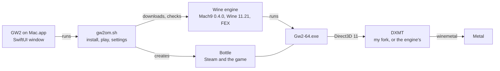
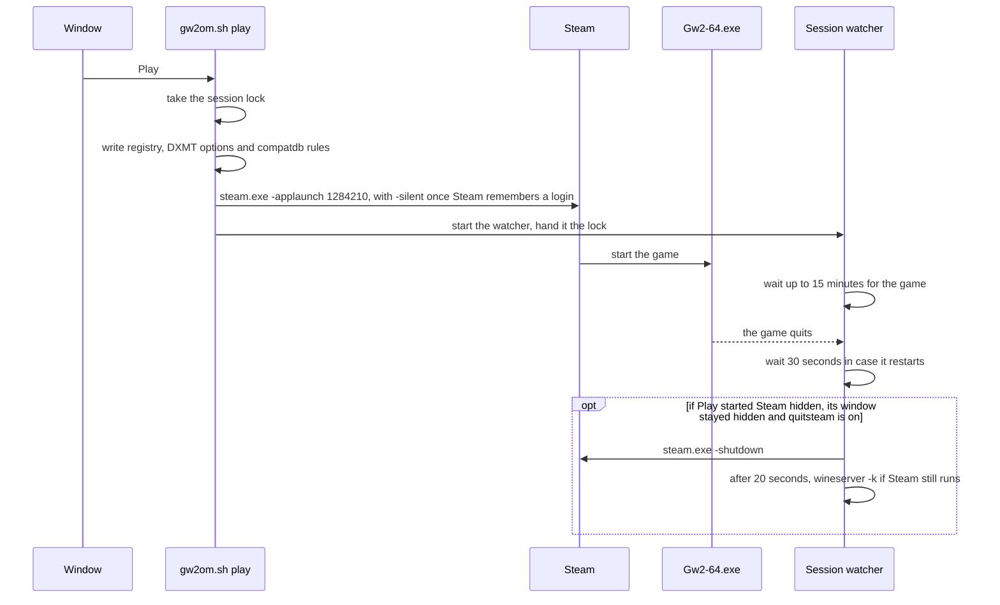
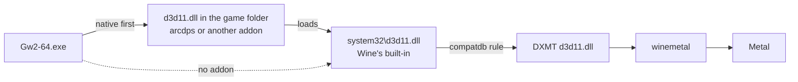

# GW2 on Mac

GW2 on Mac is a small macOS app I wrote to play [Guild Wars 2](https://www.guildwars2.com) on
Apple silicon. It installs the game into a Wine engine and bottle of its own and starts it. The
engine is athei's [Mach9](https://github.com/athei/mach9) 0.4.0, an arm64 Wine 11.21 that runs the
game's x86_64 code with FEX, used as it ships but for three parts: the game's Direct3D 11 goes to
Metal through my DXMT fork, built for this engine, which the app puts into the engine's DXMT tree,
and every Wine process loads my builds of Wine's `ntdll.so` and of its Mac driver, `winemac.so`,
which have switches for the game. The engine's own DXMT, `ntdll.so` and `winemac.so` stay next to
them, and a setting switches back to each. A build can also carry my build of FEX, which goes in
only when I choose it from Terminal. It changes nothing you already have installed.

0.2 is GW2 on Mac without Rosetta. 0.1.x ran CrossOver 26.3's Wine under Rosetta, and 0.1.x
installs update to 0.2, which keeps its own folders, named *GW2 on Mac arm64*, and moves 0.1.x's
install into them at its first start ([Moving from GW2 on Mac 0.1](#moving-from-gw2-on-mac-01),
ADR 0018).

Website: [gw2onmac.com](https://gw2onmac.com). Download: the
[latest release](https://github.com/jdrly/gw2-on-mac/releases/latest).

> **GW2 on Mac is an unofficial fan project.** ArenaNet and NCSOFT don't make, endorse or support
> it. ArenaNet doesn't support third-party tools or compatibility layers, so you use it at your
> own risk.
>
> **It doesn't host or change the game.** Steam comes from Valve, and the game comes from Steam or
> ArenaNet. The app only provides the layer the game runs on, which is Wine plus DXMT for
> Direct3D 11 on Metal. CrossOver and Proton are the same kind of software. One optional addon is the exception.
> *Larger interface* changes the game's memory for a sharper interface at 4K. It is off by default
> and asks before it goes in. The *arcdps* switch downloads deltaconnected's arcdps from
> deltaconnected.com. It is also off by default and asks first, and I don't host or change arcdps.
> The *ReShade* switch works the same way with crosire's ReShade from reshade.me.
>
> **I do all the support for GW2 on Mac.** I'm Pharaphobia on
> [Discord](https://discord.gg/AnV3fZWz2b), or you can open a
> [GitHub issue](https://github.com/jdrly/gw2-on-mac/issues). Please don't send logs or bug reports
> about GW2 on Mac to ArenaNet's support.
>
> Guild Wars 2 is a trademark of NCSOFT Corporation. Steam is a trademark of Valve Corporation.
> Mac is a trademark of Apple Inc.

The README has three parts. [For players](#for-players) covers installing, playing and getting
help. [How it works](#how-it-works) explains the engine, Play and updates. [Development](#development)
is for building, testing and releasing the app.

# For players

## What you need

- A Mac with Apple silicon and macOS 26.4 or later. The engine's loader needs 26.4, and the install
  refuses to start on an earlier macOS, naming both versions. On macOS 26.0 to 26.3, GW2 on Mac
  0.1.x offers no update and stays as it is.
- No Rosetta. Wine, its Mac driver and DXMT run as arm64 code, and FEX runs the game's and Steam's
  x86_64 code inside Wine.
- About 75 GB of free space for the game, plus about 3 GB for the engine and Steam. The install
  refuses to start under 3 GB and warns under 75 GB.
- Guild Wars 2 on Steam, or an ArenaNet account.

The app comes as a signed and notarized DMG on the
[releases page](https://github.com/jdrly/gw2-on-mac/releases/latest). Drag it to Applications and
open it.

## Installing the game

The window offers three ways in. Pick one and its card opens. The *This Mac* panel checks macOS,
the engine, the graphics, Game Mode, the game and the free space. A check whose text is too long
for one line, such as the engine's while a switch waits for the next Play, goes on to the next
line, between two of its parts where it can, and its row grows with it.

**Steam.** The app downloads the engine, creates the bottle, installs Steam from Valve's CDN and
opens Steam's install page for Guild Wars 2. You sign in to Steam and the download starts. Your
login stays in Steam. The window follows the download and finishes the setup on its own when
Steam reports the game complete.

**ArenaNet's installer.** Download `Gw2Setup-64.exe` from ArenaNet's site and drop it into the
window. Before it changes anything, the app checks that the file is ArenaNet's, with a valid
signature over this exact file. Then the engine and bottle go in and the installer runs. The
installer leaves no record of when it's done, so the app treats the game as installed once
`Gw2.dat` is larger than 1 GB and neither the installer nor `Gw2-64.exe` is running.

**Game files I already have.** If you already play in GW2 on Mac 0.1, CrossOver, Whisky or an app
wrapper, the app can take that copy of the game instead of downloading 75 GB again. It looks in
these places:

- GW2 on Mac 0.1's bottle in `~/Library/Application Support/GW2 on Mac/bottle`, listed as
  `GW2 on Mac 0.1`
- CrossOver's bottles in `~/Library/Application Support/CrossOver/Bottles`
- Whisky's bottles in `~/Library/Containers/com.isaacmarovitz.Whisky/Bottles` and
  `…/Data/Bottles`, named from each bottle's `Metadata.plist`
- app wrappers in `~/Applications` and `/Applications`, such as Sikarugir, Kegworks, Wineskin or
  Porting Kit
- Heroic's prefixes in `~/Games/Heroic/Prefixes`, and `~/.wine`
- GameHub's folders in `~/Library/Application Support` and `~/Library/Containers`, a few levels
  deep, because GameHub doesn't document where it keeps its bottles

Inside each bottle it checks Steam's library and ArenaNet's default folder. A folder counts when it
has `Gw2-64.exe` and a `Gw2.dat` larger than 1 GB. The list shows the source app, the path, the
size, and the route. That's Steam if Steam's `appmanifest_1284210.acf` sits next to the game, and
ArenaNet otherwise. If your copy is somewhere else, use *Choose folder…* or drop the folder on the card. A
game folder works, and so does a bottle or wrapper app with the game in it.

On the same disk the app clones the files with APFS. That takes a moment and no extra space until
one of the copies changes. From another disk it copies them, after checking there's room for their
size plus 1 GB. Either way it only reads your original. My own addon files are left behind. So is
arcdps, as `d3d11.dll` or `dxgi.dll`, because addons aren't cleared for this engine yet, and any
other program's `d3d11.dll`, and a ReShade and the `ReShade.ini` next to `Gw2-64.exe`: turn ReShade
on in Settings instead. The summary says what stayed behind. Any other addon, such as an
`addons` folder, comes along as it is, and the summary names it. DXMT's caches stay behind too:
they live in the other app's cache folder, never in the game's. *Also bring my game settings* is on by default and brings `GFXSettings.Gw2-64.exe.xml`
and `Local.dat`, which holds your options and remembered login. If the new bottle already had
those files, the old ones move to a `GW2 on Mac backup <date>` folder next to them. The import
refuses to run while Guild Wars 2 runs anywhere on the Mac, since its files could change during the
copy. On the Steam route, if Steam's record says the game is incomplete, the install runs Steam's
download step and Steam continues from the files. Otherwise Steam may still verify them at the
first Play.

If the first install fails or you cancel it, it removes the engine, the bottle, the settings and
the install state it created, and any game files it copied. Other files it made on the way can
stay, such as cached downloads, logs and `dxmt.conf`. You can quit
the app during a Steam or ArenaNet download. The window picks the download up again when you open
it, and *Stop waiting* stops following it but keeps the engine and the bottle.

## Moving from GW2 on Mac 0.1

When the app finds GW2 on Mac 0.1's install and has no install of its own, it moves that install
at its first start, by itself. The window shows the move's steps in place of the install choices.
The game itself moves: 0.1's Steam folder, or on ArenaNet's route its game folder, is renamed into
this app's bottle. A rename on the same disk is instant and takes no space, so the update never needs
room for a second copy of the game, not even for a moment. Of 0.1's folders it renames that one
folder and writes nothing else. 0.1 keeps its engine, its bottle without the game, its settings and
its ReShade folder.

- The move makes a new bottle with this engine. Its Windows user is `crossover`, as in 0.1's
  bottle: CrossOver's Wine names every user so, and Mach9's Wine takes the name from `USER`, which
  the app passes. With the same name the profile stays `C:\users\crossover`, and Wine's
  `CryptProtectData` derives the same key, so what a program protected in 0.1's bottle can be read
  in the new one. Every new bottle of this app gets that name. A bottle an earlier build made
  keeps the name it has.
- On Steam's route it installs Steam from Valve first, for Steam's registry entries, then renames
  0.1's whole Steam folder into its place: Steam with its remembered login, its config and
  `userdata`, and the library with the game. Then it clones the profile's `AppData\Local\Steam`.
  On ArenaNet's route it renames the game's folder.
- The game's settings folder, `AppData\Roaming\Guild Wars 2`, is cloned whole, so 0.1 keeps its
  copy.
- The addons come as they were in the game folder: arcdps as `d3d11.dll`, or at ReShade's chain
  path, with its settings; ReShade's `d3d11.dll`, `ReShade.ini` and compiler. Before the rename the
  app keeps a copy of these few files as 0.1 had them in `0.1-addons`, for a failed move and for
  *Rollback*. The ReShade folder with your presets and shaders is cloned into this app's folder,
  with the record of the compiler 0.1 placed. Both `ReShade.ini` files then name this app's folders instead of 0.1's: `BasePath`,
  the compiled effects' cache and any path you set by hand. The interface addon's files are
  written again from your settings, and the finishing touches put the addons in order, as at every
  Play.
- Your settings come over as the *From 0.1* column under [Settings](#settings) says.

A rename and a clone keep a link as a link, so every link in what the move brings must lead to a
file inside this app's folder. A link to a folder, into 0.1's folders or to a folder elsewhere that
0.1 uses too, such as a ReShade folder on an external drive, stops the move before anything writes
through it, and the folder is renamed back. *Start fresh* then installs anew.

The move never copies the game. If 0.1's Steam or game folder is on another disk than this app's
folder, or a link sits anywhere on the way to it or to this app's folder, as with a bottle you
linked to an external drive, the move refuses before it writes anything and says why. DXMT's shader caches and ReShade's compiled effects
don't come along. The game builds them again while you play.

The move waits while anything of 0.1 runs: its Steam, the game, ArenaNet's installer or 0.1's Wine.
The window says what it waits for, and the move starts once that has quit. A move that 0.1
interrupts, that fails or that you cancel puts back the addon files 0.1 had, renames the folder
back, then removes everything it created, and the app is not installed again. Once the move has
written its record it is done, and a cancel after that keeps it. *Try again* runs it once more, and
so does the next start of the app. From its first write the move keeps `move-undo`: the folder's
two places and its inode, and what the move makes. If the app is killed mid-move, the next start
finds the folder by its inode at either place and, unless the record says the move was done,
renames it back before anything else runs. It waits while Wine or the killed run's rename still
runs. Nothing the app removes, there or anywhere else, may hold the moved folder: before each
removal it looks for that inode inside, and if it finds it, or can't tell, it leaves the folder and
logs why. The rename itself is the kernel's `rename`, through macOS's `perl`, which fails rather
than copy to another volume or move into a folder that is there, as `mv` would. The whole move
holds the install lock, and from the rename's checks to the record the session's lock too, so no
Play starts in between.

Steam may ask you to sign in once in the new bottle. I haven't tested yet whether its remembered
login survives the move, so the first Play after it shows Steam's window, even with *Start Steam in
the background* on.

*Start fresh* in Settings › Troubleshooting installs anew instead. While the move waits or after it
failed, it stops the move. After a move it first gives the game back to 0.1, as *Rollback* does,
then removes the moved install as Uninstall does, and never another install. If the move's record
is missing, so it can't give the game back, it changes nothing. Either
way the move no longer starts by itself, and the install choices list 0.1's game under *Game files
I already have*. The app keeps that in `moved-from-0.1` in its folder (`moved` or `skipped`), which
Uninstall leaves, so uninstalling a moved install doesn't move 0.1's again.

The app moves an install when 0.1's folder has its manifest, a bottle and a complete game where
0.1's state says: in Steam's own library, or in the folder ArenaNet's route used. A game in
another Steam library isn't moved, and *Game files I already have* can still import it.

## Going back to 0.1.x

The game lives in this app's bottle after the move, so 0.1.x has none until it gets it back.
*Rollback to 0.1.4* in Settings › Troubleshooting does that. It refuses while the game or Steam
runs. It renames the Steam or game folder back to where 0.1.x had it, again with no copy, and puts
back the addon files 0.1.x had in the game folder: its `version.dll`, its `ReShade.ini` naming its
own ReShade folder, arcdps where it had it. Then a window offers 0.1.4's DMG, which the browser
downloads from the release. Quit this app, open the DMG and drag its GW2 on Mac to Applications over
this one. 0.1.4 finds its engine, bottle, settings and ReShade folder as they were on the day of the
move, with the game as 0.2 left it. The version and the link come from one line in `gw2om.sh`
(`LAST_01`), the last 0.1.x release.

This app keeps its engine and bottle without the game. Its main window says the game is in 0.1's
folder, and *Move it in again* renames it back in, as the move did. If you update from 0.1.4 to
this version again, that is the button to press.

- What you changed in the game's settings on 0.2 stays on 0.2: graphics settings, key binds, new
  ReShade presets. The game folder goes back as it is, so arcdps's settings in `addons\arcdps` go
  with it. Your characters and everything else on ArenaNet's servers are the same on both. The
  app's own preferences, such as *Quit GW2 on Mac after launching*, are shared by both, since both
  are the same app to macOS.
- The game goes back with every patch 0.2 got, so 0.1.x has nothing to download.
- On Steam's route, Steam's login in 0.1.x's bottle is as it was. Steam may still ask for it, if
  signing in from the new bottle ended the old session. I don't know whether it does.
- 0.1.4's automatic update checks offer 0.2.0 again. *Skip This Version* ends that. *Check for
  Updates…* still shows it.
- 0.2's folders, *GW2 on Mac arm64*, stay, without the game. Delete them by hand with the commands
  under [Uninstall](#uninstall) if you don't come back.

Uninstall in this app removes the bottle with the game in it, except after a move: the game there is
the only copy, so Uninstall refuses until *Rollback* has given it back.

0.1.x's folders are `GW2 on Mac` in `~/Library/Application Support`, `~/Library/Caches` and
`~/Library/Logs`, without "arm64". They stay until you delete them, and then the way back is gone:

```sh
rm -rf ~/Library/"Application Support/GW2 on Mac" ~/Library/Caches/"GW2 on Mac" ~/Library/Logs/"GW2 on Mac"
```

After a move the game isn't in them, so deleting them frees 0.1.x's engine, its bottle's own files
and its caches.

## Playing

Once the game is installed, the window shows *Play*, *Repair*, *Settings* and *Uninstall…*.

The first time, Steam shows its window so you can sign in. After Steam remembers your login, Play
starts it in the background without a window, and Steam signs in and starts the game.

While the game starts, the window shows the stages as they happen, with the time so far:

1. Starting Steam
2. Updating Steam, only when Steam updates itself
3. Signing in
4. Checking game files, only when Steam verifies or updates the game
5. Starting Guild Wars 2
6. Playing

On ArenaNet's route the stages begin at *Starting Guild Wars 2*, and the game's launcher takes over
from there. If Steam waits for you to sign in, *Show Steam* brings its window up, and after 2
minutes the window suggests it. Once the game is up, the window shows how long you've played and a
*Bring to Front* button. If you open the app while the game starts or runs, it picks the session up.

When the game quits, Steam quits too, after 30 seconds in case the patcher or a restart starts the
game again. It only does this for a Steam that Play started in the background. Steam stays open if
it was already running before Play, if its window showed, or if you brought it up with *Show Steam*.
*Quit Steam when the game quits* in Settings › Game turns this off.

Some details:

- Pressing Play while the game runs brings it to the front.
- Settings take effect the next time the game starts. If Steam still runs from an earlier start
  with other settings, Play asks you to quit Steam first, because the game inherits Steam's
  environment.
- If the game's own Frame Limiter is set while vertical sync is on, the window suggests
  *Unlimited* with vsync. *Don't show again* hides the tip. With *Vsync* off in Settings it doesn't
  show, since the steady 60 it promises comes from my DXMT fork's display sync.

**Repair** puts the engine, the bottle's settings and Steam back in place. It unpacks the engine
again when its files aren't the expected ones. It keeps the game and your settings. Use it when the
window says so.

## Settings

Open Settings with ⌘, or from the window. Each pane covers one area. The defaults are the mix I
play with. The settings with a key in the table also exist as `gw2om.sh set <key> <value>` for
scripting.

On this line some settings need pieces of mine that come in later steps. Settings greys them and
says why under each, `gw2om.sh set` refuses them with the same reason, and `settings.conf` keeps
their values, which do nothing here. `gw2om.sh settings` prints `<key>_state=ok` or
`<key>_state=off:<reason>` for every key.

A switch of my `ntdll.so` or my `winemac.so` is also greyed when the file in this app doesn't
have it, which the file's `VERSION` says with a line `switches: <variable> …`. A `VERSION` without
that line greys nothing.

`settings.conf` has a line `settings_version=`. Install and Repair write every key with its value,
so the file holds the defaults it was written with. When a default changes for the files that
exist, `SETTINGS_RESETS` in `gw2om.sh` names the key and a new version, and a file older than
that reads the key as its new default until the next write keeps it. Version 1 resets
`fastlocks` to `off`. Before it, the arm64 line wrote `on` into every file while its row was
greyed, so no file held a choice of mine. Version 2 resets `dxmt`, `wine` and `macdrv` to `fork`,
`mine` and `mine`, because their rows left Settings with it, and a bottle on the engine's own
files would have had no row to show it. A key `settings.conf` still has but the app no longer
knows, such as `coolworkers` or `gamemode` (whose row left in #269), is read by nothing and gone
at the next write.

A development build starts with every switch on, since I debug from everything on backwards. Once,
by a line `dev_version=` in `settings.conf` (`DEV_ROWS` in `gw2om.sh`, read the way
`SETTINGS_RESETS` is), it turns on *Job wakes*, *Event pool*, *Faster locks*, *Launcher frames*,
*Shader warming*, *MetalFX for Subsample*, *Raw mouse-look* and `fex=mine`, which takes effect in a
build that carries my FEX. A row I turn off afterwards stays off. The switches without a row are in
`dev-switches.conf` ([The game's environment](#the-games-environment)), which a release never reads.
A dev build and the release share the folders, so a release that finds the `dev_version=` line
reads those rows at their defaults, and its next write drops the line. A dev build after it turns them on
again.

Four keys have no row: `dxmt`, `wine` and `macdrv` pick my DXMT fork, my `ntdll.so` and my
`winemac.so` (`fork`, `mine`, `mine`) or the engine's own (`engine`), and `fex` picks my FEX
(`mine`) or the engine's own (`engine`, the default). They are for my comparisons from Terminal,
with `gw2om.sh set`. The rows that need one of my files are greyed while the engine's own is
chosen, and the main window's *Engine* and *Graphics* checks name the files in place.

| Pane | Setting | Key | Default | From 0.1 | What it does |
|---|---|---|---|---|---|
| Graphics | Retina | `retina` | on | kept | draws at your display's full resolution, at some cost in frame rate |
| | Frame cap | `fpscap` | off | kept | a steady cap paced by Metal at 30, 40, 60 or 120, for a display above 60 Hz or for a lower steady rate. With *Vsync* and the game's own Vertical Sync on, a cap at or above the display's refresh does nothing |
| | Vsync | `vsync` | on | new | my DXMT fork's display sync (`CAMetalLayer`'s vsync): Metal shows each frame on one of the display's refreshes. Off, the game's rule gets `DXMT_DISPLAY_SYNC=0`, and DXMT asks Metal for a minimum time between frames instead: one refresh, or the frame cap's interval. The row acts only while the game's own Vertical Sync is on, see [The game's environment](#the-games-environment). The frame-limiter tip shows only while the row is on. Greyed while the engine's own DXMT is chosen |
| | Metal | `metal` | 4 | new | Metal 3 or Metal 4 for my DXMT fork (`DXMT_METAL4=0` or `=1` in the game's rule; at Metal 4 with `DXMT_MTL4_PRESENT=mtl3` too, see [The game's environment](#the-games-environment)). Metal 4 is the newer path. Switch to Metal 3 for better backwards compatibility. A `settings.conf` without the key reads 4, and one with `metal=3` keeps it: Install and Repair wrote the key into every file while Metal 3 was the default. Greyed while the engine's own DXMT is chosen |
| | MetalFX for Subsample | `metalfx` | off | kept | MetalFX upscales the 3D scene and the interface stays sharp. It works only with the game's Render Sampling set to Subsample, and does nothing at Native. Greyed while the engine's own DXMT is chosen |
| | Metal HUD | `hud` | off | kept | Apple's overlay with frame rate and frame times, over the game only and not over Steam's windows |
| | Launcher frames | `launcherframes` | off | new | the launcher's window gets a copy of each frame, and a frame equal to the last is skipped (`WINE_MACDRV_SURFACE=copy,skip`). Against a launcher that flickers. Experimental. It stays off until I've looked at the launcher on three starts (#105). Greyed while the engine's own `winemac.so` is chosen |
| Performance | Shader warming | `warm` | on | kept | builds the pipelines the last sessions used before the game asks for them. Experimental, as my DXMT fork's table calls `DXMT_WARM`. Greyed while the engine's own DXMT is chosen |
| | CPUs the game sees | `ncpu` | 8 | kept | from 2 up to your Mac's logical CPUs, or all. The game starts one job worker per CPU, minus one |
| | Job wakes | `jobwakes` | on | new | a job the game hands out wakes one sleeping worker, and none when no worker sleeps (`WINE_HEAT_WAKE=one,skip`). Greyed while the engine's own `ntdll.so` is chosen |
| | Event pool | `eventpool` | on | new | closed events are kept and handed out again, without a request to the Wine server (`WINE_HEAT_EVPOOL=1`). Greyed while the engine's own `ntdll.so` is chosen |
| | Faster locks | `fastlocks` | off | reset to off | short spins before the game thread sleeps on a busy lock, a job group or an event (`WINE_HEAT_SPIN=lock=20:game,event=30:game`). Experimental. It stays off until a session of mine shows more hits than misses (#105). Greyed while the engine's own `ntdll.so` is chosen |
| Interface | Larger interface | `uiscale` | off | kept | my interface addon, see below |
| | Interface Size "Larger" | `uiscale_size` | 1.75 | kept | the addon's scale: 1.5, 1.75, 1.8 or 2.0 |
| | Small text in Cronos | `uiscale_sans` | on | kept | chat, the tracker and labels have no larger font, so the addon draws them in Cronos at the larger size |
| | Cinematic dialogue | `uiscale_cinema` | off | kept | story cinematics size their dialogue apart from the interface. This draws it at the same size, with a small code patch |
| | arcdps | `arcdps` | off | as it was | downloads or removes arcdps, see below |
| | ReShade | `reshade` | off | kept | downloads or removes ReShade, see below |
| Game | Start Steam in the background | `steambg` | on | kept | Steam starts without a window once it remembers your login |
| | Quit Steam when the game quits | `quitsteam` | on | kept | shown while the previous setting is on |
| | Launch options | `launchopts` | none | kept | arguments for `Gw2-64.exe`, using letters, digits and `-_.:=,/+` |
| | Quit GW2 on Mac after launching | | off | kept | the app quits once Play has started Steam or the game |
| Mouse | Raw mouse-look | `rawmouse` | on | kept | on, the game's raw input is the mouse's own counts from GameController; off, it is the pointer's movement, see below |
| | Mouse-look speed | `mousespeed` | 1× | kept | a factor on the mouse's own counts, from 0.5× to 3×, which my `winemac.so` applies before the game gets them (`WINE_MACDRV_MOUSE_SCALE`). The game's own camera settings apply on top. Greyed while *Raw mouse-look* is off, while the engine's own `winemac.so` is chosen, or while my file in this app doesn't have the switch |
| Updates | Check automatically | `updates` | on | kept | Sparkle checks for new versions. Off in development builds, which have no update feed |
| Troubleshooting | Debug logging | `debug` | off | kept | DXMT's log at `debug` and Wine's errors, for a bug report, at some cost in performance. With my `winemac.so`, also its `macsurface` lines for `Gw2-64.exe`. FEX's messages too, and with my `ntdll.so` FEX's counters. On in development builds |

*From 0.1* is what a move from GW2 on Mac 0.1 does with each setting (`SETTINGS_FROM_01` in
`gw2om.sh`). 0.1's `settings.conf` has no version line and writes every key, so a value there is
what 0.1 ran with, chosen or not. A kept key means the same here and keeps 0.1's value. A key 0.1's
file lacks, from a release older than the key, reads as 0.1's default: *Cinematic dialogue* was on
there and is off here. A value this version doesn't take, such as a CPU count above this Mac's,
reads as this version's default. *Faster locks* resets to off: on 0.1 it was a spin in CrossOver's
msync, here it is another port with its own default. 0.1's *Game Mode* has no row here, since the
engine's loader is a Game Mode app, and 0.1's *Cooler job workers* has none on this line
([ADR 0006](docs/adr/0006-0.2-has-no-cooler-job-workers.md)), so both are dropped. *Mouse-look speed* keeps its value, though here it scales the mouse's own
counts and on 0.1 the pointer's speed, so the camera may turn at another speed. Settings that are
new on this line start at their defaults. The move's summary names the ones that changed from
what 0.1 ran with.

### Raw mouse-look

On this engine the switch is Mach9's. Its Mac driver reads the mouse from GameController and
gives the game's raw input the mouse's own counts, summed until the game next reads its input,
without the pointer's acceleration and without the Retina factor. The engine does that for every
program by a built-in rule, so with the setting on the game's rule says nothing about the mouse.
With it off the rule gets `gcmouse=false`, and the game's raw input is the pointer's movement, as
Wine does it. The pointer keeps moving under the hidden cursor either way, and the game moves it
back. The rule is written at each game start, so the change needs no closed Steam, and the session
report names which mouse the game had. *Mouse-look speed* multiplies those counts in my
`winemac.so`, with 0.1.x's values. On 0.1.x it was a factor on the pointer's speed, so the same
value can turn the camera at another speed here.

### Larger interface

The game's largest Interface Size is still small on a 4K display. This addon makes the "Larger"
size larger, from the game's own sharp fonts, and draws small text in Cronos. It is my own code,
in [`addon/ui-scale`](addon/ui-scale), and goes into the game folder as `version.dll` with
`gw2-ui-scale.ini`. It is off by default and asks first, because it changes the game's memory
and patches one piece of its code for the cinematic dialogue. ArenaNet doesn't support that, and a
game update may break it.

The addon has one more setting with no switch in Settings. Wine gives the game's critical sections,
its usual lock, no spin, so a thread that finds one taken goes to sleep at once. `csspin=5` in the
game folder's `gw2-ui-scale.ini` makes them spin for 5 microseconds first. It's off (`csspin=0`) by
default and works only while *Larger interface* is on. Change it with the game closed. Repair, or a
change to the interface settings, writes the file again with `csspin=0`.

### arcdps

Settings › Interface has an *arcdps* switch, off by default. arcdps is deltaconnected's
third-party addon, and it reads the game's memory. ArenaNet, NCSOFT and I don't support it, so the
switch asks first, and you use it at your own risk.

- On downloads `d3d11.dll` and its `.md5sum` from deltaconnected.com, checks the file against that
  checksum and checks that it is arcdps. Then it goes next to `Gw2-64.exe` as `d3d11.dll`, or to
  `addons\arcdps\chain\d3d11.dll` while ReShade is on. From then on arcdps updates itself.
- Off removes arcdps from the game folder and keeps its settings in `addons/arcdps` for next time.
- An arcdps you put there yourself, or that came with your game files, shows as on.
- Another addon in the same place, such as the Nexus loader, is left alone, and the switch says
  which file it found.
- The switch only works while the game and Steam are closed.

Other addons that load as `d3d11.dll` or `dxgi.dll` next to `Gw2-64.exe` work too. The game loads
them first, and they pass its drawing on to DXMT. [How addons load](#how-addons-load) has the
details.

### ReShade

Settings › Interface has a *ReShade* switch under arcdps, off by default. ReShade is crosire's
post-processing program. It draws effects such as sharpening, colour correction or anti-aliasing
over the finished picture, and it has its own menu in the game. It isn't made or supported by
ArenaNet, NCSOFT or me, so the switch asks first, and you use it at your own risk.

ArenaNet's [third-party programs policy](https://help.guildwars2.com/hc/en-us/articles/360013625034-Policy-Third-Party-Programs)
says: "We do not permit the use of any program that gives one player an unintended, unnatural, or
unfair advantage over another player." It also says that "some utilities help players without
affecting others", that "in general, we will not take action on an account for the use of such a
utility program or modification", that this "is subject to ArenaNet's discretion", and "You use any
third-party program at your own risk." It ends with "ArenaNet does not review, approve, or endorse
any third-party program." The policy doesn't name ReShade.

What the switch does:

- On downloads ReShade 6.8.0's installer from reshade.me and checks it against the size and
  sha256 I pinned. The installer never runs. The app takes `ReShade64.dll` out of it, checks that
  file's sha256 too, and puts it next to `Gw2-64.exe` as `d3d11.dll`.
- ReShade needs Microsoft's shader compiler, `d3dcompiler_47.dll`, because Wine's own can't
  compile its effects. If the game has one with its Chromium in `bin64/cef`, the app copies that one
  next to `Gw2-64.exe`. Otherwise it downloads Microsoft's copy from
  [mozilla/fxc2](https://github.com/mozilla/fxc2), pinned by sha256 as well. A `d3dcompiler_47.dll`
  that is already next to `Gw2-64.exe` stays as it is.
- If you haven't added shaders of your own yet, turning ReShade on for the first time also
  downloads two effect packs from GitHub at fixed commits, the ones ReShade's own installer picks by
  default: crosire's standard effects and CeeJayDK's SweetFX.
- The third file in the game folder is a two-line `ReShade.ini` that points ReShade at its own
  folder.
- Off removes ReShade's `d3d11.dll`, that `ReShade.ini`, and the compiler if the app put it there.
  ReShade's folder stays.
- Play and Install put a missing file back from the app's cache. Repair also downloads what the
  cache lacks.
- A ReShade that GW2 on Mac didn't put there is left alone, and so are another program's
  `d3d11.dll` or `dxgi.dll`, such as the Nexus loader, and a `ReShade.ini` of its own. The switch
  says which file it found.
- The switch only works while the game and Steam are closed.

**Your files.** ReShade's settings, log, presets, shaders and screenshots are in one folder outside
the bottle, `~/Library/Application Support/GW2 on Mac arm64/ReShade`. *Open ReShade folder* in the row shows it in
Finder.

| In the ReShade folder | What |
|---|---|
| `ReShade.ini` | ReShade's settings. The app writes it once, and from then on it is ReShade's and yours, except two keys under `[PROXY]` while arcdps is on too |
| `ReShade.log` | ReShade's log |
| `Presets/` | your presets. `ReShadePreset.ini` is the one ReShade starts with |
| `Shaders/`, `Textures/` | the effects and the images they read, a folder for each pack |
| `Screenshots/` | ReShade's screenshots |

ReShade's compiled effects go to `~/Library/Caches/GW2 on Mac arm64/reshade`, and *Reset the shader
cache* empties that folder too. Turning ReShade off, Repair and Uninstall all leave the ReShade
folder where it is.

**The menu.** ReShade's menu key is Home. A MacBook has no Home key, and fn + Left Arrow sends it.
To use another key, change *Overlay key* in the menu's Settings tab, or, with the
game closed, `KeyOverlay` under `[INPUT]` in the ReShade folder's `ReShade.ini`. Its four numbers
are the key's Windows key code and then Ctrl, Shift and Alt, each 0 or 1. `KeyOverlay=36,0,0,0` is
Home, and `KeyOverlay=50,0,1,0` is Shift + 2.

**What doesn't work.** reshade.me has two builds of ReShade, and the app uses the signed one. When
that build sees high network activity, it turns its add-ons off, and the depth buffer comes from
one of them. Effects that read depth, such as ambient occlusion (MXAO) and depth of field, then get
no depth buffer, and ReShade's menu says "High network activity discovered. All add-ons are
disabled to prevent exploitation." Guild Wars 2 is an online game, and I haven't checked yet how
often that happens in it. The app doesn't offer the other build. Its installer opens with "This
build of ReShade is intended for singleplayer games only and may cause bans in multiplayer games."

**Presets and shaders.** Drop a preset (`.ini`), a zip or a folder on the Settings window, or pick
them with *Add preset or shaders…* in the ReShade row. That works with ReShade on or off, and while
the game runs. The files go into the ReShade folder, never into the game folder:

- A preset is an `.ini` with a `Techniques` line, which every ReShade preset has. It goes to
  `Presets`. A dropped `.ini` without one is refused, and one inside a zip or folder stays out.
- From a zip or a folder, the contents of every `Shaders` and `Textures` folder in it, at any
  depth, go to `Shaders/<name>` and `Textures/<name>`, named after the zip or folder. Loose `.fx`
  and `.fxh` files go to `Shaders/<name>`, loose images to `Textures/<name>`, presets to `Presets`.
- Nothing else comes in, so no `.dll`, `.addon64` or `.exe`. A link inside a dropped folder is left
  out. A zip with a link in it, or with a path that leads out of its folder, is refused, and so is a
  zip or folder that unpacks to more than 256 MB or has more than 10,000 files. A refusal adds
  nothing of that drop.
- A preset of the same name that is already in `Presets` stays, unless it came from a zip, folder or
  file of the same name before. The report says which ones stayed.

Afterwards the row says what went where, which effects the new presets use that aren't in
`Shaders`, and which of them look like effects that read the depth buffer (MXAO, depth of field,
RTGI, DisplayDepth), which get none while ReShade sees high network activity. When one preset
came in and the game is closed, the app asks whether ReShade should start with it. While the game
runs, pick it in ReShade's menu.

**arcdps and ReShade together.** Both switches can be on at once. Then ReShade is `d3d11.dll`, and
it loads arcdps itself from `addons\arcdps\chain\d3d11.dll` in the game folder. For that the app
sets two keys under `[PROXY]` in the ReShade folder's `ReShade.ini`, `EnableProxyLibrary=1` and
`ProxyLibrary` with that file's path, and changes nothing else in the file. Turning either addon
off turns `EnableProxyLibrary` off first, and turning ReShade off moves arcdps back to `d3d11.dll`.
Play checks before every start that the keys are on exactly while both files are there, and fixes
them if not. In `ReShade.log` the layout shows as "Registering hooks for
'C:\windows\system32\d3d11.dll' ... > Skipped." followed by "Installing export hooks for" arcdps's
file.

I haven't seen arcdps update itself in this layout yet. If its update replaces the game folder's
`d3d11.dll`, which is ReShade's, the next Play keeps the newer arcdps at the chain path and puts
ReShade back from the app's cache.

## Updates

The app updates itself with Sparkle. *Check for Updates…* is in the app menu, and with *Check
automatically* on it looks on its own. Releases come from this repository's GitHub releases.

Some updates bring new pieces for the engine, such as 0.1.1's Mac driver for raw mouse-look. Those
go in at your next Play, before Wine starts. You don't need Repair. If the app finds an engine file
it doesn't recognise, it leaves the file alone and *This Mac* says *needs Repair*.

## Logs and help

**Collect Logs…** is in the menu and in Settings › Troubleshooting. It puts a zip on your Desktop
with what I need for a bug report:

- my logs: `wine.log` and DXMT's `Gw2-64_d3d11.log`, each with the 4 sessions before, plus the
  newest heat logs, `session.env`, the settings and the state
- a session report
- the game's `ArenaNet.log` and `GFXSettings.Gw2-64.exe.xml`
- Steam's bootstrap, content, gameprocess and shader logs
- arcdps's `arcdps.log` and `arcdps_lastcrash.log`, and the crash dumps (`*.dmp`) of Steam's
  `dumps` folder, the game folder and the game's AppData folder, when they're from the last session
  or the last 24 hours. Dumps go in as they are, at most 10, 5 MB each and 10 MB together; one
  that's left out is named in `system-info.txt`
- the names, sizes and times of `d3d11.dll`, `dxgi.dll` and the files under `addons/arcdps` in
  the game folder
- from the ReShade folder, if there is one: `ReShade.log` (its last 5 MB), `ReShade.ini`, the
  current preset as `preset.ini` (only one inside the folder) and the names of the files under
  `Shaders`
- crash reports from the last 7 days, GPU errors from the last 2 hours, and `system-info.txt`
- while the game runs, `vmmap-<date>-<time>.txt`: how much memory the game uses and how full
  FEX's code buffers are, from macOS's `vmmap`. The game stands still while `vmmap` reads its
  memory, and the file's first line says for how long. Without a running game nothing of this
  happens.

`system-info.txt` and the session report also say whether ReShade and arcdps were in, ReShade's
version and file name, and the sha256 of the `d3dcompiler_47.dll` next to `Gw2-64.exe`.

On the way into the zip it removes account, persona and Mac names, Steam IDs, e-mail addresses,
home folders (also as Wine writes them, `Z:\Users\…`), tokens and the crash logs' machine, account
and address fields. `Local.dat`, Steam's
config and Steam's login and connection logs never go in. If a file still holds one of those after
redaction, the zip leaves it out and lists it in `left-out.txt`. arcdps's logs lose GW2 account
names (`Name.1234`) on the way in, but its crash log dumps the game's threads, modules and stack,
and a character name there can't be told from other text. A crash dump can't be redacted at all:
it goes in only when the leak check finds none of those names, no Steam ID and no user folder in
it, also in its UTF-16 text. Look through the zip before you post it anywhere public.

Send the zip with a short description to Pharaphobia on [Discord](https://discord.gg/AnV3fZWz2b),
or attach it to a [GitHub issue](https://github.com/jdrly/gw2-on-mac/issues). The *Discord* button
at the top of the window opens the server, and it's also the place for arcdps and addon
questions. Please don't send it
to ArenaNet's support.

## What it puts on your Mac

Everything the app creates is in these places. It adds no launch agents or login items, and puts
nothing in `/Applications` besides itself.

| Path | What | Uninstall |
|---|---|---|
| `~/Library/Application Support/GW2 on Mac arm64/engine/` | the Wine engine as it ships, without its SDK, about 1 GB, with my DXMT fork's tree in `lib/wine/dxgi/dxmt` and my `ntdll.so` and `winemac.so` (with `win32u.so` when my driver's build has one) in `lib/wine/aarch64-unix`, and after `set fex mine` my FEX's three files, the engine's own next to each | removed |
| `…/GW2 on Mac arm64/bottle/` | the game's Wine prefix with Steam, the game's files and the game's settings. About 75 GB, or no extra space for a clone of files on the same disk or a game moved from 0.1 | removed, with the game |
| `…/GW2 on Mac arm64/settings.conf`, `state`, `install-manifest.json`, `dxmt.conf`, `compatdb.rules`, `compatdb.local`, `dev-switches.conf`, `session`, `session.req`, `.session.lock`, `reshade-compiler` | settings, install state, what was installed, DXMT's options, the game's compatdb rules and my own, a development build's switches, the current game session and its lock, the sha256 of the compiler the app put next to `Gw2-64.exe` | removed |
| `…/GW2 on Mac arm64/ReShade/` | ReShade's settings, log, presets, shaders, textures and screenshots | kept |
| `…/GW2 on Mac arm64/moved-from-0.1` | `moved` once the move from GW2 on Mac 0.1 has run, with the renamed folder's two places, or `skipped` after *Start fresh*: either way the move doesn't start by itself again | kept |
| `…/GW2 on Mac arm64/0.1-addons/` | the addon files GW2 on Mac 0.1 had in the game folder on the day of the move, which *Rollback* puts back | removed |
| `…/GW2 on Mac arm64/move-undo` | only while the move, *Rollback* or *Move it in again* runs: what it made and renamed, so a run that is killed is undone at the next start | not there |
| `~/Library/Caches/GW2 on Mac arm64/downloads/` | the engine archive, `SteamSetup.exe`, a copy of `Gw2Setup-64.exe`, and in `reshade/` the checked `ReShade64.dll` and fxc2's compiler | removed |
| `~/Library/Caches/GW2 on Mac arm64/fork/dxmt/` | my DXMT fork's caches (`DXMT_CACHE_DIR`): `Gw2-64.exe/` holds the game's shaders, recorded pipelines and pipeline archives, and the other processes keep theirs next to it | removed. *Reset the shader cache* in Settings empties it too |
| `~/Library/Caches/GW2 on Mac arm64/dxmt/Gw2-64.exe/` | the engine's own DXMT's shader cache for the game, where 0.2.0-dev.1 kept it, apart from my fork's, which translates shaders differently. Other processes keep theirs where the engine's DXMT puts it by default | removed, and emptied by *Reset the shader cache* |
| `~/Library/Caches/GW2 on Mac arm64/reshade/` | ReShade's compiled effects | removed. *Reset the shader cache* empties it too |
| `~/Library/Logs/GW2 on Mac arm64/` | `install.log`, `wine.log`, DXMT's `Gw2-64_d3d11.log`, `session.env`, the heat logs, and `.lock-claim` for the install lock | kept |
| `~/Library/Application Support/GW2 on Mac/`, `~/Library/Caches/GW2 on Mac/`, `~/Library/Logs/GW2 on Mac/` | GW2 on Mac 0.1.x's folders, not this app's. The move renames their Steam or game folder into this app's bottle and writes nothing else of them, and *Rollback* renames it back. They are the way back ([Going back to 0.1.x](#going-back-to-01x)) | kept |

In the game folder, `version.dll` and `gw2-ui-scale.ini` exist only while *Larger interface* is on,
arcdps's `d3d11.dll`, or `addons\arcdps\chain\d3d11.dll` next to ReShade, only while *arcdps* is
on, and ReShade's
`d3d11.dll`, `ReShade.ini` and the `d3dcompiler_47.dll` the app put there only while *ReShade* is
on. The app never touches another program's `version.dll`, `d3d11.dll`, `dxgi.dll`,
`d3dcompiler_47.dll` or `ReShade.ini` there, with one exception: *Rollback* and a failed move put
back the files GW2 on Mac 0.1 had at those names, and remove the ones it didn't have. The app's own preferences, such as the chosen
route and the last Settings pane, live in the defaults domain `cz.jandrly.gw2onmac`, 0.1.x's. Other Wine
apps' bottles are only ever read. Of GW2 on Mac 0.1's folders the move renames the Steam or game
folder, and nothing else.

## Uninstall

*Uninstall…* in the window asks first and tells you the game's files go with the bottle. Close the
game and Steam before you run it. It removes everything in the table above except the logs, the
ReShade folder, the move's record and GW2 on Mac 0.1.x's folders, which it never touches. After a
move the game in the bottle is the only copy, so Uninstall refuses while a game is in the bottle,
until *Rollback* has given it back to 0.1.x. Every removal the app makes works the same way: a folder
with a `Gw2.dat` or `Gw2-64.exe` in it stays, and the log says why, unless the install never came
from a move and you asked to uninstall it. To do it by hand, after a move only once *Rollback* has
given the game back (check that `~/Library/Application Support/GW2 on Mac arm64/bottle` has no
`Gw2.dat` in it):

```sh
rm -rf ~/Library/"Application Support/GW2 on Mac arm64" ~/Library/Caches/"GW2 on Mac arm64"   # the ReShade folder too
rm -rf ~/Library/Logs/"GW2 on Mac arm64"      # the logs, if you want them gone too
```

Then move the app to the Bin. A Steam library you added outside the bottle, in Steam › Settings ›
Storage, stays where it is.

## Known limits

- My DXMT fork has no vkd3d-proton swap-chain bridge, so D3D12 programs can't present through it.
  Guild Wars 2, Steam and their CEF windows are D3D11. `gw2om.sh set dxmt engine` goes back to the
  engine's own DXMT, which has it.
- I've installed and played through the app since 2026-11-04, on the Steam route with my existing
  game files imported, and I now play on the published 0.1.1. A fresh Steam download and
  ArenaNet's installer haven't had a real install yet, so the Steam route's `StateFlags` check and
  the ArenaNet route's 1 GB rule are still unchecked against a real download.
- Raw mouse-look comes from SWTOR on Mac, where people have used it for a long time. In Guild
  Wars 2 this Mac driver build has had one in-game test so far, on 2026-11-08.
- I've played with arcdps on this engine, and it works. I haven't tested the Nexus loader.
- ReShade came over from 0.1.4, and I haven't run it in the game on this engine yet. Its
  `ReShade64.dll` is an x86_64 DLL, so it runs through FEX like the game. What I've tested is the
  app's side: the switch, the ReShade folder, the import, arcdps's renaming and Collect Logs, in a
  sandbox with stand-in files. The pins are the sha256 of the files reshade.me and mozilla/fxc2
  served when I checked them. Whether ReShade loads and draws on DXMT here, and whether arcdps
  loads next to it, is still open.
- While Steam verifies the game's files, *Checking game files* shows no percentage, because Steam's
  logs don't give one. A game update shows its progress.
- There's no Keyboard pane. SWTOR on Mac's game keys by keyboard position are in the Mac driver,
  but nothing turns them on. On QWERTZ layouts they swap Z and Y, and I haven't checked how Guild
  Wars 2 names keys in its bindings.
- DXMT's caches live in the app's own cache folder, so they aren't shared with another DXMT setup
  of the game on the same Mac. Caches an older build left in
  `$(getconf DARWIN_USER_CACHE_DIR)dxmt/Gw2-64.exe/` stay where they are, since another setup may
  use them. Your first sessions build the app's cache from scratch.
- Blish HUD isn't covered.
- For *Game files I already have*, GameHub's location is a guess. *Choose folder…* always works.

# How it works

## The pieces



The app is a SwiftUI window around one bash script, `gw2om.sh`, which runs under macOS's own
bash 3.2. The window calls it for everything: `status`, `install`, `play`, `settings`, `set`,
`repair`, `uninstall` and a few more, listed at the top of [`src/gw2om.sh`](src/gw2om.sh). The
script reports back in lines that start with `@`, such as `@phase`, `@progress` and `@error`.

The Wine engine is not in the app. It is athei's
[Mach9 0.4.0](https://github.com/athei/mach9/releases/tag/v0.4.0), the release asset
`wine-v0.4.0-macos-arm64.tar.xz`, built from Wine `athei/wine@501796b0ed1`, which is wine-11.21-54,
FEX `597e7ccbedd`, DXMT `athei/dxmt@10e27aed3f5` and the other components its release page lists. The script
downloads it at install time, pinned by size and sha256. The download resumes, retries and has a
second address through GitHub's API. `status`, the manifest and Collect Logs name the three
commits.

After unpacking, the script takes the quarantine attribute off the whole tree. An archive downloaded
in a browser and put into the downloads folder by hand carries it, and `tar` copies it onto every
file. The loader is notarized and would pass, the engine's ad hoc signed libraries would not. Then
it removes the SDK, which nothing reads at run time: `include/`, `lib/wine/tests/`,
`lib/wine/x86_64-windows/` and `share/man/`. Last it checks the build, which means the sha256 of the loader
`lib/wine/aarch64-unix/wine.app/Contents/MacOS/wine`, of `ntdll.so`, of `winemac.so`, of
`win32u.so` and of FEX's three files, and `codesign --verify --strict` on `wine.app` with Mach9's team `WLKUUJD25W`
and the identifier `app.mach9.loader`. That reads the signature and starts nothing.

The app writes nothing into the engine afterwards but its DXMT tree, `ntdll.so`, `winemac.so`,
`win32u.so` and FEX's three files, and nothing at all inside `wine.app`. The loader is signed with an embedded
provisioning profile, and a re-signed, edited or copied loader exits. The check of the engine's
`ntdll.so`, `winemac.so`, `win32u.so` and FEX files takes each where it is, in place or next to
mine as `<file>.engine`.

My files are built for one engine, and each `VERSION` in `components/` names it in a line
`engine: Mach9 v0.4.0 (wine-v0.4.0-macos-arm64.tar.xz, sha256 <the tarball's>)`. A `VERSION`
without that line counts as built for Mach9 0.3.1, the engine before 0.4.0. Files built for 0.3.1
don't run on 0.4.0: its wineserver speaks protocol 973, 0.3.1's 972. So none of my files go into
the engine while it is another one than the app's pin (its `.gw2om-source` names another tarball,
as an engine an earlier version of the app left does), or while a `VERSION` of mine names another
engine. The app then leaves the engine's files as they are and says why in an `@warn` that names
both engines. Repair puts the app's engine in place. `stage-components.sh` refuses such a build of
mine before it gets into the app at all.

An app update that moves the pin finds the engine of the release before it. That engine still
counts as installed (`installed=yes`, `engine_installed=old`), and the *Ready* panel's chip and
the Engine cell say "Repair to update". Play refuses and names Repair. Repair downloads the pinned
engine and replaces the old one, but not while Steam, the game or the bottle's Wine runs. A failed
download leaves the old engine in place, and the error says so
([ADR 0016](docs/adr/0016-an-engine-of-another-release-is-replaced-by-repair.md)).

### The DXMT tree

The engine's compatdb gives every process `lib/wine/dxgi/dxmt` as its DXGI tree (the built-in
`dxgi=dxmt` rule, and the pin on Steam's web helper), and Wine loads `winemetal.so` from that
tree's `aarch64-unix/`. A rule can't point the game at another tree, because the `dxgi` key knows
only `dxmt` and `wined3d`. So the app swaps the tree. The active one is always
`lib/wine/dxgi/dxmt`, and the other waits next to it:

- `dxmt.engine`: the engine's own, as it ships, moved aside and never changed
- `dxmt.fork`: a copy of the engine's tree with the files of `components/dxmt` over it, which are
  `d3d11`, `dxgi`, `d3d10core` and `winemetal` for `aarch64-windows` and `i386-windows`, plus
  `winemetal.so`, `VERSION` and the licence, marked with `.gw2om-dxmt`. In the engine's tree
  `aarch64-unix/winemetal.so` is a link to `lib/wine/aarch64-unix/winemetal.so`, the one
  `winemetal.so` that serves its ARM64X and its i386 DLLs. My copy replaces the link with my
  fork's own file and never writes through it, so the two DXMTs never share a `winemetal.so`, and
  the engine's comes back intact, link and file, when the setting switches to it. The copy has no
  quarantine attribute: a dev build downloaded in a browser carries it on every file of the app,
  `cp -p` copies it, and the script takes it off before the tree goes into place. A tree made
  quarantined by an earlier build keeps it until *Reinstall the engine* or an update with another
  build of my fork

Steam's processes get the same DXMT as the game, as on 0.1.x. My fork's `dxgi.dll` has no
vkd3d-proton swap-chain bridge, so a D3D12 program in that tree can't present. Guild Wars 2,
Steam and the CEF windows of Steam and the game's launcher are D3D11, so none of them needs it.
The `dxmt` setting picks the tree.
The swap is two renames, done only while no session runs or starts, under the session's lock:
at install, Repair, `set dxmt` and Play. While Steam runs, the change waits for the next start.
`status` prints `dxmt` (the setting), `dxmt_tree` (`fork`, `engine`, `oldfork` for an earlier
build of mine, `other`) and `graphics`: `yes` when the tree is the one asked for, `switch` when the
next start puts it in (after a change during a session, or an update of the app with another build
of my fork), and `other` when the tree is neither the engine's own nor mine. Repair then unpacks
the engine again and puts the asked-for tree in.
It also prints my fork's build in the app: `dxmt_version` (its `VERSION`'s first line, such as
`v0.80-489-g2483559`), `dxmt_release` (`0.80`) and `dxmt_commit`. The *This Mac* panel's Graphics
cell shows `DXMT 0.80 · 2483559 · Metal 3` for my fork, with the Metal the next start uses
(`status` prints it as `metal`), and `DXMT · d903db8`, athei's commit, for the engine's own. It
shows the Metal only when the tree is in place; otherwise it says `at the next Play` or
`needs Repair`.
To tell my fork's tree from an earlier build, the script compares every file of
`components/dxmt` (44 MB in `0.2.0-dev.3`) with the tree. Play and `status` do that once and
reuse the answer for the rest of the command, until a swap changes the tree.

### My ntdll.so

Wine has one `ntdll.so` for every process of the bottle, `lib/wine/aarch64-unix/ntdll.so`. My
build of it comes from my Wine fork [jdrly/wine](https://github.com/jdrly/wine), which starts at
the commit the engine was built from, and is in the app as `components/ntdll`. The app puts it in
place and moves the engine's own aside once, as `ntdll.so.engine`, only after its sha256 matched
the pin. Back to the engine's own is one rename. Like the DXMT tree, it switches only while no
session runs or starts, under the session's lock, at install, Repair, `set wine` and Play. Mine is
copied next to it first, so a switch cut short leaves one of the two files in place, or none
between the renames, and the next switch finishes it.

`status` prints `wine` (the setting), `wine_file` (`mine`, `engine`, `other` or `none`, the file
in place), `wine_commit` (its commit), `wine_release` (the Wine release my file is on, `11.21` from
its `VERSION`'s `wine-11.21-…`, empty for the others), `wine_build` (my build's commit in this app)
and `wine_ready`: `yes`, `switch` when the next start puts the asked-for file in, and `other` when
the engine's own is neither in place nor next to it. Repair then unpacks the engine again. The
*This Mac* panel's Engine cell shows `Wine 11.21 · d831f80` when my `ntdll.so` and `winemac.so`
from one build are in place, the engine's title with both of its own, and the engine's name with
the other file, such as `Mach9 0.4.0 · ntdll d831f80` or `Mach9 0.4.0 · another winemac`, when
only one is mine. A Mac driver set cut short shows as `winemac and win32u mixed`.

The app tells my file from the engine's by comparing it with `components/ntdll/ntdll.so`, not by
the fork's hash, because a release signed with my Developer ID changes the file's bytes. The
engine's loader has library validation off, so it loads the file either way. `Resources/VERSIONS`
names the file's sha256 as built, and `session.env` the sha256 of the file in the engine.

A build of the app without my file has no `components/ntdll`. It leaves the engine's own in place,
and greys the switches that need my file.

The code is written for more than one file: `unix_lib` in `gw2om.sh` has one row per file, with its
setting, its folder in `components/` and the engine's pinned sha256. The second row is my Mac
driver's.

### My winemac.so

Wine's Mac driver, `lib/wine/aarch64-unix/winemac.so`, draws every window of the bottle: Steam's,
its web helper's, the game's launcher and the game. My build of it comes from the same fork and
commit line as my `ntdll.so` and is in the app as `components/macdrv`. The app installs it the same
way, with its own setting, `macdrv`, so I can take my driver out and keep my `ntdll.so`, or the
other way round. The engine's own goes aside as `winemac.so.engine`, and the pin is its sha256,
`19c5ff04…`. `status` prints `macdrv`, `macdrv_ready`, `macdrv_file`, `macdrv_commit`,
`macdrv_release` and `macdrv_build`, and the *This Mac* panel counts my driver in with my
`ntdll.so`.

Its switches are `WINE_MACDRV_*` entries of the game's rule. My driver reads them once in each
process, and the engine's own ignores them. They reach `Gw2-64.exe` only, which is the launcher too,
so Steam's windows run my file with every switch unset. With `macdrv` at `engine` the app writes
none of them and greys the rows that need them. Today that is *Launcher frames*.

A build of the app without my file has no `components/macdrv`. It leaves the engine's own in place,
and greys *Launcher frames*.

My Wine fork's archive for the driver also holds my `win32u.so` when that commit changed a function
of it. `win32u.so` is the layer every process that draws or handles input calls, and it calls into
the driver, so the two come from one tree and must never load from two builds. The app installs
them as one set under the same setting: both mine or both the engine's own. The engine's own
`win32u.so` goes aside as `win32u.so.engine`, pinned by its sha256, `1ac94b07…` (2,370,696
bytes). A switch copies my files next to theirs first and then renames file by file, so a switch
cut short leaves a mix: `macdrv_file=mix`, which the next switch finishes and Play never starts
on. While Steam still runs, Play says to quit it. When one of the engine's own files is gone,
`macdrv_ready=other`, Play refuses and Repair unpacks the engine again. `status` also prints
`win32u_bundled` (`yes` when this app's build has one) and `win32u_file` (the engine's
`win32u.so` now: `mine`, `engine`, `other` or `none`). A driver build without `win32u.so`
installs `winemac.so` alone and puts the engine's own `win32u.so` back if an earlier build of
mine left its own there. Its switches are `WINE_WIN32U_*` entries, gated by the same `switches:`
line of the driver's `VERSION`.

### My FEX

FEX runs every instruction of the game. Its x86_64 half is three files of the engine:
`lib/wine/aarch64-windows/xtajit64.dll`, the name Wine loads for an x86_64 process,
`libarm64ecfex.dll`, the same file under FEX's own name, and `lib/wine/aarch64-unix/libarm64ecfex.so`,
which the DLL loads by name and calls by index, so the two have to come from one build. My build of
them comes from my FEX fork, jdrly/FEX, and is in the app as `components/fex`: the DLL once, which
the app puts in under both names, and the `.so`. The i386 half, `xtajit.dll`, which Steam's
processes use, stays the engine's.

The setting `fex` starts at `engine`: my FEX goes in only after `gw2om.sh set fex mine` from
Terminal, and `gw2om.sh set fex engine` takes it out again. There is no row in the Settings window.
The swap works as for my `ntdll.so`, while no session runs or starts: each of the engine's own
files goes aside as `<file>.engine` once, and only when its sha256 is the pin's, `cd6803d9…` for
both DLL names and `0a3e7ea4…` for the `.so`. Three files in two folders can't change in one step,
so the switch copies all three of mine next to theirs first and then renames them back to back.
Back to the engine's own is three renames. A switch cut short leaves a mix of mine and the
engine's, which the next switch or Play finishes, saying so in the log. Play never starts on a mix:
if one is still there, or a file is neither mine nor the engine's, it refuses and says to Repair.
Repair unpacks the engine again when one of the engine's own FEX files is neither in place nor
next to mine.

`status` prints `fex` (the setting), `fex_file` (`mine` or `engine` when all three files are,
`mix`, or `other` when one is neither), `fex_commit`, `fex_build` (my build's commit in this app)
and `fex_ready` (`yes`, `switch` or `other`, as for `wine_ready`). The *This Mac* panel's Engine
cell adds `· FEX bff3f7c` while my FEX is in place. `session.env` gets `LIB_fex`: `mine <commit>
<sha256 of xtajit64.dll>` or `engine`, and the session report prints which FEX ran.

FEX's options are `FEX_*` variables, and a rule's `env=` sets them for the game. The table
`FEX_SWITCHES` in `gw2om.sh` has one row per setting, `<key> <entry> <needs>`, where `<needs>` is
`fork` for an option only my FEX has and `any` for one the engine's FEX has too. An entry goes into
the game's rule while its setting isn't off and, for `fork`, while my FEX is in place and its
`VERSION`'s `switches:` line names the variable. A setting whose FEX is missing is greyed with the
reason, and `set` refuses it. The table is empty: each switch of mine adds its row.

A build of the app without my FEX has no `components/fex`. `set fex mine` is refused with "This
build carries no FEX of mine", and the engine's files are never touched.

## Installing, step by step

`gw2om.sh install <route>` runs five phases. A failed or cancelled first install removes what that
run tracked as created: the engine, the bottle, `settings.conf`, `state`, `install-manifest.json`,
and an import's copied game folder with Steam's record. Other files it made can stay, such as
cached downloads, logs and `dxmt.conf`.

1. **The engine.** Check macOS, download, unpack, take the quarantine off, remove the SDK, check
   the build, then put my DXMT fork into its DXMT tree and my `ntdll.so` and `winemac.so` in
   place, as above.
2. **The bottle.** `wineboot`, then `settings.conf`, `dxmt.conf` and three values in `user.reg`:
   `RetinaMode` under `Software\Wine\Mac Driver`, `EmulateModeset=N` under
   `Software\Wine\X11 Driver` and `ShowCrashDialog=dword:0` under `Software\Wine\WineDbg`.
   Mach9's own launcher writes `EmulateModeset=Y`. 0.1.x never writes it, and I write `N`, so a
   bottle with `Y` from an earlier 0.2 build gets `N` at its next start without a running session
   ([#90](https://github.com/jdrly/gw2-on-mac/issues/90)). With `Y`, moving the cursor made the
   frame interval saw between 16.7 and 33 ms, where 0.1.x stays at 16.7. Wine fakes the game's
   mode set and drops its gamma ramp, so macOS flips the game's frames straight to the display,
   and each cursor update holds a frame back by a refresh. The game's Gamma slider did nothing
   either. A value I set under `AppDefaults` for `Gw2-64.exe` stays as it is.
3. **Steam or ArenaNet's installer.** Steam's `SteamSetup.exe` comes from Valve's CDN and runs with
   `/S`. ArenaNet's installer goes through `gw2om.sh check-setup` first, which uses only macOS's
   `/usr/bin/openssl`. The file must be a PE x86_64 executable. Its Authenticode signature must be
   valid, with the message digest covering the SpcIndirectData content. The signed PE hash must
   match the file, recomputed. The signer's certificate must be ArenaNet's. The chain up to
   Windows' root certificates isn't checked, because macOS doesn't have them.
4. **The game's download.** Steam opens `steam://install/1284210`, or ArenaNet's installer starts.
   The command ends with `stage=waiting_game` and the window follows the download. For Steam it
   reads `BytesDownloaded` and `BytesToDownload` in `appmanifest_1284210.acf` and waits for
   `StateFlags` 4. For ArenaNet it waits for the 1 GB `Gw2.dat` rule.
5. **Finishing touches.** `gw2om.sh finish` creates DXMT's cache folder, puts the interface addon
   in if it's on, writes the registry settings, records `stage=finished`, and the window shows
   Ready.

An import, `gw2om.sh install import <folder> [--no-settings]`, runs the engine and bottle phases,
then Steam on the Steam route, then places the folder in the bottle's
`steamapps/common/Guild Wars 2` with Steam's record, or in `Program Files/Guild Wars 2` for
ArenaNet. `gw2om.sh scan` finds the installs and `gw2om.sh check-game <dir>` checks one folder.
Both only read.

A move, `gw2om.sh install move`, runs the same phases from 0.1's install
([Moving from GW2 on Mac 0.1](#moving-from-gw2-on-mac-01)). Before the bottle it writes
`settings.conf` from 0.1's, and on Steam's route 0.1's Steam folder, renamed, replaces the one
Valve's installer made. It refuses while 0.1's Wine runs, and checks again before the rename,
before each folder it clones and after the last. A failed or cancelled move also removes the ReShade folder and
`reshade-compiler` it brought, `dxmt.conf` and `.session.lock`, so the app's folder is as empty as
before. `gw2om.sh status` prints `old_install`, `move` (yes when the window should start it),
`move_record`, `move_route`, `move_busy` and `move_wait`. `gw2om.sh start-fresh` is
Troubleshooting's *Start fresh*.

## The game's environment

The install's own Wine calls, `wineboot` and Valve's Steam installer, get `USER`, `WINEPREFIX`,
`WINEDEBUG=-all`, `WINEMSYNC=1` and `WINEDLLOVERRIDES=winemenubuilder.exe=d`, and nothing else of
the app's. `USER` is the bottle's Windows user, the name of its folder in `drive_c/users`, or
`crossover` for a new bottle: Mach9's Wine names the user after it
([ADR 0019](docs/adr/0019-0.1.x-moves-into-a-new-bottle-at-the-first-start.md)). If the app inherited `WINE_COMPATDB`, `WINE_COMPATDB_FILE`, `WINE_LARGE_ADDRESS_AWARE`
or `WINE_PROF_SERVICE`, they are removed from every Wine start, because each changes what the
engine does for every process. The engine's built-in rules already give each process DXMT, leave
Gecko out, keep `rundll32.exe` from offering to install Mono, and set Steam's web helper up.

`settings.conf` holds the settings. Every start turns them into three things: the environment of
the session's first process, `dxmt.conf`, and the game's compatdb rules. `gw2om.sh env` and
`gw2om.sh rules` print what Play would use.

The environment is fixed while Steam runs, because Steam passes its own on to the game. It holds
`USER`, `WINEPREFIX`, `WINEDEBUG=-all`, `WINEDLLOVERRIDES=winemenubuilder.exe=d`, `WINEMSYNC=1`,
`DXMT_CONFIG_FILE`, `DXMT_LOG_PATH`, `WINE_COMPATDB_FILE`, and `WINENCPU` unless the game sees every
CPU. Debug logging adds `DXMT_LOG_LEVEL=debug` and sets `WINEDEBUG=err+all,fixme-all`, with
`,Gw2-64.exe:+macsurface` while my `winemac.so` is in place: my driver's channel, in the launcher
and the game only.

With my DXMT fork in the engine, it also gets what the fork reads (its `docs/gw2/README.md`):
`DXMT_CACHE_DIR` set to `~/Library/Caches/GW2 on Mac arm64/fork`, so the fork's caches stay in
its `dxmt/` and never in the per-user folder, 0.1.x's or the engine's DXMT's;
`DXMT_DEPENDENCY_COMPRESSION=1`; `DXMT_WARM=all` with shader warming on;
`DXMT_SUBSAMPLE_METALFX=1` with MetalFX on; and `DXMT_STATS=1` with Debug logging, which the fork
has on by default anyway. With the engine's own DXMT none of them is set, since it reads none.

`compatdb.rules` in the app's folder is the file `WINE_COMPATDB_FILE` names. Every Wine process
reads it when it starts, so a change reaches the next game start even while Steam runs. Play
writes it before it starts anything, to a temporary file that it then renames. The rules are in the
text Mach9's compatdb reads. With everything on and raw mouse-look off they are:

```text
exe=Gw2-64.exe;gcmouse=false;metal_hud=true;dll_overrides=d3d11,dxgi=n,b;dll_overrides=version=n,b;env=DXMT_SHADER_CACHE_PATH=<caches>/dxmt/Gw2-64.exe
exe=CefHost.exe;metal_hud=false;env=DXMT_SHADER_CACHE_PATH=
```

- `gcmouse=false` is there while raw mouse-look is off. It takes the game back from the engine's
  built-in rule, which reads the mouse from GameController in every process.
- `metal_hud` is there while the Metal HUD is on. The engine turns it into the `MTL_HUD_` variables
  in the game only. `CefHost.exe`, which the game starts for its launcher and the Trading Post,
  would inherit them, so its rule takes them away.
- `d3d11,dxgi=n,b` is there while a `d3d11.dll` or `dxgi.dll` is in the game folder, such as
  arcdps or Nexus. `version=n,b` is there while the larger interface is on. With no such file Wine
  loads its own.
- `DXMT_SHADER_CACHE_PATH` keeps DXMT's shader cache for the game in the app's cache folder, never
  in the per-user one another DXMT setup may use: `dxmt/Gw2-64.exe` for the engine's own DXMT, as
  in 0.2.0-dev.1, and `fork/dxmt/Gw2-64.exe` while my fork is active. My fork doesn't read the
  variable; it takes the same folder from `DXMT_CACHE_DIR`.
  `CefHost.exe` gets it removed.
- `DXMT_METAL4` follows it while my fork is active: `0` with the *Metal* row at Metal 3, `1` at
  Metal 4. The engine's own DXMT doesn't read it, so it stays out then. `CefHost.exe` gets it
  removed.
- `DXMT_MTL4_PRESENT=mtl3` follows at Metal 4, in release and development builds alike: my fork
  presents each frame through a Metal 3 command buffer and keeps the rest on Metal 4
  (jdrly/dxmt#227). On Metal 4's own present a moving cursor makes the frame interval saw between
  one and two refreshes (jdrly/dxmt#223), whatever the present's order, and this way it's flat. In
  my Lion's Arch laps Metal 4 with it ran about 58 fps median, against about 50.5 on Metal 3. It
  goes in only while my fork's tree in the engine names the switch, read from its DLLs as for
  `dev-switches.conf`'s DXMT lines below. Otherwise `status` prints the entry and why it stays out
  as `metal_present_out=`, and `metal_present=` when it's in. `CefHost.exe` gets it removed.
- `DXMT_DISPLAY_SYNC=0` follows while my fork is active and *Vsync* is off. My fork reads it in the
  game's process, once per swap chain (`d3d11_swapchain.cpp`), and its display sync is on without
  it. Display sync acts only on a present with a sync interval, which the game asks for while its
  own Vertical Sync is on. Then, with display sync on, a frame cap at or above the refresh rate
  does nothing, a cap that is a whole number of refreshes keeps a minimum duration, and any other
  is kept by a frame limiter (`DXMT_CAP_LIMITER`). With it off, a present asks Metal for a minimum
  presentation interval instead (`presentDrawable:afterMinimumDuration:`): one refresh without a
  cap, the cap's interval with one, so 120 on a 60 Hz display asks for 8.3 ms. Without a cap that
  needs DXMT to know the refresh rate; when it doesn't, there is no minimum. At interval 0 display
  sync is off either way, and a cap gives the same minimum interval. `CefHost.exe` gets it removed.
- The `WINE_HEAT_*` entries are my `ntdll.so`'s switches, which it acts on in `Gw2-64.exe` only.
  They follow the cache path, one `env=` field each, and only while my file is in place. The table
  `HEAT_SWITCHES` in `gw2om.sh` has one row per setting, `<key> <entry>`: *Job wakes* writes
  `WINE_HEAT_WAKE=one,skip`, *Event pool* `WINE_HEAT_EVPOOL=1` and *Faster locks*
  `WINE_HEAT_SPIN=lock=20:game,event=30:game`. My file unregisters a wait that found its object
  signaled without a switch (#104), so the rule has no `WINE_HEAT_MSYNC_UNREG`. An older file of
  mine that still reads it runs with the unregister off, as the engine's own does.
  `WINE_HEAT_PROF_FEX=<build id>:<age>:<SizeOfImage>` tells my file's sampler which FEX it may read: it goes in while my FEX is in place too, with the
  values its `VERSION` gives for `libarm64ecfex.dll`, since a build id can't say that a FEX is mine
  and the app, which installed it, can. It needs my file's `switches:` line to name it; a file
  without the line doesn't get it. Any other entry whose variable the file's `VERSION`
  doesn't list on its `switches:` line stays out. Debug logging adds `WINE_HEAT_COUNT=1` and
  `WINE_HEAT_LOG` with the logs folder, where my file writes `heat-<pid>.log` every 5 seconds,
  and `FEX_PROFILESTATS=1`, which makes FEX keep its counters per thread for my file to read.
  They cost FEX a timer read at the start and end of each compile and each locked lookup, which
  is why they ride on Debug logging. Debug logging also adds `FEX_SILENTLOG=0` with either
  `ntdll.so`, so FEX's own messages go to `wine.log`. That is more than the line about hardware
  TSO the report looks for. FEX's debug messages are compiled into the engine's build, so FEX then
  writes a line for every exception it handles, and one for each piece of self-modifying code and
  each unaligned atomic it handles. It writes each line the moment it happens, on the thread
  that hit it. A session with many of them gets a longer `wine.log` and may run slower. Nobody has
  measured that in the game yet. The session report prints FEX's line count and lines a second,
  so one session with Debug logging shows it.
  `CefHost.exe`'s rule unsets each of them again with an empty value.
- The `WINE_MACDRV_*` entries are my `winemac.so`'s, rows of the same table. Each goes in only
  while my driver is in place, whatever `wine` says, and `CefHost.exe`'s rule unsets it. *Launcher
  frames* writes `WINE_MACDRV_SURFACE=copy,skip`, after the `WINE_HEAT_*` switches and before the
  counters. The comma needs no escape. *Mouse-look speed* writes `WINE_MACDRV_MOUSE_SCALE` with
  its value after that, and nothing at 1 or while *Raw mouse-look* is off. An entry whose variable
  the driver's `VERSION` doesn't list on its `switches:` line stays out, as for my `ntdll.so`.
- The `FEX_*` entries are rows of `FEX_SWITCHES` ([My FEX](#my-fex)), after all of the above, and
  `CefHost.exe`'s rule unsets each. The table is empty today.
- In a development build, the lines of `dev-switches.conf` in the app's folder come next, one
  `env=` field each, and `CefHost.exe`'s rule unsets each. The file has one `NAME=value` a line,
  with a comment above it: the piece that reads it, its issue, and `played` or `unplayed` (whether
  a session of the game has run with it). A line I comment out or delete is off, and a line I add
  goes in as it is. Install, Repair and Play write the file from the table `DEV_SWITCHES` in
  `gw2om.sh` when its version is newer than the file's `version=` line: a switch the file doesn't
  name yet, not even commented out, is added at the end, on, and nothing else changes. The table
  has every switch of my forks that is off by default, at the value that turns its new behaviour
  on, apart from diagnostics, anything that can cap the frame rate below 60 (DXMT's lower thread
  priorities and `DXMT_BG_POLICY=occlusion` among them), values only I can choose and the rows'
  own variables. A DXMT line that acts on one Metal only, `DXMT_DRAIN_SPLITS` on Metal 3, stays in
  with the *Metal* row at the other, where it does nothing.
  `DXMT_MTL4_LAYER_SET` (jdrly/dxmt#226) stays out: I turn that one on by hand, never with
  another present switch, so a change in play has one cause. `DXMT_MTL4_PRESENT=mtl3` left the
  table at version 4, since the rule has it at Metal 4 now. Version 4 changes a file of an older
  version in one place: its `DXMT_MTL4_PRESENT=mtl3` line as the table wrote it goes, with its
  comment. A `DXMT_MTL4_PRESENT` line I changed, such as `=done`, stays and still wins: the file's
  lines come after the rule's entries. One I commented out to play Metal 4's own present becomes
  `DXMT_MTL4_PRESENT=mtl4` under a comment, so it stays off.
  Version 8 takes three lines out because my DXMT fork deletes their switches: `DXMT_PSO_ARCHIVE=1`
  and `DXMT_PSO_GENERATIONS=1` (with the archive on the game crashed at exit, and Metal's own
  shader cache already keeps what it saved) and `DXMT_PRESENT_QUEUE=pace` (it gave up at frame 181
  in every session). A line as the table wrote it goes with its comment. One I changed or commented
  out stays as it is, and does nothing once my DXMT fork's build no longer has the switch.
  Version 9 takes three more lines out, because my DXMT fork has their switches on by default now:
  `DXMT_MTL4_DEVICE_RESIDENCY=1`, `DXMT_MTL4_TIMESTAMP_REUSE=1` and `DXMT_MTL4_ALLOCATOR_POOL=1`. A
  line as the table wrote it goes with its comment. One I commented out becomes `NAME=0` under a
  comment, so it stays off.
  Version 10 adds four lines of my DXMT fork: `DXMT_PRESENT_SKIP_NIL=1` (jdrly/dxmt#324: a present
  whose layer gave no drawable is skipped), `DXMT_DRAIN_SPLITS=1` (jdrly/dxmt#316: teardown on
  Metal 3 also waits for the split-off command buffers), `DXMT_REFRESH_REQUERY=1` (jdrly/dxmt#314:
  the refresh rate is read again after exclusive fullscreen) and `DXMT_STEADY_SLEEP=1`
  (jdrly/dxmt#314: the frame limiter and the background throttle sleep on
  `QueryPerformanceCounter`). It takes `DXMT_MTL4_SHOWN_WAIT=write` out, because `write` is my DXMT
  fork's default now (jdrly/dxmt#332). That line as the table wrote it goes with its comment. One I
  commented out becomes `DXMT_MTL4_SHOWN_WAIT=next` under a comment, so it stays off.
  Version 11 takes `FEX_DISPATCHERL1LOOKUP=1` (#161) and `FEX_ENTRYHEADERLOOKUP=1` (#162) out,
  which version 5 added, because my FEX has both on by default now (#266). A line as the table
  wrote it goes with its comment. One I commented out becomes `NAME=0` under a comment, so it
  stays off.
  A row whose variable a line of the file sets, *Faster locks* with the file's
  `WINE_HEAT_SPIN`, is greyed while that line is there, since the file's entry wins. A line of the table goes in only while the file of mine that
  reads it is in place and has the switch: the `switches:` line of my `ntdll.so`'s,
  `winemac.so`'s or FEX's `VERSION` (a `VERSION` without that line names none). My `win32u.so`'s
  lines need it in place with my `winemac.so`, as one set. My DXMT fork's build has no such
  record: the app looks for the name in the DLLs of the fork's tree in the engine, where each
  switch it reads is a string. That tree can be an earlier build while Steam still runs with it.
  `FEX_DYNAMICL1CACHE` is FEX's own and goes in with either FEX. While the rule can start my
  `ntdll.so`'s sampler (`WINE_HEAT_PROF=on` or `=1`, or `WINE_HEAT_CONTROL`, whose file can say
  `prof=on` in a session, in a line of the file or of any rule of `compatdb.local`) and my
  FEX, whose `VERSION` names `FEX_ENTRYHEADERLOOKUP`, is in the engine, the game's rule ends with
  `FEX_ENTRYHEADERLOOKUP=0`, in a release too. A `compatdb.local` rule for `Gw2-64.exe` that sets
  it comes after the app's rule and wins; one for `exe=*` comes before it and doesn't. With that switch
  on, which my FEX's default is since #266, FEX no longer stores the block a thread entered last,
  which the sampler reads. A `FEX_ENTRYHEADERLOOKUP` line of the file stays out then. Version 6 adds
  `FEX_LEA32BITADDS=1`, `FEX_SIGNEXTENDINGLOADS=1` (#164), `FEX_ENTRYCOMPILELOCK=1` (#165),
  `FEX_HOSTFEATURES=disableavx` (#118) and `DXMT_RENAME_TRIM=600` (jdrly/dxmt#265). My FEX's
  `VERSION` names the last FEX one as `FEX_HOSTFEATURES=disableavx`, and the name is what counts.
  FEX reads `FEX_HOSTFEATURES` as a comma list, but in the rules a later entry for a variable
  replaces the earlier one. So the file's `FEX_HOSTFEATURES` lines go in as one entry, their items
  joined in order (`disableavx,enableafp`); of `enableavx` and `disableavx` the later one stays,
  since FEX refuses a value with both. A rule of `compatdb.local` for `Gw2-64.exe` that sets it
  comes after the app's and replaces that entry, and the app doesn't write that file. The file's
  `FEX_HOSTFEATURES` lines then stay out, and the reason names the value to write in
  `compatdb.local` for both. An update adds `disableavx` to a file whose own `FEX_HOSTFEATURES`
  lines say nothing about AVX. Version 7 added `DXMT_MTL4_SHOWN_WAIT=write` (jdrly/dxmt#271), and
  version 10 took it out again. It acts only at Metal 4, where the rule has `DXMT_MTL4_PRESENT=mtl3`: the Metal 4 queue waits for
  the last present's `shown` event only before the first encoder that writes the presented
  texture, not before the next frame's work, so a GPU frame over 16.7 ms needn't skip a refresh.
  The log says at each
  start what stays out and why, and `status` prints `dev_switches=` and `dev_switches_out=`.
- A `compatdb.local` that I put in the app's folder is appended as it is, for trying FEX switches
  such as `exe=Gw2-64.exe;env=FEX_HOSTFEATURES=disableavx`. Nothing in the app writes it, and
  Collect Logs includes it. It comes last, so a line of it wins over the app's: with
  `exe=Gw2-64.exe;env=DXMT_METAL4=0` in it, the game runs on Metal 3 whatever the *Metal* row says.

The engine's built-in rules already give every process DXMT, DPI awareness, raw mouse input from
GameController and FEX's reduced x87 precision. The `compatdb` check on GitHub's runners reads each
text the sandbox suite pins (`scripts/compatdb-check/rules`) with Mach9 0.4.0's `compatdb-core` and
checks that it writes back byte for byte.

A setting change that only changes the rules or `dxmt.conf` takes effect at the next game start.
One that changes the environment, the registry or the engine's files (`ncpu`, `debug`, `retina`,
`dxmt`, `wine`, `macdrv`, `fex`) waits until Steam has
quit.

The other settings:

| Key | Sets |
|---|---|
| `retina` | `RetinaMode` in the bottle's `user.reg` |
| `fpscap` | `d3d11.preferredMaxFrameRate` in `dxmt.conf` |
| `ncpu` | `WINENCPU`, bounded by `sysctl hw.logicalcpu` |
| `uiscale` | the addon files in the game folder |
| `uiscale_size`, `uiscale_sans`, `uiscale_cinema` | the addon's ini: `scale`, `sans=cronos` or `keep`, `cinema=1` |
| `reshade` | ReShade's files in the game folder; the game's compatdb rule gives `d3dcompiler_47` as `n,b` while a ReShade is there |

The script writes registry settings straight into the bottle's `user.reg`, as SWTOR on Mac does.
It only does that while no Wine session of the bottle runs or starts. The write takes the session's
lock, so if a game session holds it, the change waits for the next Play that finds the bottle idle.

## What Play does



`gw2om.sh play` runs `steam.exe -applaunch 1284210 <launch options>` on the Steam route, adding
`-silent` once Steam's `config/loginusers.vdf` has a user with `"RememberPassword" "1"`. On the
ArenaNet route it runs `Gw2-64.exe <launch options>`. It also writes `session.env` and rotates the
logs when no session runs. `session.env` records the engine and its Wine, FEX and DXMT commits, the
`ntdll.so` and `winemac.so` the session loads (`LIB_wine`, `LIB_macdrv`: mine or the engine's,
its commit and sha256), the FEX it loads (`LIB_fex`: `mine <commit> <sha256>` or `engine`), the
settings, the environment and the rules.

Play refuses while a `Gw2-64.exe` of another app runs, such as 0.1.x's or a Mach9.app's: one
account, one login. While this bottle's game runs, Play brings it to the front instead. Every Wine
process here runs as the engine's loader, `app.mach9.loader`, and so does Steam's, so the window
finds the game by the pid that `status` and `session-status` print as `game_pid`.

One session runs at a time. The session's lock is a kernel `flock` on `.session.lock`, taken by the
app's helper `helpers/sessionlock`. Play takes it before it writes registry settings, and passes it to the
watcher, `gw2om.sh watch-session`, which it starts detached so the window can quit. The lock ends
with the watcher, so nothing stale is left behind. After Play writes the first version of the
`session` file, the watcher is its only writer. Others append requests to `session.req`: `join` from
a second Play, `shown` from *Show Steam*. The watcher applies them in order.

The watcher follows the engine's own processes. It waits up to 15 minutes for `Gw2-64.exe`, since
Steam may update itself and ask for a sign-in first. When the game quits it waits 30 seconds. Then,
if this Play started Steam in the background, it runs `steam.exe -shutdown` through the engine with
the game's environment, and if Steam still runs 20 seconds later, `wineserver -k` for this bottle
only.

It leaves Steam alone when:

- Steam was running before Play
- Steam's window showed, before the first sign-in or with *Start Steam in the background* off
- *Quit Steam when the game quits* is off
- someone brought Steam's window up during the session
- the game never started, by the timeout or because Steam closed first

Play decides whether Steam belongs to the session by looking at the bottle's processes before it
starts Steam. The bottle's Steam only ever starts through Play, so a `steam.exe` that changes
without a request is Steam restarting itself after an update.

A second Play during a session joins it. That happens while Steam starts the game, or in the grace
after it quit. The second Play waits until the watcher has the request, and the watcher waits for
the game again. If no Steam ran before that Play, Steam counts as the session's. Once the watcher
has decided to quit Steam, or if it doesn't answer, Play starts nothing and asks you to try again in
a few seconds.

The `session` file's `stage` is one of `waiting_game`, `playing`, `grace`, `closing_steam` or
`done`, with a `result`. The watcher logs to `install.log` under `---- session`, and Uninstall stops
it.

### The start's stages

The window polls `gw2om.sh session-status` once a second while a session runs. It prints `stage`,
`detail`, `progress`, `elapsed`, `game_elapsed`, `steam`, `game`, `game_pid`, `closing`,
`quit_steam` and `limiter_hint`. The stages come from these signals:

| Stage | Detected by |
|---|---|
| Starting Steam | a start is under way and Steam hasn't signed in |
| Updating Steam | Steam's `logs/bootstrap_log.txt` verifies Steam's files, or downloads or installs an update, with its percent |
| Signing in | `steamwebhelper.exe` runs and `logs/connection_log.txt` shows no logon since the start |
| Checking game files | `logs/content_log.txt` has app 1284210 validating or updating. An update's percent comes from its appmanifest |
| Starting Guild Wars 2 | Steam has signed in, or `Gw2-64.exe` runs |
| Playing | DXMT's log for this session has the device (`Using feature level`). The engine's DXMT logs nothing per frame |

Only the session's lines count, meaning Steam's log lines from the session's start on, and only
their state lines. Nothing from them is printed, so no account name or ID leaves `session-status`. `status`
prints `session=live` while the watcher waits for the game, follows it, sits in the grace or
closes Steam, which is how the window picks a session up when it opens. A Steam idling on its own
doesn't count. A Play that joins a session restarts the stages with `session-status --since <time>`.

`gw2om.sh show-steam` runs `steam.exe steam://open/main` through the engine and sends the watcher a
`shown` request, so that Steam stays open after the game. If Steam is already quitting, the window
stays shut.

The frame-limiter tip reads `frameLimit` and `verticalSync` from the bottle's `GFXSettings.Gw2-64.exe.xml`
and never writes the file.

## Game Mode

macOS turns Game Mode on only for a process whose executable sits in a bundle with
`LSSupportsGameMode`. On this engine every Wine process runs as the loader in `wine.app`, whose
`Info.plist` carries `LSSupportsGameMode`, `GCSupportsGameMode` and the games category, so the app
builds nothing and has nothing to switch. `status` prints `gamemode=engine`, and the main window's
*Game Mode* check says so. Settings has no row for it since #269. Whether the game gets Game Mode
when Steam starts it, rather than Launch Services, is still to be seen in play.

## Raw mouse-look in the driver

Raw mouse-look is SWTOR on Mac's port of SWGL on Mac's two mouse patches. The stock driver moves
the real pointer for each of the game's re-centring `SetCursorPos` calls, and those moves reach the
game once per screen refresh. With `RawMouseWhenCursorHidden=y`, an input thread in the driver
reads GameController's `GCMouse` and sends the moves to the Wine server as relative motion while the
macOS pointer stays still. `GCMouse` reports the mouse's own counts, so the driver measures their
ratio to the pointer's moves while you turn, and sends them at that ratio times
`RawMouseGameControllerScale`. Until the first measurement, and for devices `GCMouse` doesn't
report, it sends the pointer's moves. The driver hides the pointer with a blank cursor image. Turning
the cursor off would drop the game out of direct presentation. The SWG-specific
`IgnoreStaleCursorWarps` stays off.

The same driver build carries SWTOR on Mac's game keys by keyboard position,
`winemac-physical-keys.patch` with its `PhysicalKeyboard` value. It does nothing unless the
registry turns it on, and this app never does.

## How addons load



While a `d3d11.dll` or `dxgi.dll` is next to `Gw2-64.exe`, the game's compatdb rule gives it `d3d11`
and `dxgi` as `n,b`, so that addon loads first. The addon then loads `system32\d3d11.dll`, Wine's built-in,
which the compatdb points at the DXMT tree. I checked the chain on 2026-11-08 with arcdps
1.2026.1023.2303. arcdps loaded system32's `d3d11.dll`, that loaded `winemetal.dll`, and a device
came up.
Without an addon the game gets the built-in directly. Steam and the launcher keep Wine's default
order.

`rundll32.exe` gets the same `d3d11` and `dxgi` as `n,b` while an addon's `d3d11.dll` or
`dxgi.dll` is in the game folder (arcdps, also at `addons/arcdps/chain/d3d11.dll`, a ReShade,
Nexus), and its rule goes when the last one does. arcdps does part of its work in `rundll32` with
its own DLL: its crash window (`c_exceptionerrormsg`) and very likely its update
(`c_closeandupdate`). In Wine's default order `rundll32` would load Wine's own `d3d11` in place of
that file, because arcdps's version information names no company (Wine's `version_heuristics`).
The entry point would then be missing, and after a crash the game would close without a word
(#155, #209).

arcdps updates itself, so the app can't recognise it by hash. A `d3d11.dll` or `dxgi.dll` next to
`Gw2-64.exe`, or `addons/arcdps/chain/d3d11.dll`, counts as
arcdps when it's a PE whose export directory lists `addextension2`, arcdps's extension API, and the
file names arcdps. Other addons may mention arcdps and look up its exports, but they don't export
them. `gw2om.sh set arcdps on|off` does the switching. It takes the session's lock like the registry
writes, so it refuses while a session runs. `status` and `settings` print `arcdps_state`, which is
`on`, `off`, `foreign` with the file in `arcdps_foreign`, or `nogame`, and `arcdps_dll`, where
arcdps is. `GW2_ON_MAC_ARCDPS_URL` points the download elsewhere for tests.

ReShade is the app's when the file is the pinned `ReShade64.dll`, by sha256. Any other DLL that
exports `ReShadeRegisterAddon` is a ReShade the app didn't place, and it stays as it is.
`gw2om.sh set reshade on|off` takes the same lock. `status` and `settings` print `reshade_state`
(`on`, `off`, `foreign`, `blocked` or `nogame`), `reshade_version`, `reshade_dll`,
`reshade_blocker`, `reshade_folder` and `addons_layout`. ReShade finds its folder through the
`ReShade.ini` next to `Gw2-64.exe`, whose `[INSTALL] BasePath` ReShade reads before anything else,
and loads `d3dcompiler_47.dll` by name, so `d3dcompiler_47` as `n,b` in the game's compatdb rule
makes it take the compiler next to the game. With both addons in, `addon_dll` gives ReShade `d3d11.dll` and arcdps
`addons/arcdps/chain/d3d11.dll`, and `proxy_sync` keeps ReShade's `[PROXY]` keys on exactly while
both files are in place. Next to ReShade, arcdps as `dxgi.dll` in the game folder didn't load in
my sessions, because `system32\dxgi.dll` was already loaded when ReShade started.

`GW2_ON_MAC_ADDONS_LAYOUT=exclusive` makes each switch refuse while the other addon is in.
`gw2om.sh reshade import <path>...` does the import, and `gw2om.sh reshade use
<preset>` makes a preset the one ReShade starts with. The `GW2_ON_MAC_RESHADE_*`,
`GW2_ON_MAC_COMPILER_*` and `GW2_ON_MAC_SWEETFX_URL` variables point the downloads elsewhere for
tests.

## Engine updates

The app puts only my DXMT fork into the engine. An app update with another build of it finds the
earlier one in the engine's tree (`graphics=switch`, `dxmt_tree=oldfork`), and the next Play or
Repair puts the new one in, made again from the engine's own tree. A new engine comes with new
pins in `gw2om.sh`, and Repair or *Reinstall the engine* unpacks it.

### The install lock

`.lock` holds its owner's pid and keeps installs, repairs, uninstalls and settings changes apart. Creating it, taking over one whose process is gone, and removing it all happen under
`.lock-claim`, a kernel lock taken through the same `sessionlock` helper. Only the owner removes
the lock. `.lock-claim` lives in the logs folder, which Uninstall keeps, so it's always the same
file. Each contender holds the claim only for those steps and releases it before anything else runs,
so Wine and Steam never inherit it. A contender waits up to 5 seconds for the claim, which
`GW2_ON_MAC_LOCK_WAIT` changes.

## Logs in depth

Collect Logs is SWTOR on Mac's `collect-logs.sh` adapted to this app's files, with the same
redaction, crash reports, unified-log GPU errors and leak check.

The session report, `Resources/session-report.sh [--keep] [--from S] [--to S] [log]` or `--compare A B`, sums up the
last session from DXMT's own log lines:

- when arcdps caught a crash that ended the session (its `arcdps_lastcrash.log` in the game
  folder is from after Play), one line with what it caught: the game's assertion, as `intercepted
  gw2 assertion "frameId", file "...\FrApi.cpp", line 2289`, or an exception with its code
- frame rate as median, 10th percentile and minimum, frame times, hitches and DXMT's share of them
- shader compiles and DXMT's encode thread's waits for them: how many, their total and the
  longest
- shader warming, presentation, and the Metal the session drew with, from `DXMT_METAL4` on my
  fork's first line: `Metal 3`, or for Metal 4 its commits and errors. The header names it too,
  and for Metal 4 the present that ran, from the `present=` field of the fork's `METAL4` lines:
  through a Metal 3 command buffer (`mtl3`), once the pass's commit completed (`done`), or Metal
  4's own (`mtl4`). A fork from before jdrly/dxmt#227 writes no such field.
- ReShade and arcdps as the session started, from `session.env`
- which `ntdll.so` ran and its switches, and with Debug logging the game thread's row of the
  session's heat log, a second. The game thread is the thread with the most semaphore releases: it
  hands the job workers their jobs, about 49,000 a second, and the workers make a few thousand
- the same thread's server requests from `heat-requests-<pid>.log`, which my `ntdll.so` writes
  next to the heat log: its twelve busiest requests by count with their time, and the
  `set_cursor`, `get_message`, `message` and `set_queue_mask` splits, as totals and a second. My
  dumper appends the game thread's block every 5 seconds and at exit, and the report sums the game thread's blocks that
  lie wholly inside the heat log's run, or inside `--from <s> --to <s>` (seconds since the game
  started). It says how many blocks it counted and the seconds they cover, so a block across an
  edge shows as missing time
- from a heat log whose rows end in the thread's start address and name (jdrly/gw2-on-mac#99):
  the game thread's counters a second and a frame, its timers (`lock_ms`, `wait_ms`, `wake_ms`,
  `alert_ms`, `server_ms`) as milliseconds a frame, and its lock and wait sleeps by length. For
  the whole run they come from the heat log's totals, which include loading, and the frames are
  DXMT's; with `--from` or `--to` they come from the game thread's blocks in the interval, and the
  frames are its `select` requests, since GW2 polls its socket once a frame. Also the job workers
  summed in one line, and the request tables of the two other threads the log follows, under their
  names and start addresses
- FEX's counters, from the `fex` lines my `ntdll.so` puts into the same blocks, for each thread
  that has them, the game thread first: the time spent compiling and the blocks compiled, lookup
  cache misses and the time on the cache's lock, writes to code pages (SMC) and signal time, in
  all; compile time and misses a second, as the median of the blocks and the highest one; and the
  compile bursts, each run of blocks where compiling took over 10% of the time, with its start,
  length and blocks compiled. A block without counters ends a burst. The first burst is the
  game's start. A later one of similar size is FEX throwing its code away, or a new map. Counters
  the report has no words for are summed under their own names. A thread FEX had no slot for says
  so: FEX's stats have room for about 36 threads and can't grow on macOS. A line my `ntdll.so`
  wrote instead of counters is printed whole
- with Debug logging, whether FEX said in `wine.log` that it uses hardware TSO, the Mac's own x86
  memory ordering, and how many lines FEX wrote there, how many a second from Play to the log's
  last line, and how many were errors
- which `winemac.so` ran and its switches, and with Debug logging the last `macsurface` line of
  the launcher's window from `wine.log`. The launcher's is the window with the most flushes, about
  40 a second, since the game draws with Metal
- "FEX that ran": my FEX with its commit or the engine's own, and the `FEX_*` entries of the game's
  rule
- in a development build, the lines of `dev-switches.conf` the game's rule had (`DEV_SWITCHES` in
  `session.env`), and those it left out, each with why (`DEV_SWITCHES_OUT`)
- for each `vmmap` file taken since the session started: the minutes in, the footprint and FEX's
  code buffers by size, as "16M full, 32M full, 64M 25.4M resident; FEX has thrown its code away 2
  times"

`gw2om.sh vmmap` takes such a file from Terminal, and Collect Logs takes one too while the game
runs. It runs `/usr/bin/vmmap` only on the `Gw2-64.exe` of this app's engine, the one `status`
names as `game_pid`, and keeps of its output the header through `Physical footprint (peak)`, the
regions that are `rwx/rwx` and the summary. FEX's code buffers are the process's only `rwx/rwx`
regions. FEX starts a new one twice the size, up to 128 MB, each time it throws its code away, so
the largest is the one in use and every other one is a discard. The full region list of an 8 GB
game is about 50,000 lines, and nothing reads it. `vmmap` stops the game while it reads it, so
nothing takes one on a timer. The file's first line has the game's pid, its seconds since start
and how long `vmmap` took, which is the longest the game can have stood still.

# Development

## Building

You need Xcode 27, for the macOS 27 SDK. The app targets macOS 26.4, as the engine does.

```sh
scripts/stage-components.sh    # copy my DXMT fork, my ntdll.so, winemac.so and FEX and the addon into prebuilt/
./build.sh                     # build dist/GW2 on Mac.app, ad-hoc signed
```

On this branch the app bundles five components: my DXMT fork built for the arm64 engine, my
`ntdll.so`, my `winemac.so` and my FEX built for it when there is one of each, and the interface
addon. 0.1.x's Wine pieces stay on
`main`; `build.sh` doesn't need them and `stage-components.sh` doesn't stage them.

Every build of this branch, a dev build and a release candidate too, is `GW2 on Mac.app` with the
bundle id `cz.jandrly.gw2onmac`, as 0.1.x is, and replaces whatever `GW2 on Mac.app` is in
`/Applications`. Keep 0.1.4's DMG at hand. The app's name and file name are `APP_NAME` at the top
of `src/gw2om.sh` and `collect-logs.sh` and `appName` in `src/native/App.swift`. The folders' name,
*GW2 on Mac arm64*, is `APP_FOLDER` in those two scripts and `session-report.sh`, and `appFolder`
in `App.swift`. A text that names one of the folders gives the folder's real name.

**Where DXMT comes from.** The fork's CI builds it for this engine
([jdrly/dxmt#182](https://github.com/jdrly/dxmt/issues/182)): `aarch64-windows/` and
`i386-windows/` with `d3d11`, `dxgi`, `d3d10core` and `winemetal.dll`, `aarch64-unix/winemetal.so`,
and `VERSION`, `LICENSE`, `COPYING.LIB`. `VERSION`'s first line names the commit, as `git
describe` writes it. `stage-components.sh` copies that artifact, unpacked, from
`work/dxmt-arm64/install` in the workspace (`DXMT_BUILD` overrides it) and writes the record
`prebuilt/dxmt/SHA256SUMS`, every file's sha256. `build.sh` refuses a `prebuilt/dxmt` with a file
that doesn't match the record, or one the record doesn't name. Until a components archive has the
real build, `stage-components.sh --standin` adds a stand-in in the same layout for the checks;
`--pack` and `scripts/release.sh` refuse it.

**Where my ntdll.so comes from.** My Wine fork's `GW2` workflow builds it for this engine (#40)
and publishes each commit's build as the asset `ntdll-arm64-<commit>.tar.xz` of jdrly/wine's
pre-release `arm64-builds`: `ntdll.so`, `VERSION`, `COPYING.LIB` and `LICENSE`. `VERSION` has the
lines `commit: <full sha>`, `engine: … sha256 <the engine tarball's>` and `ntdll.so: sha256 <the
file's>`. `stage-components.sh` copies it, unpacked, from `work/ntdll-arm64/install` in the
workspace (`NTDLL_BUILD` overrides it) and writes `prebuilt/ntdll/SHA256SUMS`. It refuses a build
for another engine than `ENGINE_SHA256` (a `VERSION` without an `engine:` line counts as built for
Mach9 0.3.1, and the refusal names the engine the record names) or on another base than `ENGINE_WINE` (`VERSION`'s `base:`
line), an `ntdll.so` that isn't the file its `VERSION` names or
has no valid signature, and with `WINE_COMMIT` set, a build of another commit or none. Without a
build and without `WINE_COMMIT` it stages no `ntdll/`, and the app leaves the engine's own in
place. `build.sh` refuses a `prebuilt/ntdll` that doesn't match its record.

**Where my winemac.so comes from.** The same workflow builds it from the same commit and publishes
it next to the `ntdll` archive as `macdrv-arm64-<commit>.tar.xz` (#57): `winemac.so`, `VERSION`,
`COPYING.LIB` and `LICENSE`, with `winemac.so: sha256 <the file's>` in `VERSION`, and `win32u.so`
with its own `win32u.so: sha256` line when the build has one. Staging takes them from
`work/macdrv-arm64/install` (`MACDRV_BUILD`) into `prebuilt/macdrv` with the same checks for each
file, refuses a `VERSION` that names a `win32u.so` the archive lacks, and `MACDRV_COMMIT` asks for
a commit as `WINE_COMMIT` does. `build.sh` refuses a `prebuilt/macdrv`
that doesn't match its record.

**Where my FEX comes from.** My FEX fork's `GW2` workflow builds it for this engine (#109) and
publishes each push to its `gw2-on-mac` as the asset `fex-arm64-<commit>.tar.xz` of jdrly/FEX's
pre-release `arm64-builds`: `aarch64-windows/` with `libarm64ecfex.dll` and `libwow64fex.dll`,
`aarch64-unix/` with their `.so` halves, `VERSION`, `LICENSE` (MIT) and `NOTICES`, the licences of
what FEX links. `VERSION` has the lines `commit: <full sha>`, `switches: <FEX_* options>`, `base:
<the engine's FEX commit>`, `engine: … sha256 <the engine tarball's>` and `<file>: sha256 <the
file's>` for each file. `stage-components.sh` copies the x86_64 half, `VERSION`, `LICENSE` and
`NOTICES` from `work/fex-arm64/install` (`FEX_BUILD`) into `prebuilt/fex`. It refuses a build for
another engine than `ENGINE_SHA256` or on another base than `ENGINE_FEX`, a file that isn't the one
its `VERSION` names, a `libarm64ecfex.so` without a valid signature, and with `FEX_COMMIT` set, a
build of another commit or none. `build.sh` refuses a `prebuilt/fex` that doesn't match its record.

**Where the addon comes from.** `stage-components.sh` copies `version.dll` and
`gw2-ui-scale.ini` from `GW2_ON_MAC_WORKSPACE`, by default `../gw2-on-mac` next to this checkout,
at `work/ui-scale/build`. `UISCALE_BUILD` overrides that. The DLL must carry the addon's marker
string. The script changes nothing in the workspace. Git ignores `prebuilt/`.

**Without the workspace.** A checkout without my workspace, like a GitHub runner, can't copy
anything, so `stage-components.sh` downloads the components archive instead and keeps its
`ui-scale/`, and its `dxmt/` if that is the arm64 build (0.1.x's archives have an x86_64 one). It does that when `GW2_ON_MAC_WORKSPACE` doesn't exist, or with `--fetch`. The archive
is a pre-release of this repository, tagged `components-<date>`. [`prebuilt.lock`](prebuilt.lock)
pins its tag, file name and sha256, and the script refuses a download or cached copy with another
sha256 before it unpacks anything. My `ntdll.so` is a download of its own: with `ntdll_url=` and
`ntdll_sha256=` in `prebuilt.lock`, the script fetches jdrly/wine's asset, checks its sha256 the
same way and stages it as from the workspace. My `winemac.so` is the same with `macdrv_url=` and
`macdrv_sha256=`, and my FEX with `fex_url=` and `fex_sha256=`. `prebuilt.lock` pins none of them
today. `build.sh` then checks `prebuilt/` like any other.

`--pack <tag>` makes such an archive from `prebuilt/` without `ntdll/`, `macdrv/` and `fex/` and
writes `prebuilt.lock` for it, keeping its `ntdll_`, `macdrv_` and `fex_` lines; README.md on
`main` says how I publish one.

**In a dev build.** The Dev build workflow ([Releasing](#releasing)) takes neither my workspace nor
the archive. It fetches my DXMT fork's build of the commit I name into `work/dxmt-arm64/install`,
builds the addon with `scripts/build-addon.sh` into `work/ui-scale/build`, and stages both with
the checkout as `GW2_ON_MAC_WORKSPACE`. Staging refuses a DXMT build whose `VERSION` names another
engine than `ENGINE_SHA256` in `src/gw2om.sh`, or a `winemetal.so` without a valid signature, and
with `DXMT_COMMIT` set, a build of another commit. `STAGED_FROM` puts the fork's commit and where
its files came from into the first line of `prebuilt/STAGED`. With a Wine commit it fetches my
fork's `ntdll.so` asset into `work/ntdll-arm64/install` and stages it with `WINE_COMMIT` set;
without one a dev build has none. A Mac driver commit does the same for `winemac.so`, into
`work/macdrv-arm64/install` with `MACDRV_COMMIT`, and a FEX commit for my FEX, from jdrly/FEX's
`arm64-builds` into `work/fex-arm64/install` with `FEX_COMMIT`. A dev build with my FEX still
starts on the engine's own: `fex` is `engine` until I set it.

**The engine's source** is athei's: [athei/mach9](https://github.com/athei/mach9) and the
repositories its release page lists, each under its own licence. The app doesn't bundle any of it,
and changes only which DXMT tree, `ntdll.so`, `winemac.so` and FEX are active ([The DXMT
tree](#the-dxmt-tree), [My ntdll.so](#my-ntdllso), [My winemac.so](#my-winemacso), [My
FEX](#my-fex)). See [`THIRD_PARTY_NOTICES.md`](THIRD_PARTY_NOTICES.md).

**The interface addon** is this repository's own code in [`addon/ui-scale`](addon/ui-scale).
`scripts/build-addon.sh` builds `version.dll` with Homebrew's mingw-w64 (`brew install mingw-w64`)
into `work/ui-scale/build` and runs its native test. Staging takes the workspace's build of the
same source, which differs only in link timestamps, or this repository's with
`UISCALE_BUILD="$PWD/work/ui-scale/build"`. `build.sh` refuses an addon older than its source:
each setting in `addon/ui-scale/gw2-ui-scale.ini` has to be a `key=` line in the bundled ini and a
string in the bundled `version.dll`.

**What build.sh does.** It checks `prebuilt/` again, compiles `src/native/*.swift` for arm64 and the
`procpaths` and `sessionlock` helpers, and bundles my DXMT fork, my `ntdll.so` and `winemac.so` if
staged, the addon, fonts, art and licences. It
downloads Sparkle at a pinned version and sha256, and compiles the Icon Composer icon
`src/AppIcon.icon` with actool into `Assets.car` and a fallback `AppIcon.icns`.

- `GW2_ON_MAC_VERSION` sets the version, 0.2.0-dev.5 by default. `X.Y.Z-dev.N` makes a development build,
  as in SWTOR on Mac, and `X.Y.Z-rc.N` a release candidate, N below 1000 in both. A release
  candidate is a development build in everything but its name: the chip says "Release candidate ·
  0.2.0-rc.1" and the release's title "(release candidate)". Its `CFBundleVersion` sorts above
  every development build of the version and below the release (0.2.0-dev.23 is 0.1.9999.1023,
  0.2.0-rc.1 is 0.1.9999.2001). A plain `X.Y.Z` is a release. Any other form stops the build, and
  so do leading zeros, an X, Y or Z of 10000 or more, and a dev build or release candidate of 0.0.0.
- `GW2_ON_MAC_FEED_URL` and `GW2_ON_MAC_ED_PUBLIC_KEY` turn updates on. Without them Sparkle stays
  off, which is normal for local builds.

**The icon.** `swift src/make-icon.swift layers src/AppIcon.icon` draws the wordmark layer. The ensō,
`Assets/icon-ring.png`, is artwork from the design I approved. `… preview src/AppIcon.icon <sheet.png>`
renders a review sheet of every appearance and size.

**Window icons** are Lucide's, drawn from path data. After adding an SVG to `src/icons`, run
`python3 -I scripts/gen-icons.py`.

## Testing

Tests never touch a real install, and never run while Wine, Steam or the game is open on my screen.

**On GitHub.** The Checks workflow ([`.github/workflows/checks.yml`](.github/workflows/checks.yml))
runs on every pull request and every push to `main`, on GitHub's runners, so none of it needs my
Mac. It has read-only access and no secrets, and its actions are pinned by commit.

- `lint`: `shellcheck -S warning` on the bash scripts and `actionlint` on the workflows
- `compatdb`: `scripts/compatdb-check`, a small Rust program, reads each rules text the sandbox
  suite pins with Mach9 0.4.0's `compatdb-core` (`Table::parse_strict`) and checks that it writes
  back byte for byte. It needs `cargo`, so it runs only there, never in the app's build.
- `build`: `bash -n` (macOS's 3.2) on the scripts, `stage-components.sh --fetch`, `./build.sh`,
  then the build's `VERSIONS` and component hashes in the run's summary. `build.sh` writes
  `dist/<name>.files`, every file's sha256, which a dev build's DMG is compared with. Until `prebuilt.lock`
  pins my arm64 DXMT, my `ntdll.so` and my `winemac.so`, `stage-components.sh --standin` adds a
  stand-in for each it lacks. It also checks that `build.sh` refuses a DXMT file, an `ntdll.so` or
  a `winemac.so` that doesn't match its record, a file the record doesn't name, a changed
  `version.dll` and an addon older than its source, and `stage-components.sh` a changed archive. It stages an `ntdll.so` and a
  `winemac.so` with a `win32u.so` from pinned downloads in their assets' layout (signed dylibs
  built on the runner, as `file://` URLs), refuses each under another sha256, and refuses a Mac
  driver archive whose `VERSION` names a `win32u.so` it lacks.
- `sandbox (settings)`, `sandbox (sessions)`, `sandbox (rest)` and `sandbox (move)`: `test-sandbox.sh`
  on that build, its four groups (`GROUP`, below) as four jobs side by side. Without my workspace, the ArenaNet route and the real
  arcdps are skipped, and each skip shows as a notice on the run.
- `renders`: `ui-render.sh`, with the PNGs as the run's `renders` artifact. A runner has no design
  exports, so there are no `compare-*.png`.
- `addon`: `scripts/build-addon.sh` with Homebrew's mingw-w64, so the addon compiles and its native
  test runs. The app's build takes `version.dll` from the components archive instead.

The Dev build workflow calls the same jobs with my real DXMT fork and the addon built on the
runner instead of the archive and the stand-in ([Releasing](#releasing)).

What still needs my Mac is signing with my Developer ID, notarizing and publishing a release
(`scripts/release.sh`, which has Sparkle's key and my Developer ID), the ArenaNet route's and the
real arcdps's checks, and playing.

`scripts/test-sandbox.sh` tests the backend of a built app end to end in `work/app-sandbox/test`,
with 1049 checks on a Mac without my workspace. It uses a stand-in engine archive whose `bin/wine` only pretends, plays Steam's and
ArenaNet's downloads itself, and uses a clone of the game's own ArenaNet-signed `Gw2-64.exe` as the
installer to check. That's `SIGNED_PE`, by default the copy in my development workspace's bottle.
Without one, those checks are skipped. It covers:

- dry runs, both routes, finish, every setting and its effect, and the addon
- my DXMT fork in the engine's tree with the engine's own next to it as it ships, its link left
  alone, the switch to the engine's own and back, a switch waiting while a session runs, an
  earlier build of mine replaced at Play, a swap cut short between its renames or during its copy,
  a foreign tree left for Repair, and the hashes of `wine.app`'s files unchanged through all of
  it
- my `ntdll.so` in the engine with the engine's own next to it, the switch to the engine's own and
  back, a switch waiting while a session runs, a switch cut short, an earlier build of mine, a
  foreign file left for Repair, the `WINE_HEAT_*` entries in the rules, the session's record and
  the session report. With a build that has no `ntdll.so` of mine, the checks that the engine's
  own stays and the settings are greyed run instead, and the rest say "skip"
- my `winemac.so` the same way, switched apart from `ntdll.so`, with the `WINE_MACDRV_*` entry in
  the rules and none while the engine's own is chosen, `macsurface` in `WINEDEBUG`, and the
  report's `macsurface` line from a stand-in `wine.log`
- my `winemac.so` and `win32u.so` as one set, with a stand-in `win32u.so` when the build has
  none: both in and both back byte for byte, a switch cut short after each of its renames finished
  by the next, Play refusing a mix while Steam runs and finishing it once Steam has quit, a mix it
  can't finish refused until Repair, a driver build without `win32u.so` putting the engine's own
  back, and the `WINE_WIN32U_*` lines of `dev-switches.conf` in a dry run of Play only while my
  `win32u.so` is in place
- raw mouse-look's registry values, which go to `Gw2-64.exe` only and never set `PhysicalKeyboard`,
  and registry writes waiting while a session holds the lock
- arcdps on and off from a stand-in deltaconnected.com, set by `GW2_ON_MAC_ARCDPS_URL` to a
  `file://` folder. It uses stand-in PEs with and without arcdps's exports, and the real arcdps as
  `ARCDPS_REAL`, read only. It tests the md5 check, a web page instead of the checksum, no server, a
  self-updated arcdps, `dxgi.dll`, another addon left alone, and refusals while a session runs or a
  Play holds its lock.
- ReShade on and off from stand-in downloads: an installer with a zip appended, a compiler and two
  effect packs, from `file://` folders. It tests the pinned hashes, an installer without
  `ReShade64.dll`, the game's own compiler, fxc2's and one you put there, a ReShade the app didn't
  place, another addon in the way, files put back at Play and Repair, Uninstall keeping the ReShade
  folder, and refusals while a session runs. With arcdps it tests every order of turning both on
  and off with ReShade's `[PROXY]` keys after each step, the keys put right at Play, the two-key
  edit byte for byte on a CRLF file, arcdps's update over ReShade's file, a development build's
  arcdps as `dxgi.dll`, a Nexus stand-in at each place, failed steps undone, a kill halfway
  through, and the exclusive layout (`GW2_ON_MAC_ADDONS_LAYOUT`).

- ReShade's import and `reshade use`: a preset, a zip with its `reshade-shaders` folder and a folder
  of loose effects, the report and its missing and depth effects, refusals of anything executable,
  of a bad source, of zips that climb out, hold links or pass the size and file limits
  (`GW2_ON_MAC_PACK_LIMIT`, `GW2_ON_MAC_PACK_MAX_FILES`), of links in the ReShade folder, presets of
  the same name, odd file names, and `PresetPath` written while the rest of `ReShade.ini` stays
  byte for byte.
- an update from 0.1.0 with stand-in 0.1.0 files from `GW2_ON_MAC_OLD_COMPONENTS`. Play puts the
  new pieces in without Repair. Damaged or foreign DXMT, sibling and Wine files stay for Repair. Two
  Plays race, with the first paused after classifying and halfway through the replacement
  (`GW2_ON_MAC_TEST_PAUSE`). A failure and a kill land between the Mac driver's pieces
  (`GW2_ON_MAC_UPDATE_FAIL_AFTER`, `GW2_ON_MAC_UPDATE_KILL_AFTER`) and get rolled back or finished
  by the next Play. A kill halfway through a backup, followed by a failing retry
  (`GW2_ON_MAC_UPDATE_KILL_IN_BACKUP`), leaves the originals intact. Two contenders race for a dead
  process's install lock, and one wins. A fresh contender arrives while another holds the claim
  after reading a live owner, and gets refused. A missing piece refuses Play, and this version's
  pieces under 0.1.0's manifest count as set up.
- the move from GW2 on Mac 0.1, from a stand-in 0.1.4 install on both routes, with arcdps alone and
  with ReShade (its ini once as a link): each file in its place, both inis free of 0.1's folders,
  `USER=crossover` on every Wine start, the settings key by key as `SETTINGS_FROM_01` says and the
  summary's changes, Start fresh before, after and over another install, and Uninstall keeping the
  record. 0.1's folders are checksummed and listed before and after a finished move, a cancel, a
  failure at each step (`GW2_ON_MAC_MOVE_FAIL`), each kind of 0.1 process, a kill after the
  rename, before and after it and after the record (TERM and KILL each, a kill followed by status
  or by Uninstall), and links out of what the move brings. The renamed folder keeps its inode, and `install.log` has no `cp` or
  `mv` of it. Another volume is refused through the test switch and through a disk image mounted in
  0.1's bottle, and a linked folder on the way, with nothing written. Rollback is refused while
  Wine runs and while 0.1's place is taken, killed half-way, done (0.1 as it was, file by file),
  done twice, and followed by Move it in again, on both routes. Uninstall refuses while the moved
  game is in the bottle, and Start fresh without the move's record.
- play, the busy checks, repair, reset-shaders, reinstall-engine and the lock
- Collect Logs' redaction, arcdps's logs and the crash dumps (recent ones in, older ones, one
  too large, one with the user's folder in UTF-16 and `.dmp` files elsewhere out), ReShade's files
  with their `Z:\` paths, the session report's crash line, a release build's Collect Logs,
  uninstall, and a failed install's rollback
- Steam's `-silent` with and without a remembered login, and the CPU counts
- the session's watcher, with stand-in Steam and game processes and shorter times
  (`GW2_ON_MAC_WATCH_TIMEOUT`, `GW2_ON_MAC_WATCH_GRACE`, `GW2_ON_MAC_WATCH_QUITWAIT`,
  `GW2_ON_MAC_WATCH_POLL`). Cases: Steam quits after the game, a restart within the grace, a Steam
  already running, the setting off, Steam's window shown, the timeout, Steam closed before the
  game, Steam restarting itself, a `shown` request, Play in the grace, Play while Steam quits, one
  watcher per session including two Plays at once, a stale lock file and a held lock that doesn't
  answer, the `wineserver -k` fallback, and Uninstall stopping the watcher.
- existing game files: stand-in GW2 on Mac 0.1, CrossOver, Whisky and wrapper bottles with a
  sparse `Gw2.dat`, the scan, arcdps and another `d3d11.dll` left behind, a checksum of 0.1's
  folders before and after, check-game, the clone on both routes, the settings and their backup,
  a real copy from an attached disk image when `hdiutil` can attach one, a forced copy
  (`GW2_ON_MAC_IMPORT_COPY`), the free-space refusal (`GW2_ON_MAC_FREE_KB`), the refusal while the
  game runs, and that the sources never change
- a development build's switches, last. The checks above run with them off
  (`GW2_ON_MAC_DEV_SWITCHES=off`). These run two copies of the app's `Resources`, one with
  `channel=dev` and one without a channel, in roots of their own: a development build's fresh
  install with every switch of the table in `dev-switches.conf` and the rows on, `build.sh`'s
  versions (0.2.0-rc.1 between 0.2.0's dev builds and 0.2.0, a malformed version refused) and a
  release candidate's install, whose status shows its version, the rule with
  each line whose file has the switch and none whose file hasn't, status, `session.env`, the log
  and the session report, `FEX_ENTRYHEADERLOOKUP=0` in the rule with each of the sampler's lines,
  in `dev-switches.conf` or `compatdb.local` (a line of mine turning it on left out, none with the
  engine's own FEX, and in a release too), version 6's four FEX lines and `DXMT_RENAME_TRIM` in and
  out, `FEX_HOSTFEATURES` joined with a line of mine, `enableavx` after `disableavx`, and out under
  a `compatdb.local` rule for the game but not one for another program, a file at version 5
  updated (with a `FEX_HOSTFEATURES` line of mine, and with AVX already decided there), version
  10's four DXMT lines in and out (in a dry run of Play's rule too, with no `DXMT_MTL4_SHOWN_WAIT`),
  a file at version 9 updated (and with one of those lines commented out, which stays so), a file
  at version 7 updated (version 8's three lines gone, a changed or commented-out one kept), a file
  at version 8 updated (version 9's three lines gone, a commented-out one kept off), a file at
  version 9 with `DXMT_MTL4_SHOWN_WAIT=write` updated (the line gone, a changed one kept, a
  commented-out one kept off with `=next`), a file at version 10 updated (version 11's two FEX
  lines gone, a commented-out one kept off with `=0`), a line commented out or added, the engine's own DXMT, a second start
  that changes nothing, an update that adds a newer switch and keeps the rest, a row turned off
  that stays off, a release that writes no file and reads none, and a release's install updated
  by a development build

`GROUP=settings scripts/test-sandbox.sh` runs only the first part of one Steam install's life,
from the dry runs to Collect Logs. `GROUP=sessions` runs the rest of it, from Steam in the
background to Uninstall, on an install it makes itself first (`fixture_install`). `GROUP=rest` runs
only what starts from nothing: the ArenaNet route, a failed install, existing game files and a
development build's switches. `GROUP=move` runs only the move of GW2 on Mac 0.1's install, which
also starts from nothing. Without `GROUP` the suite runs all four in that order, with the move
between existing game files and the switches, and `sessions` goes on from the install `settings`
made. Checks runs the four groups as four jobs. On one Mac, run them one at a
time: each ends every watch-session of this app. At its end the suite prints the seconds each
section took, and on a runner it adds them to the job's summary.

`scripts/ui-render.sh` renders every window state, light and dark, headlessly into
`work/app-renders/`. Nothing shows on screen and the app never activates. With the exports of
the design I approved in `DESIGN_EXPORTS`, by default my workspace's, it also writes `compare-*.png`
with the design next to the render. The design file isn't in this repository.

To try things by hand, `GW2_ON_MAC_ROOT=/abs/dir` puts every path `gw2om.sh` and `collect-logs.sh`
use under that folder, and `GW2_ON_MAC_DRY_RUN=1` prints what would change without changing it:

```sh
R="dist/GW2 on Mac.app/Contents/Resources"
GW2_ON_MAC_ROOT=$PWD/work/app-sandbox/try GW2_ON_MAC_DRY_RUN=1 "$R/gw2om.sh" install steam
```

The app passes both variables on, so the window can run against a sandbox too. In a sandbox,
`gw2om.sh` refuses to run the real engine's Wine. `GW2_ON_MAC_ALLOW_WINE=1` overrides that, for a
deliberate test only. The full list of test variables is at the top of
[`src/gw2om.sh`](src/gw2om.sh).

## Releasing

`scripts/release.sh` comes from SWTOR on Mac. It signs with Developer ID from the inside out: the
bundled Mach-O components, `procpaths` and `sessionlock`, Sparkle, then the app with
`src/entitlements/app.plist`. It builds and notarizes the DMG, then builds the Sparkle feed with
delta updates and checks it with `scripts/check-appcast.swift`.

- Every mode that creates or changes a GitHub release stops unless `GW2_ON_MAC_PUBLISH=1`. The
  default mode creates a draft release, and publishing the draft makes the update live. Installed
  apps read `https://github.com/jdrly/gw2-on-mac/releases/latest/download/appcast.xml`.
- The feed needs an app built with `GW2_ON_MAC_FEED_URL` and `GW2_ON_MAC_ED_PUBLIC_KEY`.
- `--sign-only` and `--no-notarize` run locally without touching GitHub.
- The appcast's item names the app's `LSMinimumSystemVersion` as `sparkle:minimumSystemVersion`,
  26.4 on this branch, or the script stops. Sparkle on an older macOS then offers nothing.

- `--dev` makes `GW2-on-Mac-<version>.dmg` with `GW2 on Mac.app` in it and publishes
  it as a GitHub pre-release with no feed, so `releases/latest` stays on 0.1.x. A release
  candidate goes out the same way, titled "(release candidate)" where a development build's says
  "(development build)".
- `--adhoc` does the same without my Developer ID, for the Dev build workflow. It keeps
  `build.sh`'s ad hoc signatures and only verifies them, makes an unsigned DMG, and doesn't
  notarize. It refuses a version below `build.sh`'s, a tag that exists and the stand-in DXMT,
  `ntdll.so` or `winemac.so`. It
  mounts the DMG and checks that its app matches `dist/<name>.files` file for file, with a valid
  signature, this app's bundle id, the dev channel and no feed. The pre-release gets the DMG and
  the record `GW2-on-Mac-<version>.build.txt`, and the notes get a section on installing a
  build that isn't notarized.

**The update from 0.1.x, a test still to run on my Mac.** `release.sh` builds a feed only for a
plain version, never for `X.Y.Z-dev.N` or `X.Y.Z-rc.N`, so the test build is 0.2.0 itself, with the
feed and key 0.1.x has, its feed served from `127.0.0.1` and never uploaded. With 0.1.4's DMG in
`release/updates/`, the feed gets a delta from it, or the script says it made none:

```sh
key="$(plutil -extract SUPublicEDKey raw "/Applications/GW2 on Mac.app/Contents/Info.plist")"
GW2_ON_MAC_VERSION=0.2.0 GW2_ON_MAC_ED_PUBLIC_KEY="$key" \
  GW2_ON_MAC_FEED_URL=https://github.com/jdrly/gw2-on-mac/releases/latest/download/appcast.xml ./build.sh
gh release download v0.1.4 -R jdrly/gw2-on-mac -p 'GW2-on-Mac-0.1.4.dmg' -D release/updates
DOWNLOAD_URL_PREFIX=http://127.0.0.1:8000/ RELEASE_NOTES=work/0.2.0-test.md scripts/release.sh --no-release
(cd release/0.2.0 && python3 -m http.server 8000 --bind 127.0.0.1)   # in a second window, left running
defaults write cz.jandrly.gw2onmac GW2UpdateFeedURL http://127.0.0.1:8000/appcast.xml
```

`work/0.2.0-test.md` is the notes the update window shows. Then I quit 0.1.4, open it again so it
reads the test feed, and click *Check for Updates…*. Afterwards `defaults delete cz.jandrly.gw2onmac
GW2UpdateFeedURL`, because 0.2 reads the same domain.

**Dev builds come from GitHub's runners.** The Dev build workflow
([`.github/workflows/devbuild.yml`](.github/workflows/devbuild.yml)) builds one from `arm64` and
publishes it as the pre-release `v<version>`. A release candidate (`-f version=0.2.0-rc.1`) takes
the same way ([ADR 0017](docs/adr/0017-a-release-candidate-is-a-dev-build-by-another-name.md)):

```sh
gh workflow run devbuild.yml --ref arm64                    # DXMT's newest green commit, build.sh's version
gh workflow run devbuild.yml --ref arm64 -f dxmt_commit=<sha> -f wine_commit=<sha> -f macdrv_commit=<sha> -f fex_commit=<sha> -f version=0.2.0-dev.6
gh workflow run devbuild.yml --ref arm64 -f publish=false   # a dry run: the DMG as an artifact, 7 days
gh release download v0.2.0-dev.5 -R jdrly/gw2-on-mac -p '*.dmg' -D ~/Downloads
```

- DXMT is my fork's build of a commit on its `gw2-on-mac`: the release asset
  `dxmt-arm64-<commit>.tar.xz` of jdrly/dxmt's `arm64-builds`, checked against GitHub's digest,
  or until that exists, the artifact `dxmt-arm64-<commit>` of the fork's `GW2` run, fetched with
  the run's own token. A commit that isn't on the branch, or whose run hasn't finished green, is
  refused. Without `dxmt_commit` the plan job takes the newest commit whose `GW2` run for its push
  ended success, so a head whose run is still going doesn't stop the build. A notice on the run
  names that commit and, when it isn't the head, the head's run and its state.
- My `ntdll.so` comes only with `wine_commit`, a commit on my Wine fork's `gw2-on-mac`: the
  release asset `ntdll-arm64-<commit>.tar.xz` of jdrly/wine's `arm64-builds`, checked against
  GitHub's digest. A commit that isn't on the branch or has no asset is refused. Without
  `wine_commit` the app has no `ntdll.so` of mine and leaves the engine's own in place.
- My `winemac.so` comes only with `macdrv_commit`, the same way: the asset
  `macdrv-arm64-<commit>.tar.xz`, with my `win32u.so` when the archive has one. The two commits are
  separate inputs, so a build can carry my `ntdll.so` or my Mac driver without the other.
- My FEX comes only with `fex_commit`, a commit on my FEX fork's `gw2-on-mac`: the release asset
  `fex-arm64-<commit>.tar.xz` of jdrly/FEX's `arm64-builds`, checked against GitHub's digest.
  Without it the app has no FEX of mine. With it the app still starts on the engine's own FEX until
  `gw2om.sh set fex mine`.
- The addon is built on the runner from the commit, with Homebrew's mingw-w64.
- Checks' jobs run on that build: `lint`, `compatdb`, `build`, `sandbox` and `renders`, and
  `addon` builds the addon a second time, as on a pull request. Then `release.sh --adhoc` packages
  the app the `build` job made and never builds it again.
- The notes are `release-notes/<version>.md` when the commit has one. Otherwise the run writes
  them: the app's and the forks' commits, and a link to the DXMT fork's changes since the previous
  dev build's DXMT. The record names all five commits.
- The run proves its refusals on copies: the stand-in DXMT, `ntdll.so`, `winemac.so` and FEX, a
  `VERSION` with another commit or another engine, a version below `build.sh`'s and a tag that
  exists. With `wine_commit`, `macdrv_commit` or `fex_commit`, also a build whose `VERSION` names
  another commit, base or engine, a file that isn't the one its `VERSION` names and a `.so` without
  a valid signature. `release.sh` checks that the DMG's app has that commit's file with the sha256
  its `VERSION` names.
- A pull request that changes the workflow, `checks.yml`, `build.sh`, `release.sh`,
  `stage-components.sh`, `build-addon.sh` or `app-files.sh` runs it with `publish` false.

A dev build is signed ad hoc and not notarized. `gh release download` sets no quarantine
attribute, so macOS opens it. After a download in a browser, `xattr -dr com.apple.quarantine
"/Applications/GW2 on Mac.app"` comes before the first start. Signing it with my Developer
ID on the runner is a later step.
- I haven't tested `wineserver` under the hardened runtime yet.

Release notes live in [`release-notes/`](release-notes), one file per version, in SWTOR on Mac's
format. Releases are `X.Y.Z`, development builds `X.Y.Z-dev.N` and release candidates
`X.Y.Z-rc.N`, with SWTOR on Mac's bundle-version scheme. Git ignores the `release/` output.

## Layout

```
build.sh                   the app bundle (see Building)
src/native/                SwiftUI: App (model, menus), MainWindow, Settings, Play, Updates
                           (Sparkle), Brand (the design's tokens and pieces), Lucide and LucideData
src/gw2om.sh               the backend, bash 3.2
src/collect-logs.sh        Collect Logs…
src/helpers/procpaths.c    every process's real executable, for gw2om.sh's busy checks
src/helpers/sessionlock.c  the kernel lock (flock) for the game session and the install lock's claim
src/fonts/, src/art/, src/icons/, src/AppIcon.icon, src/make-icon.swift, src/Info.plist
addon/ui-scale/            the interface addon's source (version.dll) and its native test
patches/                   the patches to Wine in the bundled ntdll.so, wineserver and Mac driver
scripts/                   stage-components, build-addon, test-sandbox, ui-render, session-report,
                           release, app-files, check-appcast, gen-icons
release-notes/             the notes of each release
prebuilt/, dist/, release/, work/, .cache/   build and test output, ignored by git
```
